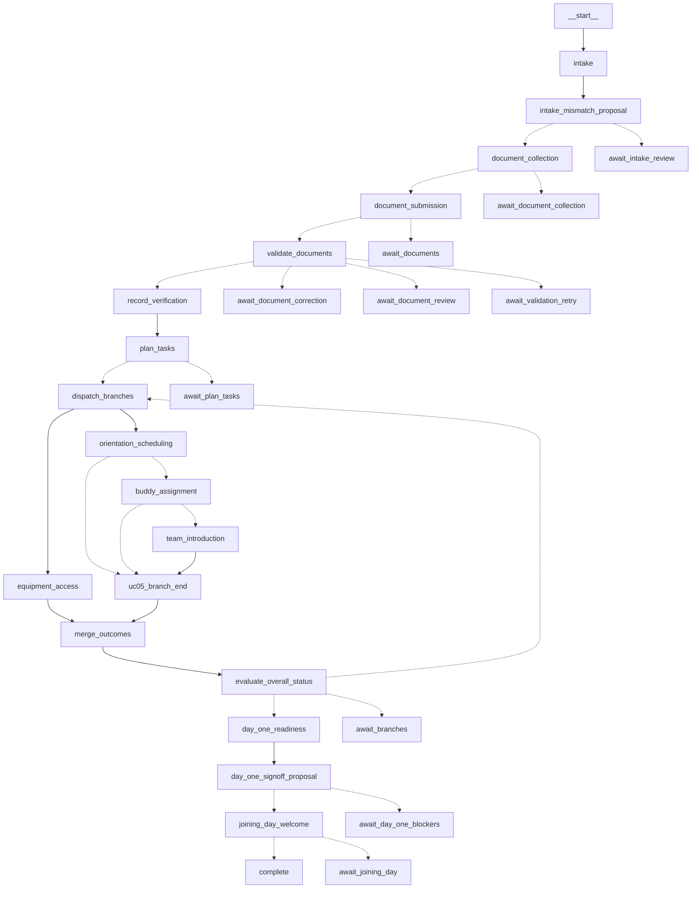

# State-Driven Onboarding Workflow

> **Superseded for the stage order and the UC02/UC03 split.** UC02 now plans right after UC01, and
> UC03 owns document collection, storage and validation, with a UC03 → UC02 replanning loop. See
> [`../../docs/UPDATED_ONBOARDING_WORKFLOW.md`](../../docs/UPDATED_ONBOARDING_WORKFLOW.md). The
> state, wait, retry and API mechanics below still apply.

`hr_onboarding_common.orchestration` runs onboarding as an explicit LangGraph state machine: each
stage stores a structured outcome, the next stage is chosen from that outcome, waits are first-class
states, and after document verification `plan_tasks` (UC02) runs as a sequential prerequisite before
`equipment_access` (UC04) and `orientation_scheduling` (UC05) fan out and run in parallel. This
document describes what the code does today (orchestrator version 0.3.0) and what it does not.

**Synthetic only.** This project has no real-time API and no live integration. Every run, example
and test uses synthetic data, the FakeLLM, mock connectors and contract-compatible test doubles.
Every stage outcome carries `data_origin: "synthetic"`, the document request is sent through a
mock (`transport: "mock-notification"`, `synthetic: true`), and the API's case view says
`data_origin: "synthetic"`. Nothing here is a real-world action or verified live data.

**Scope of the change.** Orchestration only. The UC01–UC05 sub-agent sources are unchanged (verified
by checksum, see §12). Where a UC contract does not fit, a narrow orchestration adapter or a test
double is used and the gap is reported in §11.

| Module | Responsibility |
|---|---|
| `orchestration/orchestrator_agent.py` | Graph, routing, stage wrappers, branch write-through, case operations |
| `orchestration/state.py` | Stages, statuses, `WorkflowStatus`, `Branch`, the branch reducer, status aggregation |
| `orchestration/workflow.py` | Stage operation table, stage inputs, branch delta/fold, pending actions, derived view |
| `orchestration/workflow_models.py` | Pydantic contract of the state; validated on every write-through |
| `orchestration/adapters/uc02_document_collection.py` | The orchestrator's document-request stage (orchestration adapter, §2; not UC02 task management) |
| `orchestration/adapters/uc03_documents.py` | UC03 validation, per-document classification (§3) |
| `orchestration/notifications.py` | Mock notification port for the document request |
| `orchestration/api.py` | HTTP entry points (§9) |
| `orchestration/agent_contract.py`, `execution.py` | The standard UC request/response contract, canonical statuses, error categories, transitions ([docs/UC_INTEGRATION_CONTRACTS.md](../../docs/UC_INTEGRATION_CONTRACTS.md)) |
| `orchestration/dependencies.py` | The stage dependency registry, checked before every stage ([docs/ORCHESTRATION_WORKFLOW.md](../../docs/ORCHESTRATION_WORKFLOW.md) §5) |
| `orchestration/state_sync.py` | Field ownership and validated state synchronization ([docs/SHARED_STATE_AND_CONTEXT.md](../../docs/SHARED_STATE_AND_CONTEXT.md)) |
| `guardrails/policy.yaml` | Role allowlists, retry budget, kill switch |

## 1. Business workflow and graph

```
START → UC01 create employee record → UC02 initiate document collection (mock request)
      → WAIT required documents available → UC03 validate documents → [verification decision]
            invalid / missing / correction needed → WAIT for corrected documents → UC03 re-validate
            HR review needed                      → WAIT for an HR reviewer     → UC03 re-validate
            technical failure                     → WAIT for retry              → UC03 re-validate
            verified ↓
      → record verified_context → UC02 plan tasks + deadlines (sequential prerequisite)
            not complete (blocked / failed / retry pending) → WAIT, neither branch below starts
            complete ↓
      → parallel fan-out:  UC04 equipment/access | UC05 orientation
      → merge outcomes → evaluate overall status
      → (both branches complete) day-1 readiness → HR signoff → joining-day welcome (UC05) → END
```

`plan_tasks` is a sequential prerequisite, not a branch: `equipment_access` and
`orientation_scheduling` each declare it as a REQUIRED dependency (`dependencies.py`'s `_TASK_PLAN`),
so neither one's UC04/UC05 adapter is ever called until `plan_tasks` reports COMPLETE. Once it has,
the two remaining branches start together and neither waits for the other.

The compiled graph (`agent.graph.get_graph().draw_mermaid()`; dashed edges are conditional, every
`await_*` node goes to END):



`record_verification` runs once, right after a verified UC03 result: it records `verified_context`
(see §4 below) so `plan_tasks` -- the first post-verification stage -- can read it. `dispatch_branches`
now runs *after* `plan_tasks`, not instead of it, and fans out only the two
remaining branches. `merge_outcomes` has two incoming edges declared as one join
(`add_edge(["equipment_access", "uc05_branch_end"], "merge_outcomes")`): it runs once, after both
branches, however many steps each takes.

**After the merge.** "Evaluate overall status" is followed by the existing day-1 readiness signoff
and the UC05 joining-day welcome. They are kept, not removed: the signoff is the orchestrator's own
HITL gate (`day_one_signoff`), and the welcome's dependency on it is an explicit, documented
prerequisite that the welcome adapter also checks (`PREREQUISITE_NOT_MET`). They are not a barrier
on the branches -- they run only after the branches merge.

## 2. UC02: two distinct stages

| Stage | Operation | What runs | When |
|---|---|---|---|
| `document_collection` | UC02 operation A, an orchestrator stage (not a UC02 call): initiate document collection (UC03 checklist, mock notification) | `adapters/uc02_document_collection.py` | right after UC01 |
| `plan_tasks` | UC02 operation B: task plan (checklist, owners, dependencies, deadlines) | `UC02SubAgent.run` via `adapters/uc02_tasks.py` | sequential prerequisite after verification (§4), not a branch |

**Operation A is an orchestration adapter, not a UC02 call.** UC02 exposes no document-collection
entry point: `UC02SubAgent.run` creates the onboarding record *and* the whole plan (its
`collect_documents` task included), which is operation B. UC02's mock Outlook connector refuses
every delivery without an approved gate decision (UC02's own rule: delivery belongs to UC06 behind
`joining_confirmation`). Using it would mean inventing an approval, so the adapter:

1. checks the orchestrator's boundary role `document_collection_trigger_roles` (UC02 enforces no
   caller identity -- the same compensation as for planning);
2. takes the required documents from **UC03's checklist** (read-only, the same `ChecklistService`
   UC03 validates against);
3. sends one request through `MockNotificationOutbox`: recipient `employee:<id>` (no address, no
   name), body = case id + document labels, under the idempotency key `doc-collection:<case>:r1`,
   written ahead to the case store as `sending` before the send.

| Outcome | Stage status | Code |
|---|---|---|
| request accepted by the mock (now or earlier) | `complete` | — |
| mock refused it (known not delivered) | `retry_pending` | `DOCUMENT_REQUEST_DELIVERY_FAILED` — resume or retry resends, same key |
| transport lost / process stopped mid-send | `retry_pending` | `DOCUMENT_REQUEST_DELIVERY_UNCERTAIN` — **not** resent by resume; only an authorized `retry_stage`, same key |
| UC03 checklist unavailable | `retry_pending` | `DOCUMENT_CHECKLIST_UNAVAILABLE` |
| no required document applies | `blocked` | `DOCUMENT_CHECKLIST_EMPTY` |

## 3. The wait, validation routing, correction and resume

**The wait (`document_submission`).** Not a UC call. It is `complete` once every required document
has a current revision that does not still need correcting; otherwise `waiting_for_input`
(`DOCUMENTS_OUTSTANDING`), with `document_collection.outstanding` naming each document and why
(`not_submitted`, `correction_required`, `hr_review_rejected`).

**Documents are supplied** with `submit_documents` (API `POST …/documents`): a document type, an
opaque `document_ref`, `source` (`uploaded` or `on_file` = mark available from records already on
file) and the extraction metadata UC03's request needs (`readable`, `required_fields_present`,
`expiry_date`, `evidence_stored`, `extracted_name`, `extraction_confidence`,
`attestation_confirmed`). There is no field for document contents; unknown fields are refused. Each
submission of a type is a new revision. The call re-opens the wait and validation and resumes.

**UC03's contract, as the routing uses it** (read from UC03's validator and rules):

- UC03 **never** assigns `document_status=ACCEPTED`. A valid document is `UNDER_REVIEW`; it is
  verified when `compliance_item_status=COMPLETE`, which UC03 grants only with no blocking finding,
  stored evidence (where required) and `hr_review_status=APPROVED` -- an input its caller supplies.
- A second `RECEIVED` submission of a type UC03 already received is a `DUPLICATE_REQUEST` (UC03
  skips its content rules and requires HR review). UC03 has no resubmission operation.

So the UC03 adapter sends each document **revision** to UC03 once. An unchanged revision reuses its
earlier result (a plain resume makes no UC03 call); an HR decision on a revision UC03 already
validated is sent as UC03's review call (`submission_status=UNDER_REVIEW` + `hr_review_status`).

Each document is classified from UC03's enums (`compliance_item_status`, `required_next_action`),
never free text:

| UC03 says | Classification | Correction requirement | Stage status |
|---|---|---|---|
| `compliance_item_status=COMPLETE` | verified | — | (all verified) `complete` |
| `SEND_REMINDER` (missing) | missing | `supply` | `waiting_for_input` |
| `SEND_REPLACEMENT_REQUEST`, `FLAG_INJECTION`; `NONE` but not complete | correction_required | `resubmit` | `waiting_for_input` |
| HR reviewer rejected this revision | hr_review_rejected | `resubmit` (`HR_REVIEW_REJECTED`) | `waiting_for_input` |
| `HUMAN_CONFIRMATION`, `HR_REVIEW` (incl. `DUPLICATE_REQUEST`, name mismatch) | hr_review_required | `hr_review` | `awaiting_approval` |
| on hold, `DENY_ACCESS`, visa/PRO actions, anything else | blocked | `resolve` | `blocked` |
| UC03 raised (any exception) | — (nothing judged) | — | `retry_pending` (`UC03_TECHNICAL_ERROR`) |

The stage takes the most pressing of `blocked` > `waiting_for_input` > `awaiting_approval`.
`validation_issues` lists every non-`VALID` finding per document; `correction_requirements` says
exactly what each document needs. A technical failure keeps the earlier per-document results and
never produces a correction requirement -- it is never misread as invalid documentation (only the
exception's type is recorded: a request-validation message could echo submitted metadata).

**Routing (`route_after_validation`):** `complete` → `record_verification` (then `plan_tasks`);
`waiting_for_input` or `blocked` → `await_document_correction`; `awaiting_approval` →
`await_document_review`; anything else (`retry_pending`, `failed`) → `await_validation_retry`. No
branch starts until `complete`.

**HR review.** `review_documents` (API `POST …/documents/reviews`) records an authenticated
reviewer's decision (`document_review_roles`, default `hr_admin`) on a document whose current
revision awaits review; anything else is 409. Approved → UC03's review call; rejected → a new
revision is required. The decision is the reviewer's; the orchestrator relays it as UC03's input.

**Resume after correction** never re-runs UC01 and never resends the request: both stages are
`complete` and skipped (`test_corrected_documents_resume_at_validation_without_recreating_the_record_or_resending_the_request`).

## 4. The plan_tasks barrier, then parallel fan-out and fan-in

**`plan_tasks` (UC02 operation B) is a sequential prerequisite, not a branch.** It runs once
validation is `complete`, right after `record_verification` -- a lightweight node that records
`verified_context` (documents verified, the verified document types, `verified_at`, case/employee
ids, joining date) so `plan_tasks` (and, once it completes, the two branches below) can read it. A
plain `_stage_node`, exactly like `intake`/`document_collection`/`validate_documents`: skipped once
`complete`, parked at `await_plan_tasks` while `blocked`/`failed`/`retry_pending`/`awaiting_approval`
(`route_after_plan_tasks`). `equipment_access` and `orientation_scheduling` each declare it as a
REQUIRED dependency (`dependencies.py`'s `_TASK_PLAN`): `execution.invoke` checks dependencies
*before* calling a UC adapter, so neither UC04 nor UC05 is ever called until `plan_tasks` reports
COMPLETE. This is enforced twice over -- by the graph topology itself (`dispatch_branches` is only
reached once `plan_tasks` has completed) and, for any path that can run a branch stage directly
(`retry_stage`, a tenant's own redispatch), by the dependency registry.

`dispatch_branches` runs once `plan_tasks` is `complete`. It bumps `dispatch_round`, sets
`active_branches` and clears the branch channel. Its two successors run in the **same LangGraph
step, on separate threads** (`test_equipment_access_and_orientation_scheduling_run_at_the_same_time`
uses a 2-party barrier; a serialized pair would break it).

| Branch | Stages | Owns (result fields) |
|---|---|---|
| `uc04_equipment_access` | `equipment_access` | `equipment_access_result` |
| `uc05_orientation` | `orientation_scheduling` → `buddy_assignment` → `team_introduction` (+ optional `buddy_introduction`) | `orientation_schedule_result`, `buddy_assignment_result`, `team_introduction_result`, `buddy_introduction_result`, `employee_ref` |

`plan_tasks` is not in this table: its result (`task_plan`) is a plain owned field, written directly
by the sequential stage, exactly like `document_validation_result`. Neither branch waits for the
other once both have started: neither UC04's (`evaluate_orchestrated` input) nor UC05's contract has
a field for UC02's task plan itself, so none of its *content* is passed to either -- only its
*completion* (and, through `state["joining_date"]`, any date it has revised -- see "UC02's
DATE_CHANGE gate" below) gates them. Inside the UC05 branch the order is UC05's own (an approved
induction proposes the buddy; an approved buddy drafts the team introduction); a parked UC05 step
ends the branch for this run (`uc05_branch_end`).

**Conflict-safe merge.** A branch never writes a shared field. It returns its cumulative outcome
under its own key of the `branch_outcomes` channel, whose reducer (`state.merge_branch_outcomes`)
merges keys -- both branches writing in one step cannot overwrite each other. A branch's outcome
holds only what it owns: its stages' statuses, errors, attempts, outcomes, retry metadata,
blockers and approvals (by stage tag), its result fields, and its new history events.
`merge_outcomes` folds every branch in (`workflow.fold_branch_outcome`) and clears the channel.
Routes inside a branch read the branch's own view (shared state + its outcome so far). `joining_date`
is never one of a branch's owned fields, so the fold can never touch it.

### UC02's DATE_CHANGE gate

UC02's task-planning operation (`plan_tasks_and_assign_deadlines`) does not itself determine or
confirm the joining date -- it treats `state["joining_date"]` (set by UC01 at intake) as an
immutable input for that call. UC02 does have a real, separate, asynchronous HR-approval gate for
revising it (`GateName.DATE_CHANGE`, `onboarding_task_management.sub_agent.service.
OnboardingService.request_change` / `.decide_change` / `.apply_change`), now wired into the
orchestrator (`adapters/uc02_tasks.py`'s `request_uc02_date_change` / `relay_uc02_decision`):

- `OnboardingOrchestratorAgent.request_uc02_date_change(case_id, joining_date=..., actor=...)`
  (`POST .../task-planning/date-change`) opens the gate through the same cached `UC02SubAgent`
  instance `plan_tasks` already built (`deps._uc02_sub_agent.service`, never a second one). Requires
  `plan_tasks` COMPLETE (an `onboarding_id` to act on); raises `PrerequisiteNotMetError` otherwise,
  and propagates whatever UC02 itself refuses (the onboarding is not active, the date does not
  change anything, or it falls outside the verified holiday calendar). Nothing is re-planned yet.
- The decision is made through the existing generic `decide_approval` (same approvals endpoint every
  other approval uses), which detects a UC02-tagged approval and relays it to
  `relay_uc02_decision` instead of UC05's relay. Rejected: recorded, `state["joining_date"]`
  unchanged. Approved: UC02 re-plans (`apply_change`), and `state["joining_date"]` is set to the
  exact date originally requested (`ReplanOutcome`, `apply_change`'s return value, carries no
  joining-date field of its own; the orchestrator already knows the value it asked UC02 to apply).
  `joining_date` is co-owned by `Stage.INTAKE` and `Stage.PLAN_TASKS` (`state_sync.FIELD_OWNERS`);
  `field_provenance["joining_date"]` records the source (`"date_change_approval"`) and the approval
  id. Deciding an already-decided reference again is a no-op, routed by `approval_decisions` as well
  as `pending_approvals` so a repeat never falls through to UC05's relay or re-calls UC02.
- Because `equipment_access`/`orientation_scheduling` cannot start before `plan_tasks` is COMPLETE,
  a date change applied before they are dispatched is the one they both see -- their adapters read
  `state["joining_date"]`.
- A change requested after the joining-day event has been recorded is refused.

### Joining-date revisions and reconciliation

A change can only be requested once `plan_tasks` is complete, and by then the same invocation has
normally dispatched both branches -- so a change usually arrives after UC04 and UC05 used the
earlier date. `orchestration/joining_date.py` keeps the results consistent:

- **One source of truth.** `joining_date` holds the date. `joining_date_revision` is 1 once UC01
  sets it and +1 on every applied change; `joining_date_history` keeps one entry per revision (date,
  previous date, stage, UC, source, approval id, time); `field_provenance.joining_date` names the
  current value's source and revision. `verified_context.joining_date` is kept equal to it.
- **Every result records its date.** Each stage's `StageOutcome.inputs` holds the
  `joining_date` and `joining_date_revision` it was handed; `equipment_access_result` also records
  them and UC04's own EC-11 `reassessment`.
- **Stale detection.** A date-dependent result (`equipment_access`, `orientation_scheduling`) is
  stale when it was produced for a date other than the current one. Date equality decides, so a
  result already produced for the current date is never re-run (a change back to an earlier date
  re-runs only what was produced for the intermediate date). UC05's own start date for the case
  (`orientation_schedule_result.uc05_start_date`) must also equal it.
- **Reconciliation, before every run** (`OnboardingOrchestratorAgent._reconcile_joining_date`,
  written through before the graph runs, so a process stop resumes it): a stale COMPLETE stage is
  re-opened (`stage_history` code `JOINING_DATE_CHANGED`) and the graph runs it again with the
  current date; a stale stage in any other runnable status runs again anyway; a stale UNCERTAIN or
  FAILED stage is left for a person. Day-1 readiness evaluated for another date is re-opened, its
  signoff no longer counts, and an undecided `day_one_signoff` request for another revision is
  withdrawn (`HITLInbox.withdraw`, status `withdrawn` -- not a decision; deciding it later is
  refused). Stages that do not depend on the date (buddy assignment, team introduction) are not
  re-run.
- **UC04** re-evaluates under a new idempotency key per revision (`<key>.jd<revision>`): UC04
  refuses a key reused with a different payload, and its EC-11 reassessment re-plans due dates.
  Within one revision the key is stable, so a retry or a resume after a crash replays UC04's stored
  answer instead of evaluating twice.
- **UC05** fixes a case's start date at its intake and has no operation to change it. The UC05
  adapter re-reads UC05 (read only) and, when UC05 holds another start date, blocks
  `orientation_scheduling` with `JOINING_DATE_MISMATCH` and a blocker for a person to align UC05's
  record; nothing is rescheduled from the orchestrator.
- **Readiness protection.** `day_one_readiness` is `blocked` (`JOINING_DATE_UNRECONCILED`) while
  any date-dependent result is stale or UC05 holds another start date, so no signoff is requested;
  the signoff request names the date and revision it is for; `trigger_joining_day` and the
  joining-day scheduler use the authoritative date and refuse while UC05's differs
  (`joining_date_unreconciled`).
- **Visible state.** `joining_date_consistency` (derived): `consistent`, `stale`, `conflict` or
  `not_started`, with the date and revision every date-dependent stage last used. The case API
  returns it with `joining_date_revision` and `joining_date_history`.

Tests: `test_joining_date_reconciliation.py` (including the real UC04 worker's reassessment and the
real UC05 worker's mismatch stop).

**Crash consistency.** Each branch step is also written through to the case store under a per-case
store lock (`_persist_branch`: load, fold this step, save). A branch that finished survives a crash
of a sibling or of the process, and is skipped on resume.

## 5. State schema and status semantics

The LangGraph channel schema is the `OnboardingCaseState` TypedDict (dict access, so every existing
adapter keeps working); its typed contract is `workflow_models.WorkflowStateModel`, validated on
every write-through (`_persist`). New fields (all back-filled on older states):

| Field | Holds |
|---|---|
| `case_id`, `client_id`, `employee_id`, `employee_ref`, `correlation_id` | identity and correlation (unchanged; `employee_ref` = canonical id mapping, see the architecture doc §3.3) |
| `current_stage` | the required stage that most needs attention (most severe status, then workflow order) |
| `workflow_status` | `WorkflowStatus` (below) |
| `branch_statuses` | per branch: `status`, its stages' statuses, `next_action`, `error` |
| `completed_stages` | `complete` stages in workflow order -- stage completion, not workflow completion |
| `pending_actions` | what must happen next and who acts: `supply_documents`, `correct_documents`, `review_documents`, `decide_approval`, `retry_stage`, `resolve_blocker`, `await_event`, `escalate` |
| `document_collection` | required documents (from UC03's checklist), `outstanding`, the mock request (`idempotency_key`, `status`, `attempts`, `message_id`) |
| `submitted_documents` | per type: `document_ref`, `source`, `revision`, `submitted_at/by`, metadata, `hr_review` |
| `document_validation_result` | per document: UC03 statuses, findings, `required_next_action`, `classification`, `revision` |
| `validation_issues`, `correction_requirements` | see §3 |
| `verified_context` | what `plan_tasks` and both branches receive from UC01/UC03 |
| `joining_date_revision`, `joining_date_history` | the joining date's revision (1 from UC01, +1 per applied UC02 change) and one history entry per revision (§4) |
| `joining_date_consistency` | derived: whether every date-dependent result was produced for the current joining date (`consistent` / `stale` / `conflict` / `not_started`) |
| `task_plan` | `plan_tasks`'s own result (not a branch output -- a sequential prerequisite, §4) |
| `equipment_access_result`, UC05 result fields | branch outputs (§4) |
| `stage_outcomes` | per stage: `uc`, `operation`, `status`, `attempt`, `started_at`, `finished_at`, `inputs`, `result_key`, `next_action`, `error`, `data_origin` |
| `retry_metadata` | per stage: `failures`, `max_attempts`, `last_code`, `retries_authorized`, `exhausted` |
| `idempotency_keys`, `stage_attempts`, `stage_errors`, `stage_history`, `pending_approvals`, `blockers` | unchanged meaning |
| `created_at`, `updated_at` | timestamps (`updated_at` on every write-through) |

**Stage statuses** (`StageStatus`): `pending`, `in_progress`, `waiting_for_input` (new: documents to
supply or correct), `awaiting_approval`, `waiting` (joining day), `retry_pending` (new: technical
failure), `blocked`, `uncertain`, `failed`, `complete`, `not_requested`.

**Workflow/branch status** (`WorkflowStatus`): `pending`, `running`, `waiting_for_input`,
`waiting_for_approval`, `completed`, `blocked`, `failed`, `retry_pending`. Stage → workflow mapping:
`in_progress`→running; `awaiting_approval`→waiting_for_approval; `waiting`/`waiting_for_input`→
waiting_for_input; `uncertain`→blocked (an operator must reconcile); `blocked` with a technical code
(`UC05_PROVIDER_UNAVAILABLE`, `UC05_UNAVAILABLE`, `DECISION_NOT_APPLIED`)→retry_pending, otherwise
blocked; `complete`/`not_requested`→completed.

**Aggregation policy** (`derive_workflow_status`, deterministic, tested by
`test_workflow_status_aggregation_policy`): over every *required* stage, `completed` only once the
terminal `complete` stage is reached (every branch, the HR signoff and the welcome); otherwise the
first present of **failed > blocked > retry_pending > waiting_for_approval > waiting_for_input >
running > pending**. One completed branch therefore never hides another branch's failure, block or
wait. **Required vs optional:** every stage is required except `buddy_introduction` (UC05 offers it
only as an HR-requested operation; it never blocked readiness before either); an optional stage
never decides the workflow or a branch status, and is still shown in `branch_statuses.*.stages`.

`overall_status` is kept for existing clients (failed / at_risk for `uncertain` or `retry_pending`
/ in_progress when parked on `waiting` / blocked / complete).

## 6. Stage contracts and data handoff

| Stage | Input from earlier stages (`stage_outcomes[*].inputs`) | Output field |
|---|---|---|
| `intake` (UC01) | client, offer reference (+ intake-only inputs from process memory) | `employee_id`, `joining_date`, `case_id` |
| `document_collection` | UC01's `employee_id`, joining date, role, location | `document_collection` |
| `document_submission` | required types, submitted revisions | `document_collection.outstanding` |
| `validate_documents` (UC03) | per document: revision, `document_ref`, HR review decision (metadata goes to UC03 only) | `document_validation_result`, issues, requirements |
| `plan_tasks` (UC02 B) | `verified_context`, role context | `task_plan` (tasks, owners, due dates) |
| `equipment_access` (UC04) | `verified_context`, role, `task_plan_available` | `equipment_access_result` (items, tickets, blockers) |
| UC05 branch | `verified_context`, canonical employee id, offer event, `task_plan_available` | orientation, buddy, team-introduction results |
| `joining_day_welcome` (UC05) | the joining-day event | `welcome_message_result` |

UC05's HR Policies Q&A is unchanged and outside the graph (UC05's `policy_question` event, with its
approved sources and citations); see the UC05 suite (`test_policy_qa_service.py`,
`test_policy_knowledge_base.py`) and `test_hr_policy_qa_still_answers_through_uc05`. No NDA or
HR-policy signature/acknowledgement tracking was added to UC05 or to the workflow state. (UC03's own
checklist lists NDA and policy-attestation *documents* to validate; the orchestrator passes UC03's
`attestation_confirmed` input through unchanged as document metadata and tracks nothing more.)

## 7. Checkpoints, persistence and limitations

| Layer | Persisted by | Survives a restart |
|---|---|---|
| Case state (the authoritative resume point) | `CaseStateStore`: in memory, or `SqliteCaseStateStore` (`build_deps(persist_dir=…)`) | with SQLite |
| Graph checkpoints, thread id = case id | `MemorySaver` / `SqliteSaver` | with `persist_dir` |
| Branch steps | written through to the case store under a store lock | with SQLite |
| Document request in flight | write-ahead `sending` before the send | with SQLite: seen as uncertain, not resent |
| The mock notification outbox | process memory | no (it is a test double) |
| Intake-only inputs | process memory, by design | no (`INTAKE_INPUT_UNAVAILABLE`) |
| Each UC's business data | each UC (UC01–UC04 in memory; UC05 optionally SQLite) | per UC |

Resume re-invokes the graph from the stored case state; completed stages are skipped. Waits are
`await_*` nodes that end the run (no LangGraph `interrupt()`; the project already resumes from the
case store because `get_state` after END was unreliable in this LangGraph version). Verified:
`test_a_restarted_orchestrator_resumes_the_wait_at_validation` (new instance, same SQLite store: no
UC01 call, no second request), `test_a_process_stopping_mid_send_leaves_the_request_uncertain_not_resent`.

**Limitations.** SQLite stores are single-host; operations on one case are serialized per process
(striped locks) -- several orchestrator processes need a shared lock this store does not provide.
UC03's in-process stores are memory-only: after a restart UC03 no longer knows which document types
it received, so its duplicate rule restarts with it (the adapter still never re-sends an unchanged
revision). No scheduler is started (§11).

## 8. Idempotency and retry

| Mechanism | Guarantee (test) |
|---|---|
| Completed stages skipped on every run | no second UC01 record, task plan, UC04 evaluation, UC05 booking (`test_resume_and_retry_never_duplicate_a_side_effect`) |
| Document request: fixed idempotency key + write-ahead | never resent once sent; unknown outcome never resent without authorization (`test_an_uncertain_document_request_is_not_resent_until_an_authorized_retry`) |
| One UC03 call per document revision | no `DUPLICATE_REQUEST` from a resume (`test_an_unchanged_revision_is_never_sent_to_uc03_twice`) |
| Gate dedupe, idempotent start, UC05 read-before-write and ledger | unchanged (architecture doc §7) |

**Retry policy.** A technical failure parks the stage as `retry_pending` (never auto-retried in a
loop: there is no scheduler). A resume runs it again; each failure counts against
`stage_max_attempts` (policy, default 3); at the limit the stage is `failed` (`RETRY_LIMIT_REACHED`)
and the workflow `failed`. A `failed` stage is terminal: a plain resume does not run it again (before
the standard UC contract was added, every resume re-ran it and spent the exhausted budget again).
`retry_stage` (API `POST …/stages/{stage}/retry`, `stage_retry_roles`)
runs one eligible stage again and resets its budget: eligible = `retry_pending`, `failed`, or
`blocked` with a technical code. Waits, approvals, business blocks and completed stages are refused
(409) -- a retry cannot fix them. For an uncertain document request, `retry_stage` is the
authorization to send again, under the same key. Completed stages are never re-run by a retry.

## 9. API entry points

All under `/v1/orchestration`, through the existing `IdentityProvider`, tenant = the verified
actor's `client_id`, kill switch on every write, no stack traces.

| Route | Roles | Does |
|---|---|---|
| `POST /cases` | `case_operator_roles` | start (idempotent per offer) -- runs to the document wait |
| `GET /cases/{case_id}` | `case_reader_roles` | case, `workflow_status`, branch/stage statuses, stage outcomes, documents (refs only), validation, task plan, UC04/UC05 results |
| `POST /cases/{case_id}/documents` | `document_submitter_roles` | `{documents: [{document_type, document_ref, source?, metadata?}]}` -- supply / mark available, then resume |
| `POST /cases/{case_id}/documents/reviews` | `document_review_roles` | `{reviews: [{document_type, decision: approved\|rejected, note?}]}` |
| `POST /cases/{case_id}/resume` | `case_operator_roles` | resume after a correction |
| `POST /cases/{case_id}/stages/{stage}/retry` | `stage_retry_roles` | retry a stage that failed technically |
| `GET /cases/{case_id}/pending-actions` | `case_reader_roles` | `pending_actions`, blockers, pending approvals, `workflow_status` |
| approvals, joining-day, UC05 operations, RSVPs | unchanged | architecture doc §9 |

Errors: 401 identity; 403 role, policy or kill switch; 404 unknown or another tenant's case
(indistinguishable); 409 not applicable to the case's state (collection not started, documents
already verified, nothing to retry, no review pending); 422 invalid content (unknown document type,
a contents field, unknown stage); 502 a UC failed its contract.

## 10. Audit, tenancy, privacy and approvals

- **Tenancy:** every read and write is scoped to the verified actor's tenant before anything is
  read or changed; another tenant's case is answered exactly like a missing one
  (`test_another_tenant_can_neither_read_nor_change_a_case`).
- **Authorization:** role checks run first and fail closed; a refused call changes nothing and
  consumes no approval (`test_unauthorized_callers_change_nothing_and_consume_no_approval`).
  `resume_case` now also checks `case_operator_roles` when an actor is given. HITL semantics are
  unchanged: the decider is always the authenticated person; the orchestrator owns only
  `intake_mismatch_review` and `day_one_signoff`.
- **Audit:** `orchestrator.documents_submitted` (types, revisions, refs, source),
  `orchestrator.documents_reviewed` (types, decisions, revisions), `orchestrator.stage_retry_requested`
  (stage, previous status, code); every orchestrator audit event now carries the case's
  `correlation_id`.
- **Privacy:** document contents never enter the system (no field for them). Extraction metadata is
  kept in the case state only, for UC03; it is never logged, audited or returned -- the API returns
  references, revisions and review decisions without submitter, reviewer or note
  (`test_document_metadata_never_reaches_logs_audit_or_responses` scans captured structured logs,
  audit events and three API responses for a sentinel name and date). Stage logs carry ids and codes
  only (`orchestration.stage_finished`: case, tenant, stage, status, code, attempt, correlation id).

## 11. Assumptions and unresolved dependencies

| Item | Status / action required |
|---|---|
| UC02 has no document-collection operation | Orchestration adapter + mock notifier (§2). UC02 (or UC06) to expose the operation and its delivery gate |
| UC02 `agent/advisor.py:1` SyntaxError | Unchanged (protected). Real task planning stays `failed` (`UC02_PACKAGE_UNIMPORTABLE`); doubles in tests |
| UC03 never returns `ACCEPTED`; verification needs a caller-supplied HR approval | The previous orchestration adapter required `ACCEPTED` and could never complete against real UC03 -- fixed in the adapter (orchestration code), HR review added (§3) |
| UC03 has no resubmission operation | A replacement is flagged `DUPLICATE_REQUEST` and needs HR review; its content rules are not re-run by UC03. UC03 owner to decide whether replacements should be re-validated |
| UC04 `Uc04Input` requires `SYN-CASE-nnn` / `SYN-…` ids | Real UC04 refuses real UC01 case ids (`INVALID_INPUT`, seen in `test_real_agents_verify_documents_then_fan_out…`); pre-existing, identity translation needed |
| Who supplies extraction metadata | Assumed: the document intake system (or HR) supplies it with the reference; no OCR/extraction is invoked by the orchestrator |
| Required vs optional | Assumed from existing contracts: every stage required except UC05's HR-requested buddy introduction |
| Correction notifications | Not sent automatically; the correction requirement is a pending action for HR. A second collection round would use key suffix `r2` (not implemented) |
| Scheduler | None is started; `retry_pending` stages wait for a resume or `retry_stage`; the joining-day scheduler is unchanged (architecture doc §10.1) |
| Multi-process deployment | Needs a shared case lock and a server database behind `CaseStateStore` |

## 12. Running the workflow and the tests locally

```powershell
cd HR-Onboarding-Common
.venv\Scripts\python.exe scripts\run_workflow_demo.py            # walk start -> COMPLETE over the HTTP API (in-process)
.venv\Scripts\python.exe scripts\run_workflow_demo.py --serve    # serve the API on 127.0.0.1:8080 (dev identity headers)
.venv\Scripts\python.exe scripts\run_workflow_demo.py --real     # the real UC01/UC04/UC05 workers, UC02 and UC03
#   --persist-dir <dir>  keeps case states and checkpoints in SQLite (a restarted --serve resumes the same cases)
```

The default and `--serve` modes run the real graph, the real UC03 and the real HITL gate, with
stand-ins (each UC's output shape) for UC01, UC02 task planning, UC04 and UC05. `--real` stops at
the branches today (UC02 import defect, UC04 identifier pattern, UC01/UC05 employee identity), see §11.

```powershell
# from the workspace root: builds the UC worker environments outside the UC folders, runs both suites
powershell -ExecutionPolicy Bypass -File HR-Onboarding-Common\scripts\run_tests.ps1 -Suite common
```

```bash
# or directly (bash), with the worker interpreters built by run_tests.ps1
cd HR-Onboarding-Common
E="$LOCALAPPDATA/hr-onboarding-envs"
UC01_WORKER_PYTHON=$E/uc01/Scripts/python.exe UC04_WORKER_PYTHON=$E/uc04/Scripts/python.exe \
UC05_WORKER_PYTHON=$E/uc05/Scripts/python.exe .venv/Scripts/python.exe -m pytest
.venv/Scripts/python.exe -m pytest tests/orchestration/test_state_driven_workflow.py   # no worker needed
```

`test_state_driven_workflow.py` needs no worker process: the real graph, the real document-collection
adapter, UC03's real checklist and (for the real-UC03 tests) UC03 in-process, with doubles for the
rest (`tests/orchestration/_workflow.py` lists exactly what is real). Worker-backed tests skip with a
reason when a UC interpreter cannot start. No test calls a live LLM, a credential or any real
service.
