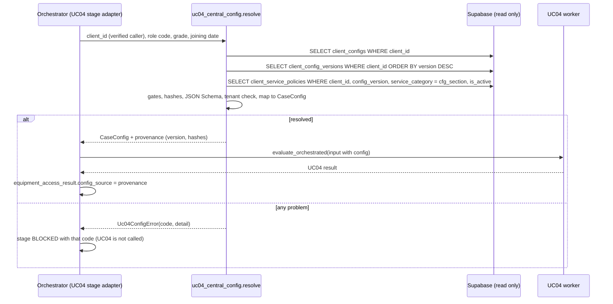

# UC04 central client configuration

UC04 (Equipment and Approved Access) evaluates every case against a `CaseConfig`: the client's equipment and access
matrices for the joiner's role, approvers, lead times, working calendar, handover rules, evidence roles, and country
and client-site rules.

**Code:** `src/hr_onboarding_common/orchestration/uc04_central_config.py`, used by
`src/hr_onboarding_common/orchestration/adapters/uc04_equipment_access.py`.
**Tests:** `tests/orchestration/test_uc04_central_config.py`.

UC04's core reads no configuration itself. Its rules (UC04 `CLAUDE.md`) forbid network and file access in the core,
and its packaging and config tests enforce that. **The orchestrator therefore resolves the configuration and passes it
to UC04 inline.** UC04's business rules are unchanged, and UC04 still validates what it receives with its own strict
`CaseConfig` model.

## 1. Choosing the source

| `UC04_CONFIG_SOURCE` | Where the configuration comes from | Fallback |
|---|---|---|
| `file` (or unset) | The JSON file named by the case (`uc04_client_config_ref`), else by `config/tenants.yaml` for the client and role. This is the earlier behaviour, unchanged. | none |
| `central` | The client's **in-force approved configuration version** in Supabase. | **none.** A missing or invalid central configuration blocks the stage; no JSON file is ever used instead. |
| anything else | refused: `UC04_CONFIG_SOURCE_INVALID` | — |

In `central` mode, a case that also names a configuration file is refused with `UC04_CONFIG_SOURCE_CONFLICT`, so there
is only ever one source.

**Requirements for `central` mode** (all in the orchestrator process):

| Requirement | Why |
|---|---|
| `SUPABASE_URL` and `SUPABASE_SERVICE_ROLE_KEY` | Database access. The key is kept in request headers only; it is never logged and never appears in an error. |
| The UC02 package (`onboarding_task_management`, already imported in-process by the UC02 adapter) and `jsonschema` | The shared configuration reader and schema validation. |
| `UC04_IDENTITY_PROFILE=PLATFORM` for the UC04 worker | Real client ids (`CLIENT_INDIA`) and uuid case ids are valid only under UC04's PLATFORM profile. |
| For **mock or synthetic** clients only: `UC02_ENV=development` or `test`, plus `UC02_ALLOW_SYNTHETIC_CONFIG=1` | The shared configuration safety policy. Without it these clients are refused, and production never accepts them. |

## 2. Data flow

**Where the identifiers come from:**
- **Client:** `state.client_id`, which comes from the verified caller, never from the request body.
- **Role:** the case's role converted to UC04's role code (`uc04_role_code`).
- **Grade:** `uc02_role_context.grade`.
- **Joining date:** `state.joining_date`; it selects the version in force on that date.

## 3. Table-to-workflow mapping

The tables are **read only** (`SELECT`), and only in the `equipment_access` stage in `central` mode:

| Table | Columns used | Filter | Checks |
|---|---|---|---|
| `client_configs` | `client_id`, `is_active`, `settings_payload` (`data_origin`, `environment`), `config_hash` | `client_id = <case client>` | Row exists and is active. Mock or synthetic clients are allowed only with the explicit test opt-in. The row must be this client's. |
| `client_config_versions` | `client_id`, `version`, `status`, `approved_by`, `approved_at`, `config_hash`, `effective_from`, `effective_to` | `client_id = <case client>`, newest first | The first version that is `approved`, has an approver and timestamp and a `config_hash`, and is effective on the joining date. The row must be this client's. |
| `client_service_policies` | `client_id`, `config_version`, `service_key`, `policy_details` (`document`, `sections_hash`, `document_hash`) | `client_id`, `config_version = <in-force version>`, `service_category = 'cfg_section'`, `is_active = true` | All six section documents present, each once. One `sections_hash`, equal to a recomputed one. `document_hash` equal to the version's `config_hash`. `uc04_equipment_access` and `shared_configuration` valid against `client_configuration/schema/client_configuration.schema.json`. **Every row** must be this client's and version's. |

The version gates and the safety policy are the shared reader's own: UC02's `SupabaseConfigSource`, the same gates
that UC02's planning and `client_configuration.retrieval` apply. The hash and schema checks repeat
`client_configuration.retrieval` exactly.

**Not read:** `task_templates`, `client_document_requirements`, `client_milestone_templates` and `client_holidays`.
UC04 doesn't need them, and its calendar comes from the version's own `shared_configuration` section.
`role_access_matrix` isn't read either: it's empty live and not produced by the seeding.

## 4. Field mapping: central sections → UC04 `CaseConfig`

| `CaseConfig` field | Central source | Rule |
|---|---|---|
| `client_id`, `role_id` | case | as resolved |
| `version` | `client_config_versions.version` | `v<version>`, e.g. `v2` |
| `role_equipment_matrix` | `uc04_equipment_access.role_equipment_matrix` + `equipment_catalogue` | Entries for the role. An entry with `grades` applies only to those grades; if the case has no grade, it's refused with `UC04_GRADE_REQUIRED`. Every item code must be in the catalogue with `kind = equipment`. If the role has no entry here but has one in the access matrix, the block is `VERIFIED_EMPTY`. |
| `role_access_matrix` | `role_access_matrix` + `access_catalogue` | Same rule, `kind = access`. A role in neither matrix is refused with `UC04_ROLE_NOT_CONFIGURED`. |
| `approver_config` | `approver_config` | Exactly `EQUIPMENT`, `ACCESS`, `EXCEPTION`, each `{role, delegate_role}` |
| `lead_times` | `lead_times` | Exactly `EQUIPMENT`, `ACCESS`, `CLIENT_SITE_CLEARANCE`, as whole numbers ≥ 0 |
| `work_calendar` | `shared_configuration.calendar` | `working_days` is ISO numbering (1 = Monday … 7 = Sunday, as UC02 reads it). It's converted to UC04's numbering (0 = Monday … 6 = Sunday) and the weekend is the complement of the working days. A stated `weekend_days` must agree with it. Holidays: only `observed: true` ones. |
| `handover_rules` | `handover_rules` | `{mode ∈ COLLECT, DELIVER, READY_AT_DESK, keep_reserved_on_missed_slot: bool}` |
| `evidence_roles` | `evidence_roles` | Lower-case keys `provisioning`, `delivery`, `collection`, `client_site_clearance` become UC04 `EvidenceType` keys. A single role becomes a one-item list. An unknown key is refused. |
| `country_rules` | `country_rules` | `null` becomes `MISSING`. Otherwise it must be exactly `{country_code, courier_extra_days, remote_first_day_required}`. Calendar fields are refused there because their day numbering isn't defined. |
| `client_site_rules` | `client_site_rules` | `null` becomes `MISSING`. Otherwise it must be exactly `{required_items, block_on_late_clearance, owner_role}`. |
| `client_overrides` | — | not in the central document; UC04's default (no overrides) applies |
| (check) | `out_of_matrix_policy` | Must be `exception_approval_required` (UC04 GR-03), otherwise refused |

**What `MISSING` means.** It is never filled with a guess. UC04 decides whether it matters for the case: for example,
a `MISSING` `client_site_rules` only blocks a case that needs a client site.

## 5. Errors

Every error **blocks the stage** with the code below, and UC04 is not called. The detail names the client, version
and reason, never a credential.

| Code | When | Next action shown |
|---|---|---|
| `UC04_CONFIGURATION_MISSING` | No client row, inactive client, no approved version in force on the joining date, incomplete section set, or a mock or synthetic client without the test opt-in | Approve and publish the client's configuration version |
| `UC04_CONFIGURATION_INVALID` | Hash mismatch, a section of another document, schema violation, a value that can't be mapped exactly, or a row of **another client or version** returned by the database | Correct the central configuration |
| `UC04_ROLE_NOT_CONFIGURED` | The role is in neither matrix, or not at the case's grade; or the case has no role | Add the role to the client's matrices |
| `UC04_GRADE_REQUIRED` | The role's matrix depends on the grade and the case has none | Record the joiner's grade |
| `UC04_CENTRAL_CONFIG_UNAVAILABLE` (retryable) | Database unreachable, HTTP 5xx or 429 | Retry later |
| `UC04_CENTRAL_CONFIG_DENIED` | HTTP 401 or 403 (credentials refused) | Platform administrator |
| `UC04_CENTRAL_CONFIG_NOT_CONFIGURED` | Supabase settings, the shared reader or `jsonschema` missing | Configure the reader |
| `UC04_CONFIGURATION_NOT_PERMITTED` | The configuration safety policy itself is misconfigured | — |
| `UC04_CONFIG_SOURCE_INVALID` / `UC04_CONFIG_SOURCE_CONFLICT` | See §1 | — |

## 6. Tenant isolation

- Every query filters on the case's `client_id`, which comes from the verified caller.
- **Every returned row** (client, version, sections) is checked to belong to that client and version. If a misconfigured
  view or policy returns another client's rows, the whole read is refused (`UC04_CONFIGURATION_INVALID`); the rows are
  never quietly filtered out.
- Nothing is cached between calls, so one case's configuration can't be served to another.
- UC04 independently refuses a `CaseConfig` whose `client_id` or `role_id` differs from the case
  (`CONFIG_SCOPE_MISMATCH`).

Tests prove each of these: different clients get their own matrices and calendars; foreign rows leaked through each of
the three tables are refused; a role configured only for another client isn't borrowed.

## 7. Traceability

`equipment_access_result.config_source` records what the case was evaluated against:
- `central` mode: `{source: "central", client_id, version, config_hash, sections_hash, data_origin, notes}`
- `file` mode: `{source: "file", file}`

A new central version changes the `CaseConfig` (version and content), so UC04 treats it as a new evaluation and
re-assesses the case (EC-11). It is never served as a replay.

## 8. Verification status (2026-11-06)

| Check | Result |
|---|---|
| Unit and integration tests with **mocked** Supabase (rows produced by UC02's seeding projection from the real profiles) | 39 tests pass (`test_uc04_central_config.py`) |
| The **real UC04 worker** (PLATFORM profile) evaluating against the central configuration | Passes. UC04 accepts the `CaseConfig`. Both items first need the standard approval of India's central approver role. After approval, the item outside India's matrix still needs the exception approval and the one inside goes ahead. |
| **Live Supabase, read only** (SELECT; test opt-in set in that one process only) | CLIENT_INDIA, CLIENT_CANADA, CLIENT_USA and CLIENT_DUBAI v2 resolve, and UC04's own `CaseConfig` (PLATFORM) accepts all four. CLIENT-ALPHA (no central configuration), an unknown role, and a mock client without the opt-in are refused with the codes above. |
| Live end-to-end orchestrated run in `central` mode | **Not performed**: it would need a live `onboarding_cases` case and the PLATFORM profile in a running deployment. |

**Live data caveat.** The four clients with central configuration are **mock clients** (`environment=mock`). They are
usable only in a development or test environment that opted in. No client currently has an approved,
non-test configuration with a `uc04_equipment_access` section.
