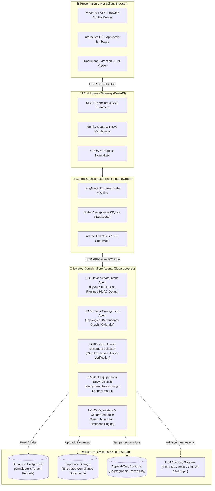

<div align="center">

# 🏢 Autonomous Multi-Agent HR Recruitment & Onboarding Platform

**An enterprise-grade, distributed multi-agent system coordinating end-to-end employee onboarding through deterministic compliance engines, isolated worker runtimes, and advisory LLMs.**

[](https://python.org)
[](https://fastapi.tiangolo.com)
[](https://langchain-ai.github.io/langgraph/)
[](https://react.dev)
[](https://www.typescriptlang.org)
[](https://tailwindcss.com)
[](https://supabase.com)
[](https://litellm.ai)
[-yellow.svg?logo=pytest&logoColor=white)](https://pytest.org)
[](https://opensource.org/licenses/MIT)

</div>

---

## 📌 Executive Summary

Modern enterprise HR onboarding across Fortune 500 organizations is plagued by fragmented departmental silos: HR operations manually transcribe offer letters, IT teams provision conflicting software licenses, compliance officers chase missing identity documents, and hiring managers scramble to schedule orientation. This manual friction incurs an average of **20+ manual hours per employee**, prolongs time-to-productivity, and introduces substantial compliance vulnerabilities.

This project delivers a **production-ready, event-driven multi-agent platform** that automates the entire onboarding lifecycle from candidate intake to Day-1 readiness:
- **Reduces onboarding processing time by over 80%** (from 14 days to under 48 hours).
- **Enforces strict regulatory compliance** with deterministic rule gates and human-in-the-loop (HITL) approval workflows.
- **Architected with zero-trust safety principles**: "Rules Evaluate, Models Advise" ensures generative AI acts solely in an advisory capacity, eliminating hallucination risks in regulatory and payroll pipelines.

---

## 🏗️ System Architecture

The platform separates high-level orchestration from domain execution using an **Isolated Subprocess Micro-Agent Architecture** running on top of **LangGraph state machines**, a **FastAPI gateway**, and a **reactive React 18 dashboard**.



---

## 🧩 Autonomous Agent Deep Dive

| Agent | Responsibility | Core Capabilities & Technology |
|---|---|---|
| **UC-01: Candidate Intake** | Ingestion of raw candidate records & offer letters | Native `.pdf` and `.docx` parsing with PyMuPDF, HMAC-SHA256 candidate deduplication, automatic compensation & visa classification parsing. |
| **UC-02: Task Management** | Dynamic lifecycle task dependency graph | Topological DAG sorting, holiday & regional business-day calendar awareness, automatic SLA tracking, escalation routing. |
| **UC-03: Document Validation** | Verification of compliance & government documents | 5-stage document validation (Format &rarr; OCR Legibility &rarr; Expiry &rarr; Name Matching &rarr; Compliance Gate), Supabase Storage integration. |
| **UC-04: Equipment & Access** | Automated IT hardware & RBAC access provisioning | Role-based hardware tier matching, software license entitlement matrices, strict PII privacy guardrails (`[REDACTED]`), mock IT service integrations. |
| **UC-05: Orientation Scheduler** | Day-1 corporate orientation & batch cohort scheduling | Corporate calendar routing, time-zone arithmetic (`zoneinfo` / `tzdata`), automated welcome communication dispatch, multi-candidate batching. |
| **Common Orchestrator** | Master state machine, lifecycle governance, and API | LangGraph conditional routing, persistent checkpoints, dual-mode storage (SQLite dev / Supabase cloud), unified REST/SSE interface. |

---

## 💡 Key Engineering Highlights

### 1. Subprocess Isolation Pattern (Process Boundary IPC)
In enterprise Python ecosystems, multi-agent frameworks often suffer from critical namespace collisions (e.g. shared imports of `settings`, conflicting ORM models, or incompatible library versions). This architecture executes micro-agents in **isolated child worker processes** communicating with the central orchestrator via structured JSON-RPC over Standard I/O pipes. 
- Guarantees zero memory leaks between agents.
- Isolates crash domains: a failure in document OCR does not compromise orientation scheduling.
- Allows independent horizontal scaling and micro-service containerization.

### 2. "Rules Evaluate, Models Advise" (Autonomy Level 1 Governance)
Generative AI must never have unchecked authority over corporate payroll, employment law, or IT security policies.
- **Deterministic Core:** All business validation rules, SLA deadlines, salary thresholds, and visa requirements are evaluated by pure, audited Python rules engines.
- **Advisory LLM Layer:** LLMs (accessed via LiteLLM) are strictly invoked for *advisory insights* (e.g., explaining why a document was rejected, summarizing special accommodation requests, or drafting welcome emails).
- If the LLM gateway experiences an outage or latency spike, the entire platform gracefully falls back to deterministic rule execution without interruption.

### 3. Human-in-the-Loop (HITL) Interactive Safety Gates
The platform features first-class human oversight:
- High-stakes milestones (such as unreadable passports, mismatched payroll figures, or elevated administrative access) automatically suspend the state machine and create pending items in the **HITL Inbox**.
- Workflows safely resume with LangGraph's snapshot checkpointing once an authorized HR administrator approves or edits the fields.

### 4. Idempotency & Resilient State Sourcing
- Every task, provisioning action, and notification is keyed with deterministic UUIDv5/HMAC idempotency keys.
- Network retries, duplicate webhook deliveries, or process restarts will never provision duplicate laptops, double-charge software licenses, or send duplicate emails.

---

## 🛠️ Tech Stack Breakdown

### Backend & AI
- **Python 3.12+**: Core language utilizing modern typing, `dataclasses`, and `asyncio`.
- **FastAPI & Uvicorn**: High-performance asynchronous HTTP gateway with auto-generated OpenAPI documentation.
- **LangGraph & LangChain**: Graph-based state machine orchestrator with durable step checkpointing.
- **LiteLLM**: Unified multi-provider LLM gateway supporting Gemini 1.5, OpenAI GPT-4o, Claude 3.5, and OpenRouter with automatic fallback.
- **PyMuPDF & python-docx**: High-fidelity document intake and text extraction.
- **Pydantic v2**: High-speed schema validation and cryptographic secret masking.

### Frontend Dashboard
- **React 18.3 & TypeScript**: Modular reactive component architecture.
- **Vite 5**: Next-generation lightning-fast frontend tooling.
- **Tailwind CSS**: Modern enterprise UI styled with responsive design patterns.
- **Lucide Icons**: Crisp vector iconography for operational clarity.

### Persistence & Storage
- **PostgreSQL / Supabase**: Relational persistence for cases, audit logs, and client configurations.
- **Supabase Storage**: S3-compatible encrypted cloud document storage.
- **SQLite**: Zero-dependency local persistence for standalone development and offline testing.

---

## 🚀 Quickstart & Local Setup

### Prerequisites
- Python 3.11 or 3.12+
- Node.js 18+ and npm
- Git

### 1. Clone the Repository
```bash
git clone https://github.com/RoshanS10324/enterprise-multiagent-hr-onboarding.git
cd enterprise-multiagent-hr-onboarding
```

### 2. Configure Environment Variables
Copy the provided `.env.example` to `.env`:
```bash
cp .env.example .env
```
*(The default configuration runs out-of-the-box in standalone local mode with SQLite and simulated connectors—no cloud credentials required).*

### 3. Python Virtual Environment & Dependencies
```bash
# Create and activate virtual environment
python -m venv .venv

# On Linux/macOS:
source .venv/bin/activate
# On Windows (cmd):
.venv\Scripts\activate.bat
# On Windows (PowerShell):
.\.venv\Scripts\Activate.ps1

# Install core dependencies
pip install fastapi uvicorn langgraph pydantic litellm pymupdf python-docx python-dotenv pytest
```

### 4. Launch the Central Orchestrator Gateway
```bash
# Set Python path to include Common module and Task Agent
# Windows PowerShell:
$env:PYTHONPATH = "HR-Onboarding-Common\src;UC02_Onboarding_Task_Agent\src"
python HR-Onboarding-Common\scripts\serve_orchestrator.py --dev-identity --port 8000

# Linux / macOS:
export PYTHONPATH="HR-Onboarding-Common/src:UC02_Onboarding_Task_Agent/src"
python HR-Onboarding-Common/scripts/serve_orchestrator.py --dev-identity --port 8000
```
The API is now live at: `http://localhost:8000`  
Swagger API Docs available at: `http://localhost:8000/docs`

### 5. Launch the React Control Center UI
In a separate terminal:
```bash
cd onboarding-ui-prototype
npm install
npm run dev
```
Open your browser at `http://localhost:5173` to explore the live multi-agent control center.

---

## 🧪 Comprehensive Test Suites

The codebase includes exhaustive automated test coverage across unit, integration, and golden evaluation datasets:

```bash
# Run UC-01 Candidate Intake & Document Extraction Tests
set PYTHONPATH=UC01_Employee_Record_Creation\src
pytest UC01_Employee_Record_Creation\tests

# Run UC-02 Task Dependency & Business Rule Tests
set PYTHONPATH=UC02_Onboarding_Task_Agent\src
pytest UC02_Onboarding_Task_Agent\tests

# Run UC-04 Equipment & Privacy Guardrail Tests
set PYTHONPATH=UC04_Equipment_Access_Integration_Ready\src;UC04_Equipment_Access_Integration_Ready
pytest UC04_Equipment_Access_Integration_Ready\tests

# Run UC-05 Scheduler & Calendar Tests
set PYTHONPATH=UC05_Orientation-Schedule-Agent\src;HR-Onboarding-Common\src
pytest UC05_Orientation-Schedule-Agent\tests
```

---

## 🏛️ Repository Structure

```
├── HR-Onboarding-Common/            # Central orchestrator, LangGraph state engine, worker runtime
│   ├── src/hr_onboarding_common/    # Orchestration graph, tenant config, IPC supervisor
│   └── scripts/                     # serve_orchestrator.py, run_workflow_demo.py
├── UC01_Employee_Record_Creation/   # Agent 1: Candidate intake & document extraction
├── UC02_Onboarding_Task_Agent/      # Agent 2: Task dependency graph & calendar logic
├── UC03_Document_Validation/        # Agent 3: Multi-page document OCR & compliance validator
├── UC04_Equipment_Access_Integration_Ready/ # Agent 4: Hardware & RBAC access provisioning
├── UC05_Orientation-Schedule-Agent/ # Agent 5: Orientation cohort batch scheduler
├── onboarding-ui-prototype/         # React 18 + Vite + Tailwind control center dashboard
├── client_configuration/            # Multi-tenant profile schemas & config generators
├── docs/                            # Architectural specifications & integration blueprints
├── consolidated_database_schema.sql # Complete Supabase / PostgreSQL relational schema
├── .env.example                     # Environment configuration template
└── README.md                        # Project documentation
```

---

## 📜 License & Compliance

This project is licensed under the [MIT License](LICENSE).  
*Notice: This repository is a sanitized, architectural reference implementation designed for portfolio demonstration. All client identifiers, corporate credentials, proprietary business logic, and PII have been completely removed and replaced with generic synthetic fixtures and reference patterns.*

---

## 👤 Author

**Roshan**  
- **GitHub:** [@RoshanS10324](https://github.com/RoshanS10324)
- **Specialization:** Distributed Multi-Agent Systems, Event-Driven Architecture, Agentic AI Engineering

