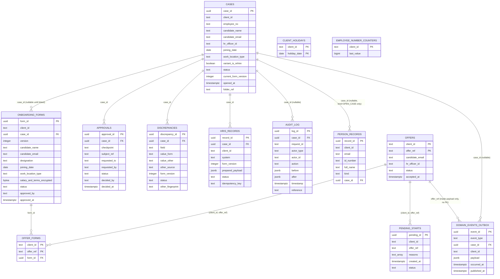

# UC-01 persistence schema (draft)

**Status: [Proposed, needs lead / AI governance approval].** This document
and the accompanying `uc01_draft.sql` are a read-only extraction of the
persistence schema *implied* by the current UC-01 code (models, ports,
in-memory adapters). Nothing here has been applied to any database. The
candidate target is **Postgres via Supabase** — that choice itself is
**[Proposed, needs lead / AI governance approval]**; `docs/known-gaps.md`
#27 previously assumed Cosmos DB, so this is a change of direction that
needs sign-off (see section 11).

How this was produced: `scripts/export_schema.py` imports every Pydantic
model in `sub_agent.models` plus the `[Proposed]` email-intake
simulator's models and dumps `model_json_schema()` for each to
`docs/schema/models.json` (24 models). `ports.py` and
`adapters/memory.py` were read in full to recover exact lookup/filter
shapes per method. Every table, column and constraint below traces back
to a specific model field, port method, or code comment; ambiguous spots
are marked `-- QUESTION:` in the SQL rather than guessed.

## Why text + CHECK instead of Postgres enum types

Every `StrEnum` in `models/enums.py` becomes `text` with a `CHECK (col IN
(...))` constraint, not a native Postgres `ENUM` type. Reasons:

- Several enums are explicitly still in flux: `CaseStatus` has 10 values
  but only `PLAN_PENDING` and `ON_HOLD` are ever assigned by current code
  (`WITHDRAWN`/`CLOSED` are checked against as "inactive" guards but never
  set; the rest are reserved for use cases outside UC-01). `ApprovalStatus`
  has 7 values but only `PENDING`/`APPROVED`/`REJECTED`/`CANCELLED` are
  ever assigned (`EDITED_AND_APPROVED`/`EXPIRED`/`ESCALATED` are unused).
  `HrisRecordStatus` has 11 values; `MISMATCH`/`BLOCKED`/`CORRECTED` are
  never assigned by any code path read.
- Postgres native `ENUM` values can only be added (`ALTER TYPE ... ADD
  VALUE`), never removed or renamed, without rebuilding the type; a
  `CHECK` constraint can be dropped and re-added in one statement. Given
  the whole policy/role model is marked `[Proposed]` and several enum
  values are reserved-but-unused placeholders, `CHECK` keeps schema
  changes cheap while the domain model is still settling.
- `AuditEntry.action` is a free-text `str` in code (not a `StrEnum` at
  all) with dozens of distinct values used across modules (`CASE_OPENED`,
  `OFFER_ACCEPTED`, `HRIS_WRITE_SUCCEEDED`, ...) and more added as the
  system grows. It gets `text NOT NULL` with no `CHECK` list at all - see
  the SQL `-- QUESTION:` comment on that column.

## 1. Entity inventory

| Entity | Source model file | Repository port | Persisted? | Proposed table |
| --- | --- | --- | --- | --- |
| Case | `models/case.py` | `CaseRepository` | Yes | `cases` |
| OnboardingForm | `models/onboarding_form.py` | `FormRepository` | Yes | `onboarding_forms` |
| (offer -> form pointer) | *(no model; `OnboardingFormSource` port only)* | `OnboardingFormSource` | Yes | `offer_forms` (bridge table) |
| Approval | `models/approval.py` | `ApprovalRepository` | Yes | `approvals` |
| Discrepancy | `models/discrepancy.py` | `DiscrepancyRepository` | Yes | `discrepancies` |
| HrisRecord | `models/hris_record.py` | `HrisRecordRepository` | Yes | `hris_records` |
| AuditEntry | `models/audit_entry.py` | `AuditLog` | Yes | `audit_log` |
| PersonRecord | `models/person_record.py` | `PersonDirectory` | Yes | `person_records` |
| OfferRecord | `models/offer.py` | `OfferRepository` | Yes [Proposed] | `offers` |
| PendingStart | `models/pending_start.py` | `PendingStartRepository` | Yes [Proposed] | `pending_starts` |
| CaseOpenedEvent, FormChangedEvent, EmployeeRecordCreatedEvent, OfferAcceptedEvent | `models/events.py`, `models/offer.py` | `EventPublisher` | Yes (new, proposed) | `domain_events_outbox` |
| (holiday calendar) | *(no model; `HolidayCalendar` port only)* | `HolidayCalendar` | Yes (new, proposed) | `client_holidays` |
| (employee number counter) | *(no model; `EmployeeNumberGenerator` port only)* | `EmployeeNumberGenerator` | Yes (new, proposed) | `employee_number_counters` |
| VariantFlags | `models/variant_flags.py` | *(embedded in Case)* | No - flattened into `cases` columns | - |
| CaseStatusView (case_id, employee_no, stage, `form_version_in_force`, joining_date, work_location_type, candidate_name, `open_discrepancies`, `pending_approvals`, hris, `warnings`), PendingApprovalView (approval_id, checkpoint, requested_to, `subject_ref_kind`, created_at), OpenDiscrepancyView, HrisStatusView | `models/case_status_view.py` | *(none; computed)* | No - read-time projection, all fields derived from `cases`/`approvals`/`discrepancies`/`hris_records` at query time | - |
| Viewer (user_id, role, client_ids) | `models/viewer.py` | *(none; from JWT)* | No - not a UC-01 table | - |
| FormChangeRequest (case_id, requested_by, change_reason, `source_discrepancy_id`, candidate_name, designation, joining_date, work_location_type, client_site_id, salary_and_terms) | `models/form_change.py` | *(none; transient input)* | No | - |
| SourceSnapshot (source, values) | `models/source_snapshot.py` | *(none; transient input)* | No | - |
| ParsedAcceptance (`sender_email`, offer_ref, subject), IntakeRejection (code) | `intake/email_intake.py` | *(none; transient)* | No | - |
| IntakeResult (`outcome`, case_id, employee_no, `rejection_code`, `review_code`, pending_id, reasons) | `intake/email_intake.py` | *(none; HTTP response DTO)* | No | - |
| HrisGateway's external-ref store | `adapters/memory.py` (`StubHrisGateway`) | `HrisGateway` | No - see section 10 | - |

## 2. Field tables

Pydantic `Optional[X] = None` -> nullable. `Field(default_factory=...)` or
a literal default -> a DB `DEFAULT`. `SecretStr` is flagged `ENCRYPTED`
(see section 7). All enums are `StrEnum`; allowed values are listed.

### `cases` (from `Case`, `models/case.py`)

| Field | Python type | Nullable | Default | Postgres type | Constraint | Notes |
| --- | --- | --- | --- | --- | --- | --- |
| case_id | str (uuid4) | no | `default_factory=new_id` | uuid | PRIMARY KEY | default `gen_random_uuid()` |
| client_id | str | no | - | text | NOT NULL | |
| employee_no | Optional[str] | yes | None | text | | format is a placeholder; Q-21 |
| candidate_name | str | no | - | text | NOT NULL | PII |
| candidate_email | str | no | - | text | NOT NULL | PII |
| hr_officer_id | str | no | - | text | NOT NULL | drives HR_OFFICER row visibility |
| joining_date | date | no | - | date | NOT NULL | |
| work_location_type | WorkLocationType | no | - | text | CHECK IN ('OFFICE','CLIENT_SITE') | |
| variants.is_rehire | bool | no | False | boolean | NOT NULL DEFAULT false | flattened from `VariantFlags` (see below) |
| variants.is_internal_transfer | bool | no | False | boolean | NOT NULL DEFAULT false | |
| variants.is_agency_contractor | bool | no | False | boolean | NOT NULL DEFAULT false | |
| variants.is_minor | bool | no | False | boolean | NOT NULL DEFAULT false | |
| variants.is_uae_resident | bool | no | False | boolean | NOT NULL DEFAULT false | declared only, never set by code read |
| variants.is_remote | bool | no | False | boolean | NOT NULL DEFAULT false | declared only, never set by code read |
| status | CaseStatus | no | PLAN_PENDING | text | CHECK IN (10 values, see enum list) | only `PLAN_PENDING`/`ON_HOLD` ever assigned |
| current_form_version | int (ge=1) | no | - | integer | NOT NULL CHECK (current_form_version >= 1) | |
| opened_at | datetime (tz-aware) | no | `default_factory=utc_now` | timestamptz | NOT NULL DEFAULT now() | |
| folder_ref | Optional[str] | yes | None | text | | from `DocumentStore.create_case_folder`, not itself a table (external ref) |

`CaseStatus` values: HELD, PLAN_PENDING, PLAN_APPROVED, IN_PROGRESS,
AT_RISK, READY_FOR_DAY_ONE, ONBOARDED, ON_HOLD, WITHDRAWN, CLOSED.

**VariantFlags flattening decision:** `Case.variants` is a nested
`VariantFlags` model (6 booleans, all default `False`, no nesting beyond
one level). Flattened to 6 boolean columns rather than one `jsonb`
column because `open_case.py` and `duplicate_check.py` branch on
individual flags (`declared.is_minor`, `duplicate_result.variants
.is_rehire`, ...) and a future query like "all open cases with
`is_minor`" wants a plain indexable boolean, not a `jsonb ->> 'is_minor'`
comparison. The rejected alternative (`variants jsonb NOT NULL DEFAULT
'{}'`) is noted in the SQL as a commented-out option.

### `onboarding_forms` (from `OnboardingForm`, `models/onboarding_form.py`)

| Field | Python type | Nullable | Default | Postgres type | Constraint | Notes |
| --- | --- | --- | --- | --- | --- | --- |
| form_id | str (uuid4) | no | `default_factory=new_id` | uuid | PRIMARY KEY | |
| client_id | str | no | - | text | NOT NULL | |
| case_id | Optional[str] | yes until linked | None | uuid | FK -> cases(case_id), nullable | see immutability note below: one-time NULL -> value backfill |
| version | int (ge=1) | no | - | integer | NOT NULL CHECK (version >= 1) | |
| candidate_name | str | no | - | text | NOT NULL | PII |
| candidate_email | str | no | - | text | NOT NULL | PII |
| designation | str | no | - | text | NOT NULL | |
| joining_date | date | no | - | date | NOT NULL | |
| work_location_type | WorkLocationType | no | - | text | CHECK IN ('OFFICE','CLIENT_SITE') | |
| client_site_id | Optional[str] | yes | None | text | | required by model validator when work_location_type=CLIENT_SITE (app-level; see section 4) |
| salary_and_terms | SecretStr | no | - | `bytea` (column: `salary_and_terms_encrypted`) | NOT NULL | never rendered; `[REDACTED]` sentinel used elsewhere; encrypted with `pgp_sym_encrypt` by the adapter, key from a secret store (see section 7 and section 12 fix #5) |
| status | FormStatus | no | DRAFT | text | CHECK IN ('DRAFT','AWAITING_APPROVAL','APPROVED','SUPERSEDED','REJECTED') | |
| approved_by | Optional[str] | yes | None | text | required (app-level) when status=APPROVED | |
| approved_at | Optional[datetime, tz-aware] | yes | None | timestamptz | required (app-level) when status=APPROVED | field_validator rejects naive datetimes |
| change_reason | Optional[str] | yes | None | text | | set by `next_version()` for change-flow versions |

`FormStatus` values: DRAFT, AWAITING_APPROVAL, APPROVED, SUPERSEDED,
REJECTED.

### `offer_forms` (bridge table; no dedicated Pydantic model)

Derived purely from `OnboardingFormSource.latest_for_offer(client_id,
offer_ref)` / `save_for_offer(client_id, offer_ref, form)` and the
in-memory adapter `InMemoryOnboardingFormSource`, which stores one
`OnboardingForm` per `(client_id, offer_ref)` key, **overwritten on every
save** (no history kept today).

| Field | Source | Postgres type | Constraint | Notes |
| --- | --- | --- | --- | --- |
| client_id | port signature | text | NOT NULL, part of PK | |
| offer_ref | port signature | text | NOT NULL, part of PK | |
| form_id | the stored `OnboardingForm.form_id` | uuid | FK -> onboarding_forms(form_id), NOT NULL | |

This is the pre-case pointer used by the `[Proposed]` email-intake
simulator's `/dev/seed` and `try_start` to find "the form seeded for this
offer" before a `Case` (and therefore a durable `onboarding_forms.case_id`
link) exists. Once `create_case()` links the form to a case
(`form.with_case(case_id)`), this row becomes vestigial for that
form_id but is left in place (current code never deletes it).

### `approvals` (from `Approval`, `models/approval.py`)

| Field | Python type | Nullable | Default | Postgres type | Constraint | Notes |
| --- | --- | --- | --- | --- | --- | --- |
| approval_id | str (uuid4) | no | `default_factory=new_id` | uuid | PRIMARY KEY | |
| case_id | str | no | - | uuid | FK -> cases(case_id) NOT NULL | |
| checkpoint | Checkpoint | no | - | text | CHECK IN ('HC_01_FORM','HC_04_DATA','HC_05_HRIS_WRITE','HC_12_VARIANT') | |
| subject_ref | str | no | - | text | NOT NULL | free-text; see section 3 for the FK-vs-string decision |
| requested_to | str | no | - | text | NOT NULL | |
| created_at | datetime (tz-aware) | no | `default_factory=utc_now` | timestamptz | NOT NULL DEFAULT now() | |
| requested_by | Optional[str] | yes | None | text | | drives separation-of-duties checks |
| status | ApprovalStatus | no | PENDING | text | CHECK IN (7 values, see enum list) | only PENDING/APPROVED/REJECTED/CANCELLED ever assigned |
| decided_by | Optional[str] | yes | None | text | | |
| decided_at | Optional[datetime, tz-aware] | yes | None | timestamptz | | |
| reason | Optional[str] | yes | None | text | | why the approval was raised |
| decision_note | Optional[str] | yes | None | text | | free-text note at decision time |

`ApprovalStatus` values: PENDING, APPROVED, EDITED_AND_APPROVED, REJECTED,
EXPIRED, ESCALATED, CANCELLED.

### `discrepancies` (from `Discrepancy`, `models/discrepancy.py`)

| Field | Python type | Nullable | Default | Postgres type | Constraint | Notes |
| --- | --- | --- | --- | --- | --- | --- |
| discrepancy_id | str (uuid4) | no | `default_factory=new_id` | uuid | PRIMARY KEY | |
| case_id | str | no | - | uuid | FK -> cases(case_id) NOT NULL | |
| field | str | no | - | text | CHECK IN ('candidate_name','designation','joining_date','work_location_type','salary_and_terms') | per `SourceSnapshot.ALLOWED_SOURCE_SNAPSHOT_KEYS`; not a Python enum but a closed, enforced set |
| value_form | str | no | - | text | NOT NULL | `[REDACTED]` sentinel when field=salary_and_terms; real PII value otherwise (e.g. candidate_name mismatches) |
| value_other | str | no | - | text | NOT NULL | same redaction rule |
| other_source | str | no | - | text | NOT NULL | free text, e.g. "offer_letter", "hr_system" |
| form_version | int | no | - | integer | NOT NULL | part of the dedup key |
| status | DiscrepancyStatus | no | OPEN | text | CHECK IN ('OPEN','RESOLVED','ACCEPTED_AS_CHANGE','STALE') | |
| decided_by | Optional[str] | yes | None | text | | |
| decided_at | Optional[datetime, tz-aware] | yes | None | timestamptz | | |
| other_fingerprint | Optional[str] | yes (but always set in practice) | None | text | NOT NULL in practice | **`exclude=True, repr=False` on the model** - see `-- QUESTION:` in SQL; this is excluded from `model_dump()`/API responses, but a real Postgres adapter must still persist it (it is the dedup key), so it must not be dropped by naively calling `model_dump_json()` to build the INSERT |

### `hris_records` (from `HrisRecord`, `models/hris_record.py`)

| Field | Python type | Nullable | Default | Postgres type | Constraint | Notes |
| --- | --- | --- | --- | --- | --- | --- |
| record_id | str (uuid4) | no | `default_factory=new_id` | uuid | PRIMARY KEY | |
| case_id | str | no | - | uuid | FK -> cases(case_id) NOT NULL | |
| client_id | str | no | - | text | NOT NULL | denormalized copy of cases.client_id (as in code) |
| employee_no | Optional[str] | yes | None | text | | |
| system | HrisSystem | no | - | text | CHECK IN ('ZOHO_PEOPLE','ZOHO_PAYROLL') | target product still TBD, see Q-mapping |
| form_version | int (ge=1) | no | - | integer | NOT NULL CHECK (form_version >= 1) | |
| prepared_payload | dict[str,str] | no | `default_factory=dict` | jsonb | NOT NULL DEFAULT '{}' | non-sensitive field NAMES+values only |
| sensitive_field_names | list[str] | no | `default_factory=list` | text[] | NOT NULL DEFAULT '{}' | NAMES only, never values; flat list -> `text[]` over `jsonb` |
| comparison_result | Optional[dict] | yes | None | jsonb | | **defined on the model but never set or read by any code path found** - reserve the column, no current writer |
| external_ref | Optional[str] | yes | None | text | | from `HrisGateway.write()`'s `WriteResult.external_ref` |
| last_error | Optional[str] | yes | None | text | | exception CLASS NAME only, never a message |
| status | HrisRecordStatus | no | NOT_PREPARED | text | CHECK IN (11 values, see enum list) | MISMATCH/BLOCKED/CORRECTED never assigned by code read |
| approved_by | Optional[str] | yes | None | text | | |
| approved_at | Optional[datetime, tz-aware] | yes | None | timestamptz | | |
| idempotency_key | Optional[str] (always derived) | no in practice | derived `f"{case_id}:{system}:{form_version}"` | text | NOT NULL, UNIQUE (see section 4) | model_validator derives it; a Postgres `GENERATED ALWAYS AS (case_id::text \|\| ':' \|\| system \|\| ':' \|\| form_version::text) STORED` column - confirmed byte-for-byte equal to the Python format (see section 12 fix #3); the adapter must never write this column directly |

`HrisRecordStatus` values: NOT_PREPARED, PREPARED, MISMATCH,
AWAITING_APPROVAL, APPROVED, WRITTEN, BLOCKED, CORRECTED, FAILED,
REJECTED, STALE.

### `audit_log` (from `AuditEntry`, `models/audit_entry.py`) - append-only

| Field | Python type | Nullable | Default | Postgres type | Constraint | Notes |
| --- | --- | --- | --- | --- | --- | --- |
| log_id | str (uuid4) | no | `default_factory=new_id` | uuid | PRIMARY KEY | |
| case_id | Optional[str] | yes | None | uuid | FK -> cases(case_id), nullable | at least one of case_id/request_id required (see below) |
| request_id | Optional[str] | yes | None | **text** (not uuid - see section 12 fix #4) | nullable | not itself a FK to any persisted request row - purely a correlation id generated (or, on the `/internal/onboarding-requests` path, caller-supplied) per call |
| actor_type | ActorType | no | - | text | CHECK IN ('AGENT','HUMAN','SYSTEM') | |
| actor_id | str | no | - | text | NOT NULL | |
| action | str | no | - | text | NOT NULL | **free text, not a Python enum** - dozens of distinct values across modules; no CHECK list (see SQL comment) |
| before | Optional[dict] | yes | None | jsonb | | never carries salary/email/name per code convention (not enforced by the type system) |
| after | Optional[dict] | yes | None | jsonb | | same |
| timestamp | datetime (tz-aware) | no | `default_factory=utc_now` | timestamptz | NOT NULL DEFAULT now() | |
| reference | str | no | - | text | NOT NULL | free-text reference (often case_id or request_id restated) |

Model-level rule: `case_id IS NOT NULL OR request_id IS NOT NULL`
(`AuditEntry._require_case_or_request_id`) -> a direct 1:1 `CHECK`
constraint.

### `person_records` (from `PersonRecord`, `models/person_record.py`)

| Field | Python type | Nullable | Default | Postgres type | Constraint | Notes |
| --- | --- | --- | --- | --- | --- | --- |
| record_id | str (uuid4) | no | `default_factory=new_id` | uuid | PRIMARY KEY | |
| client_id | str | no | - | text | NOT NULL | |
| email | str | no | - | text | NOT NULL | PII; matched case-insensitively, trimmed, in code |
| id_number | Optional[str] | yes | None | text | | PII (national ID / passport-like) |
| full_name | str | no | - | text | NOT NULL | PII; matched case-insensitively, trimmed |
| kind | PersonRecordKind | no | - | text | CHECK IN ('OPEN_CASE','PAST_EMPLOYEE','CURRENT_EMPLOYEE') | |
| case_id | Optional[str] | yes | None | uuid | FK -> cases(case_id), nullable | only set when kind=OPEN_CASE |

### `offers` (from `OfferRecord`, `models/offer.py`) - `[Proposed]`

| Field | Python type | Nullable | Default | Postgres type | Constraint | Notes |
| --- | --- | --- | --- | --- | --- | --- |
| client_id | str | no | - | text | NOT NULL, part of composite PK | **the model has no `offer_id` field at all** - see note below |
| offer_ref | str | no | - | text | NOT NULL, part of composite PK; also UNIQUE alone | cross-client uniqueness is `[Proposed]`, enforced today only in `InMemoryOfferRepository.save` |
| candidate_email | str | no | - | text | NOT NULL | PII |
| hr_officer_id | str | no | - | text | NOT NULL | |
| status | OfferStatus | no | SENT | text | CHECK IN ('SENT','ACCEPTED','WITHDRAWN') | |
| accepted_at | Optional[datetime, tz-aware] | yes | None | timestamptz | | |

**No own id column:** `OfferRecord` has no `offer_id`/UUID field; every
port method (`get`, `find_by_ref`, `save`) and every caller addresses an
offer by `(client_id, offer_ref)` or `offer_ref` alone. The proposed PK
is the composite `(client_id, offer_ref)`, with a separate `UNIQUE
(offer_ref)` constraint to enforce the `[Proposed]` cross-client rule as
a real database constraint (see section 4) rather than inventing a
surrogate key the code never uses.

### `pending_starts` (from `PendingStart`, `models/pending_start.py`) - `[Proposed]`

| Field | Python type | Nullable | Default | Postgres type | Constraint | Notes |
| --- | --- | --- | --- | --- | --- | --- |
| pending_id | str (uuid4) | no | `default_factory=new_id` | uuid | PRIMARY KEY | |
| client_id | str | no | - | text | NOT NULL | |
| offer_ref | str | no | - | text | NOT NULL | |
| reasons | list[str] | no | `default_factory=list` | text[] | NOT NULL DEFAULT '{}' | start-gate reason strings, e.g. "no onboarding form" |
| created_at | datetime (tz-aware) | no | `default_factory=utc_now` | timestamptz | NOT NULL DEFAULT now() | |
| status | PendingStartStatus | no | WAITING | text | CHECK IN ('WAITING','STARTED','CANCELLED') | CANCELLED is defined but never assigned by code read |

`(client_id, offer_ref)` -> FK to `offers(client_id, offer_ref)`.
**No `case_id` column:** even after a `PendingStart` transitions to
STARTED (`try_start` in `email_intake.py`), the code never records which
`case_id` it started - the only durable trace of offer->case linkage is
the case-scoped `OFFER_LINKED` audit entry. See the `-- QUESTION:` in the
SQL and section 3/11.

### `domain_events_outbox` (new; from `CaseOpenedEvent`, `FormChangedEvent`, `EmployeeRecordCreatedEvent` in `models/events.py`, `OfferAcceptedEvent` in `models/offer.py`)

All four event models are `frozen=True`, carry an `event_id` (uuid4
default) and a `client_id`; three of the four also carry `case_id` and
`occurred_at` (`OfferAcceptedEvent` has neither - it has `offer_ref` +
`accepted_at` instead). Rather than four separate tables, one
discriminated outbox table holds every event, with the event-specific
fields in `payload`:

| Field | Source | Postgres type | Constraint | Notes |
| --- | --- | --- | --- | --- |
| event_id | each event's `event_id` | uuid | PRIMARY KEY | |
| event_type | Python class name | text | CHECK IN ('CaseOpenedEvent','FormChangedEvent','EmployeeRecordCreatedEvent','OfferAcceptedEvent') | discriminator |
| case_id | `CaseOpenedEvent`/`FormChangedEvent`/`EmployeeRecordCreatedEvent`.case_id | uuid | FK -> cases(case_id), nullable | NULL for `OfferAcceptedEvent` |
| client_id | every event's `client_id` | text | NOT NULL | |
| payload | the event's own remaining fields | jsonb | NOT NULL | e.g. `{"form_version":1,"joining_date":"...","work_location_type":"OFFICE","variants":{...}}` for `CaseOpenedEvent`; `{"old_version":1,"new_version":2,"changed_fields":["joining_date"],"joining_date_changed":true}` for `FormChangedEvent`; `{"employee_no":"EMP-000001","form_version":2}` for `EmployeeRecordCreatedEvent`; `{"offer_ref":"OFFER-1001","accepted_at":"...","source":"email"}` for `OfferAcceptedEvent` |
| occurred_at | *(new; outbox insertion time, not a model field)* | timestamptz | NOT NULL DEFAULT now() | the event's own `occurred_at`/`accepted_at` lives inside `payload` for fidelity; this column is "when it was staged for publish" |
| published_at | *(new; standard outbox bookkeeping)* | timestamptz | nullable | NULL = not yet relayed to a real bus |
| publish_attempts | *(new; standard outbox bookkeeping)* | integer | NOT NULL DEFAULT 0 | |

`occurred_at`/`published_at`/`publish_attempts` are not Pydantic model
fields - they are standard outbox-pattern bookkeeping columns, added
because the task calls for an outbox table, not because the code already
has them. Flagged clearly so they are not mistaken for extracted model
fields.

### `client_holidays` (new; replaces `InMemoryHolidayCalendar`, no Pydantic model)

| Field | Source | Postgres type | Constraint |
| --- | --- | --- | --- |
| client_id | `HolidayCalendar.add(client_id, day)` / `.is_holiday(client_id, day)` | text | NOT NULL, part of PK |
| holiday_date | same | date | NOT NULL, part of PK |

Only used by `form_changes.py`'s joining-date warning check
(`deps.holiday_calendar.is_holiday(...)`), never by the start gate itself.

### `employee_number_counters` (new; replaces `InMemoryEmployeeNumberGenerator`, no Pydantic model) - `[Proposed, Q-21]`

| Field | Source | Postgres type | Constraint |
| --- | --- | --- | --- |
| client_id | `EmployeeNumberGenerator.next(client_id)` | text | PRIMARY KEY |
| last_value | the in-memory `_counters[client_id]` | bigint | NOT NULL DEFAULT 0 |

The current format (`f"EMP-{count:06d}"`, per-client, starting at 1) is
explicitly a placeholder (`adapters/memory.py` comment: "real rules are
open question Q-21"). This table only reproduces the *counter*, not the
formatting rule, which stays in application code until Q-21 is answered.

## 3. Keys and relationships



### Primary keys

All PKs are listed in the field tables above. The two composite PKs are
`offers (client_id, offer_ref)` and `offer_forms (client_id, offer_ref)`
and `client_holidays (client_id, holiday_date)` - each directly mirrors a
port method's lookup signature (e.g. `OfferRepository.get(client_id,
offer_ref)`).

### Foreign keys and cardinalities

| FK | Cardinality | Source in code |
| --- | --- | --- |
| `onboarding_forms.case_id -> cases.case_id` | one case : many forms (one per version) | `FormRepository.list_versions(case_id)` returns all versions for a case |
| `approvals.case_id -> cases.case_id` | one case : many approvals | `ApprovalRepository.list_for_case(case_id)` |
| `discrepancies.case_id -> cases.case_id` | one case : many discrepancies | `DiscrepancyRepository.list_for_case(case_id)` |
| `hris_records.case_id -> cases.case_id` | one case : many records (one per system x form_version) | `HrisRecordRepository.list_for_case(case_id)` |
| `audit_log.case_id -> cases.case_id` | one case : many entries, nullable | `AuditLog.entries_for_case(case_id)`; pre-case entries use `request_id` instead |
| `person_records.case_id -> cases.case_id` | one case : zero-or-one OPEN_CASE record | `open_case.py` adds exactly one `PersonRecord(kind=OPEN_CASE)` per case opened |
| `offer_forms.form_id -> onboarding_forms.form_id` | one form : zero-or-one offer pointer | `OnboardingFormSource.save_for_offer` overwrites, so at most one live pointer per `(client_id, offer_ref)` |
| `offer_forms.(client_id, offer_ref) -> offers.(client_id, offer_ref)` | one offer : zero-or-one form pointer | same |
| `pending_starts.(client_id, offer_ref) -> offers.(client_id, offer_ref)` | one offer : many pending-start rows over time (only one WAITING at a time; see section 4) | `PendingStartRepository.get_waiting/list_waiting(client_id, offer_ref)` |
| `domain_events_outbox.case_id -> cases.case_id` | one case : many events, nullable | `CaseOpenedEvent`/`FormChangedEvent`/`EmployeeRecordCreatedEvent` all carry `case_id`; `OfferAcceptedEvent` does not |

### `subject_ref`: string tag vs real FK

`Approval.subject_ref` is a free-text string that tags what the approval
is about, in three different shapes found in code:

| Pattern | Example | Meaning | Resolvable to a real row? |
| --- | --- | --- | --- |
| `"form:<form_id>"` | `form:3fae...` | an `onboarding_forms.form_id` | Yes - `form_changes._find_form` parses it this way |
| `"discrepancy:<discrepancy_id>"` | `discrepancy:9c21...` | a `discrepancies.discrepancy_id` | Yes - `compare_sources.resolve_discrepancy`/`_find_discrepancy_approval` parse it this way |
| `"hris:<case_id>:v<version>"` | `hris:abcd...:v2` | a *batch* of `hris_records` rows (one case, one form_version, both systems) | Yes, but to a set of rows, not one - `hris_write._parse_subject_ref` parses it this way |
| `"is_rehire"`, `"is_internal_transfer"`, `"is_minor"`, `"is_agency_contractor"`, `"possible_duplicate"` | `is_rehire` | a declared/detected variant flag, or a same-name notice | No - these never point at another row at all |

**Proposal:** keep `subject_ref` as-is (every piece of code that
constructs or parses it keeps working unchanged), and *add* three
nullable, indexed FK columns - `subject_form_id`, `subject_discrepancy_id`,
and a `(subject_case_id, subject_hris_form_version)` pair - populated at
write time by the same code that builds `subject_ref`, purely for
referential integrity and fast joins. The five variant-flag subjects stay
string-only (there is nothing to reference). This is additive and
low-risk: it doesn't change any existing read path, only gives future
queries/joins a typed option. The alternative (replacing `subject_ref`
entirely with a polymorphic `subject_type` + `subject_id`) was rejected
because the `"hris:..."` case genuinely addresses a *batch*, not a single
row, and `subject_ref` is parsed with three different ad hoc formats
across three different modules - normalizing all of them is a larger
change than this schema-extraction task should invent.

## 4. Uniqueness and idempotency rules

| Rule | Found in | DB constraint or app code? |
| --- | --- | --- |
| One form row per `(case_id, version)` | `FormRepository.get(case_id, version)` assumes a single match; versions are assigned sequentially by `next_version()` | **DB constraint**: `UNIQUE (case_id, version)` partial index `WHERE case_id IS NOT NULL` |
| At most one APPROVED form per case | `invariants.py` `MULTIPLE_APPROVED_FORMS` check | **DB constraint**: partial unique index `UNIQUE (case_id) WHERE status = 'APPROVED'` |
| At most one AWAITING_APPROVAL form per case | `invariants.py` `MULTIPLE_PENDING_FORMS` check; also enforced defensively in `propose_form_change` (`raise ValueError` if one already exists) | **DB constraint**: partial unique index `UNIQUE (case_id) WHERE status = 'AWAITING_APPROVAL'` |
| HRIS idempotency key = `case_id:system:form_version` | `HrisRecord._derive_idempotency_key` model_validator | **DB constraint**: `GENERATED ALWAYS AS` column + `UNIQUE` - equivalent to `UNIQUE (case_id, system, form_version)`, which `invariants.py`'s `DUPLICATE_WRITTEN_SYSTEM` check also implies should never be violated |
| offer_ref unique across clients | `[Proposed]` `InMemoryOfferRepository.save` raises `ValueError` on a cross-client collision | **DB constraint**: `UNIQUE (offer_ref)` on `offers` |
| One WAITING `PendingStart` per offer | `email_intake._ensure_waiting_pending_start` (get-then-add, never duplicates) | **DB constraint**: partial unique index `UNIQUE (client_id, offer_ref) WHERE status = 'WAITING'` |
| Discrepancy dedup key: `(case_id, field, other_source, other_fingerprint, form_version)` | `compare_sources.compare_sources`'s `is_duplicate` check (checked before insert, not currently a constraint) | **Can become a DB constraint**: `UNIQUE (case_id, field, other_source, other_fingerprint, form_version)` with `ON CONFLICT DO NOTHING` at the insert, replacing the current read-then-write app-level check (closes a TOCTOU race the in-memory version also has) |
| HRIS gateway write idempotency (`idempotency_key` per client) | `StubHrisGateway.write` keyed by `(client_id, idempotency_key)` | **Stays app/gateway-side** - this is the *external* system's own idempotency contract (see section 10), not a UC-01 table |
| `AuditEntry` requires `case_id` or `request_id` | `AuditEntry._require_case_or_request_id` model_validator | **DB constraint**: `CHECK (case_id IS NOT NULL OR request_id IS NOT NULL)` |
| `OnboardingForm`: `CLIENT_SITE` requires `client_site_id` | `OnboardingForm._check_rules` model_validator | **App code** (cross-field conditional requirement; expressible as a `CHECK (work_location_type <> 'CLIENT_SITE' OR client_site_id IS NOT NULL)` but kept in app code here since it mirrors an existing model validator one-for-one and the task scope is extraction, not redesign - noted as a safe future upgrade in the SQL comment) |
| `OnboardingForm`: `APPROVED` requires `approved_by` + `approved_at` | `OnboardingForm._check_rules` model_validator | Same as above - expressible as `CHECK (status <> 'APPROVED' OR (approved_by IS NOT NULL AND approved_at IS NOT NULL))`, noted as a safe upgrade |
| `FormChangeRequest`: at least one change field set | `FormChangeRequest._at_least_one_change_field` model_validator | **App code only** - `FormChangeRequest` is a transient input DTO, never a row |
| One `employee_no` per `(client_id, employee_no)` | `EmployeeNumberGenerator.next(client_id)` is meant to hand out one number per employee within a client | **DB constraint** (added on review, fix #7): partial unique index `UNIQUE (client_id, employee_no) WHERE employee_no IS NOT NULL` - a safety net alongside the generator itself |
| At most one `OPEN_CASE` `PersonRecord` per `(client_id, email)` | Not an explicit rule in code, but implied by `duplicate_check.check_duplicates`'s `DUPLICATE_OPEN_CASE` outcome assuming at most one `OPEN_CASE` match | **DB constraint** (added on review, fix #7): partial unique index `UNIQUE (client_id, lower(email)) WHERE kind = 'OPEN_CASE'`. This closes a race `check_duplicates` cannot: two simultaneous requests for the same `candidate_email` can both observe no existing match and both reach `create_case()`, each inserting its own `OPEN_CASE` `PersonRecord`. The index makes the second `INSERT` fail with a `unique_violation`; the adapter must catch that and return the existing `DUPLICATE_OPEN_CASE`/`LINKED_EXISTING` outcome instead of propagating the DB error, mirroring the outcome `onboarding_entry.open_onboarding_case` already returns for the synchronous case |

## 5. Immutability rules

| Rule | Found in | Proposed Postgres enforcement |
| --- | --- | --- |
| A form that is `REJECTED` or `SUPERSEDED` never changes again | `onboarding_form.py`'s lifecycle methods never transition out of these statuses; `form_changes.py` only ever reads old/rejected forms, never re-saves them | Trigger: `BEFORE UPDATE ON onboarding_forms` raises if `OLD.status IN ('REJECTED','SUPERSEDED')` |
| A form that is `APPROVED` may only transition to `SUPERSEDED` (status-only), OR stay `APPROVED` while `case_id` is backfilled from `NULL` (fixed on review, fix #1) | `OnboardingForm.supersede()` changes `status` alone; separately, `open_case.create_case()` calls `form.with_case(case_id)` on a form that may already be `APPROVED` (the direct `/internal/onboarding-requests` path builds an already-APPROVED form before any `Case` exists) - that call keeps `status='APPROVED'` and only sets `case_id` | Same trigger: if `OLD.status = 'APPROVED'` and `NEW.status = 'APPROVED'`, allow the `UPDATE` only when it is exactly the `case_id: NULL -> value` backfill with every other column unchanged; if `NEW.status = 'SUPERSEDED'`, allow it only with every other column (including `case_id`) unchanged; any other `NEW.status` is rejected |
| A form's `case_id` may move from `NULL` to a value exactly once, at any status (not just pre-terminal - confirmed `with_case()` is called on `DRAFT`, `AWAITING_APPROVAL`, and `APPROVED` forms depending on which path builds the form) | `OnboardingForm.with_case()` is called once, right after `create_case()` creates the row's `Case` | Same trigger: explicitly allow `OLD.case_id IS NULL AND NEW.case_id IS NOT NULL` at any status, but never the reverse and never a second change once non-null |
| `DRAFT` -> `AWAITING_APPROVAL` -> `APPROVED` are themselves in-place updates of the same row, not inserts (confirmed from `onboarding_form.py`, fix #1) | `submit_for_approval()`/`approve()`/`reject()` all build their replacement via `_dump_with_secret()`, which carries the existing `form_id` forward unchanged; only `next_version()` pops `form_id` to start a genuinely new row | Same trigger: no restriction applied while `OLD.status` is `DRAFT` or `AWAITING_APPROVAL` (freely updatable in place), other than the `case_id`-set-once rule above |
| Audit log is append-only | `AuditEntry` is `frozen=True` in Pydantic; no code anywhere calls `update`/`delete` on `AuditLog` | `REVOKE UPDATE, DELETE ON audit_log FROM <app role>` **and** a `BEFORE UPDATE OR DELETE` trigger that always raises, so even a superuser-ish role without the REVOKE still can't do it by accident |
| A decided `Approval` (status left PENDING) never changes again | No code path read updates an `Approval` a second time once it is APPROVED/REJECTED/CANCELLED | Trigger: `BEFORE UPDATE ON approvals` raises if `OLD.status <> 'PENDING'` |

## 6. Client scoping and draft RLS

Every proposed table reaches `client_id` either directly (`cases`,
`onboarding_forms`, `hris_records`, `person_records`, `offers`,
`pending_starts`, `domain_events_outbox`, `client_holidays`,
`employee_number_counters`) or through its `case_id`/`(client_id,
offer_ref)` foreign key (`approvals`, `discrepancies`, `audit_log`,
`offer_forms`).

`access.py`'s `case_visible(viewer, case)` is the one rule everything
else in U9 builds on:

```python
if case.client_id not in viewer.client_ids:
    return False
if viewer.role == Role.HR_OFFICER:
    return case.hr_officer_id == viewer.user_id
return True  # HR_MANAGER, CLIENT_USER, AUDITOR see every case of their clients
```

Operation-level gating (which roles may call `compare_sources`,
`prepare_hris`, decide an `HC_05_HRIS_WRITE`, ...) comes from
`policy/uc01_policy.toml` via `policy.py`'s `authorize_action`/
`authorize_decision`, and from `access.py`'s `WORKLIST_ROLES`/
`AUDIT_TRAIL_ROLES`/`STATUS_VIEW_ROLES`. **Design decision:** RLS below
only mirrors the row-level, tenant-isolation half of this (`case_visible`
and its client-scoped siblings); the role-may-call-this-action half stays
in application code, exactly as it is split today between `access.py`
(visibility) and `policy.py` (authorization). Folding action-level policy
into RLS would duplicate `policy/uc01_policy.toml` inside the database
and the two would drift.

**Draft only - not applied.** Assumes JWT claims `sub` (user id), `role`,
and a custom `client_ids` claim (JSON array of strings), matching the dev
header shape (`X-User-Id`/`X-User-Role`/`X-Client-Ids`) until Entra ID
(`docs/known-gaps.md` #24) replaces it.

**service_role bypasses RLS entirely - added on review (fix #6).**
Supabase's `service_role` key has `BYPASSRLS`; a backend connecting with
it would make every policy below a no-op regardless of how carefully it
is written. The intended model:

- Browsers/clients never connect to the database directly - only the
  UC-01 Python backend does.
- The backend connects as a restricted application role (`uc01_app`,
  see `uc01_draft.sql`), which does **not** have `BYPASSRLS`, so these
  policies actually apply to its connections.
- `access.py` (row visibility) and `policy.py` (role/action
  authorization) remain the **primary** access control, exactly as they
  are today. RLS here is **defence in depth** - a second check that
  catches an application-layer bug or an accidentally-bypassed call
  path - not a replacement for either module.

```sql
-- DRAFT - commented out, for review only.
-- CREATE OR REPLACE FUNCTION uc01_claim(name text) RETURNS text AS $$
--   SELECT current_setting('request.jwt.claims', true)::json ->> name;
-- $$ LANGUAGE sql STABLE;
--
-- CREATE OR REPLACE FUNCTION uc01_claim_client_ids() RETURNS text[] AS $$
--   SELECT ARRAY(SELECT jsonb_array_elements_text(
--     (current_setting('request.jwt.claims', true)::json -> 'client_ids')::jsonb
--   ));
-- $$ LANGUAGE sql STABLE;
--
-- CREATE OR REPLACE FUNCTION uc01_case_visible(p_client_id text, p_hr_officer_id text) RETURNS boolean AS $$
--   SELECT p_client_id = ANY (uc01_claim_client_ids())
--     AND (uc01_claim('role') <> 'HR_OFFICER' OR p_hr_officer_id = uc01_claim('sub'));
-- $$ LANGUAGE sql STABLE;
--
-- ALTER TABLE cases ENABLE ROW LEVEL SECURITY;
-- CREATE POLICY cases_select ON cases FOR SELECT
--   USING (uc01_case_visible(client_id, hr_officer_id));
--
-- ALTER TABLE onboarding_forms ENABLE ROW LEVEL SECURITY;
-- CREATE POLICY onboarding_forms_select ON onboarding_forms FOR SELECT
--   USING (case_id IN (SELECT case_id FROM cases WHERE uc01_case_visible(client_id, hr_officer_id)));
-- -- approvals / discrepancies / hris_records / audit_log follow the same
-- -- "case_id IN (visible cases)" shape.
--
-- ALTER TABLE person_records ENABLE ROW LEVEL SECURITY;
-- CREATE POLICY person_records_select ON person_records FOR SELECT
--   USING (client_id = ANY (uc01_claim_client_ids()));
-- -- offers / pending_starts / client_holidays / employee_number_counters
-- -- follow the same plain client_id-only shape (access.py has no
-- -- HR_OFFICER-level restriction for these entities).
```

See `uc01_draft.sql` for the full commented-out block alongside the
tables it applies to, including a draft `CREATE ROLE uc01_app` (no
`BYPASSRLS`) with `SELECT, INSERT, UPDATE` on the regular tables and
`SELECT, INSERT` only (no `UPDATE`) on `audit_log` and
`domain_events_outbox` - reinforcing the append-only trigger and the
outbox's insert-only-from-the-app contract. No role in this draft is
granted `DELETE` anywhere: no code path in UC-01 ever deletes a row. A
separate relay-worker role (not `uc01_app`) would hold `UPDATE` on
`domain_events_outbox` alone, to set `published_at`/`publish_attempts`
once a row is actually relayed to a real message bus.

## 7. Sensitive data

| Field | Table(s) | Must never appear in |
| --- | --- | --- |
| `salary_and_terms` | `onboarding_forms.salary_and_terms` | `audit_log.before/after`, `domain_events_outbox.payload`, `discrepancies.value_form/value_other` (redacted to `"[REDACTED]"` by `compare_sources._compare_field` when `field='salary_and_terms'`), `hris_records.prepared_payload` (skipped entirely by `hris_mapping.prepare_payloads`; only built transiently at write time by `build_sensitive_payload`, never stored), any HTTP response |
| `candidate_email` | `cases.candidate_email`, `onboarding_forms.candidate_email`, `person_records.email`, `offers.candidate_email` | `audit_log.before/after` (checked by `invariants.py`'s `SENSITIVE_IN_AUDIT`), `domain_events_outbox.payload` (none of the four event models carry it), the `[Proposed]` intake simulator's audit entries (explicit design: sender address is never logged) |
| `candidate_name` / `full_name` | `cases.candidate_name`, `onboarding_forms.candidate_name`, `person_records.full_name` | `audit_log.before/after` for the raw value (code only ever logs counts/ids/field names there); **exception**: `discrepancies.value_form/value_other` DOES store the real candidate_name text when the mismatched field is `candidate_name` (e.g. the EC-03 name-mismatch scenario) - this is PII at rest in a table that is not redacted the way salary is |
| `id_number` | `person_records.id_number` | everywhere else - never copied into `cases`, forms, or audit |
| `hr_officer_id` / `requested_to` / `requested_by` / `decided_by` / `approved_by` / `actor_id` | `cases`, `approvals`, `onboarding_forms`, `hris_records`, `audit_log` | lower sensitivity (internal staff identifiers, not customer PII), but still personal - no special redaction found in code beyond the general "never put a value in before/after, only ids/names of fields" convention |

**Proposed storage for `salary_and_terms`:** column-level encryption, not
just platform-at-rest encryption, since this is the one field the code
treats as secret end-to-end (`SecretStr`, redacted everywhere, rebuilt
fresh at write time rather than ever read back for display). Two
options, both `[Proposed, needs lead / AI governance approval]`:

1. **pgcrypto column encryption**: store as `bytea`, write with
   `pgp_sym_encrypt(plaintext, key)`, read with `pgp_sym_decrypt`, key
   sourced from a secret store (Key Vault / Supabase Vault), never from
   `.env` - matching the existing `DEDUP_HMAC_KEY` rule in
   `docs/known-gaps.md` #5.
2. **Supabase Vault** (`pgsodium`-backed secret columns): Supabase's
   managed equivalent, if the Supabase-specific vault is in scope and the
   lead prefers not to manage pgcrypto keys directly.

Either way, `id_number` (a government ID) is the other field worth the
same treatment beyond whatever the platform's default disk encryption
provides, given its sensitivity classification; `candidate_email`/
`candidate_name` are proposed to rely on RLS + platform-at-rest
encryption only, consistent with how the current code treats them (PII
protected by access control and the "never in audit" convention, not by
field-level secrecy the way `SecretStr` singles out salary).

## 8. Query patterns and indexes

From every repository port method read in `ports.py` and its
implementation in `adapters/memory.py`:

| Port.method | Exact lookup/filter | Index |
| --- | --- | --- |
| `CaseRepository.get(case_id)` | by PK | PK |
| `CaseRepository.list_for_client(client_id)` | `client_id = ?` | `cases(client_id)` |
| `FormRepository.get(case_id, version)` | `case_id = ? AND version = ?` | `onboarding_forms(case_id, version)` (same index as the uniqueness constraint) |
| `FormRepository.latest_approved(case_id)` | `case_id = ? AND status = 'APPROVED'`, `MAX(version)` | `onboarding_forms(case_id, status, version DESC)` |
| `FormRepository.list_versions(case_id)` | `case_id = ?`, ordered by version | `onboarding_forms(case_id, version)` |
| `OnboardingFormSource.latest_for_offer(client_id, offer_ref)` | by PK | `offer_forms(client_id, offer_ref)` PK |
| `ApprovalRepository.get(approval_id)` | by PK | PK |
| `ApprovalRepository.list_for_case(case_id)` | `case_id = ?` | `approvals(case_id)` |
| `ApprovalRepository.list_pending_for(requested_to)` | `status = 'PENDING' AND requested_to = ?` | `approvals(requested_to, status)` partial `WHERE status = 'PENDING'` |
| `DiscrepancyRepository.get(discrepancy_id)` | by PK | PK |
| `DiscrepancyRepository.list_for_case(case_id)` | `case_id = ?` | `discrepancies(case_id)` |
| `HrisRecordRepository.get(record_id)` | by PK | PK |
| `HrisRecordRepository.list_for_case(case_id)` | `case_id = ?` | `hris_records(case_id)` |
| `AuditLog.entries_for_case(case_id)` | `case_id = ?`, append order | `audit_log(case_id, timestamp)` |
| `AuditLog.entries()` | full scan (only used by eval/test leak-checks today) | none proposed - not a production access pattern |
| `PersonDirectory.find_by_email(client_id, email)` | `client_id = ? AND lower(trim(email)) = lower(trim(?))` | `person_records(client_id, lower(email))` expression index |
| `PersonDirectory.find_by_id_number(client_id, id_number)` | `client_id = ? AND trim(id_number) = trim(?)` | `person_records(client_id, id_number)` |
| `PersonDirectory.find_by_name(client_id, full_name)` | `client_id = ? AND lower(trim(full_name)) = lower(trim(?))` | `person_records(client_id, lower(full_name))` expression index |
| `OfferRepository.get(client_id, offer_ref)` | by PK | PK |
| `OfferRepository.find_by_ref(offer_ref)` | `offer_ref = ?` (list; see section 4 on the uniqueness this relies on) | the `UNIQUE (offer_ref)` index already covers this |
| `PendingStartRepository.get_waiting(client_id, offer_ref)` | `client_id = ? AND offer_ref = ? AND status = 'WAITING'` | the partial unique index from section 4 already covers this |
| `PendingStartRepository.list_waiting(client_id)` | `client_id = ? AND status = 'WAITING'` | `pending_starts(client_id, status)` partial `WHERE status = 'WAITING'` |
| `HolidayCalendar.is_holiday(client_id, day)` | by PK | `client_holidays(client_id, holiday_date)` PK |
| `EmployeeNumberGenerator.next(client_id)` | read-increment-write by `client_id` | `employee_number_counters(client_id)` PK |

Additional indexes implied by code that reads across a case's children
without going through a listed port method: `hris_write._records_for_batch`
filters `hris_records` by `case_id` + `form_version` (covered by the
`case_id` index above, `form_version` is low-cardinality per case);
`invariants.check_case_invariants` reads every child table for one
`case_id` (all covered above).

## 9. Transaction boundaries

Each of these should become one database transaction. Rows touched are
listed in call order as found in code.

**Adapter connection note (added on review, fix #8):** these operations
need real multi-statement transactions (`BEGIN`/multiple
`INSERT`/`UPDATE`/`COMMIT`), explicit lock/retry control (operation #9),
and in one case a specific statement order within the transaction
(operation #5 below). The Postgres adapters must use **`psycopg`
directly** against the Supabase Postgres connection string, not the
`supabase-py` REST client - the REST client's PostgREST layer executes
one statement (one implicit transaction) per call and has no way to
group #1-#12 below into a single transaction each.

1. **`open_onboarding_case`** (`onboarding_entry.py` + `open_case.py` +
   `case_events.py`) - named directly in `docs/known-gaps.md` #1 as "not
   atomic". Writes: `audit_log` (START_GATE_EVALUATED, always) ->
   *(if HELD/PAUSED, stop here)* -> `audit_log` (DUPLICATE_CHECK_EVALUATED)
   -> *(if DUPLICATE_OPEN_CASE, `audit_log` REQUEST_LINKED_TO_EXISTING_CASE,
   stop)* -> else: `employee_number_counters` UPDATE (via `.next()`) ->
   `cases` INSERT -> `onboarding_forms` UPDATE (case_id backfill) ->
   `person_records` INSERT -> `audit_log` INSERT x2 (CASE_OPENED,
   FORM_LINKED) -> `approvals` INSERT x0-2 + `audit_log` INSERT per
   approval (APPROVAL_REQUESTED) -> `domain_events_outbox` INSERT
   (CaseOpenedEvent) -> `audit_log` INSERT (CASE_OPENED_EVENT_PUBLISHED).
2. **`try_start`** (`intake/email_intake.py`, `[Proposed]`) - wraps #1,
   plus: `pending_starts` UPDATE (existing WAITING -> STARTED) or INSERT
   (new WAITING row) -> `audit_log` INSERT (OFFER_LINKED, case-scoped,
   only on CASE_OPENED/LINKED_EXISTING).
3. **`handle_acceptance_email`** (`intake/email_intake.py`) - either a
   single `audit_log` INSERT (INTAKE_REJECTED / DUPLICATE_ACCEPTANCE_IGNORED
   / INTAKE_NEEDS_REVIEW) and stop, or: `offers` UPDATE (status=ACCEPTED,
   accepted_at) -> `domain_events_outbox` INSERT (OfferAcceptedEvent) ->
   `audit_log` INSERT (OFFER_ACCEPTED) -> calls #2.
4. **`propose_form_change`** (`form_changes.py`) - `onboarding_forms`
   INSERT (new AWAITING_APPROVAL version) -> `approvals` INSERT ->
   `audit_log` INSERT (FORM_CHANGE_PROPOSED).
5. **`approve_form_change`** (`form_changes.py`) - named directly in
   `docs/known-gaps.md` #7. Code order is: `onboarding_forms` INSERT (new
   APPROVED version) -> `onboarding_forms` UPDATE (old -> SUPERSEDED) ->
   `approvals` UPDATE (APPROVED) -> `cases` UPDATE
   (current_form_version/joining_date/work_location_type/candidate_name)
   -> `discrepancies` UPDATE loop (OPEN -> STALE for changed fields) ->
   `approvals` UPDATE loop (cancel pending HC_04 approvals on staled
   discrepancies) -> `hris_records` UPDATE loop (stale older-version,
   not-yet-written records) -> `approvals` UPDATE loop (cancel pending
   HC_05 approvals, only if any record staled) -> `audit_log` INSERT
   (HRIS_RECORDS_STALED, conditional) -> `domain_events_outbox` INSERT
   (FormChangedEvent) -> `audit_log` INSERT x2 (FORM_CHANGE_APPROVED,
   FORM_SUPERSEDED).

   **Write order vs. the one-APPROVED-per-case index (added on review,
   fix #2):** Postgres checks a non-deferrable unique index per
   statement, not per transaction. Saving the new APPROVED version
   *before* superseding the old one - the order the code above actually
   uses - would momentarily have two APPROVED rows for the same
   `case_id` and violate `onboarding_forms_one_approved_per_case_uq`
   even inside a single transaction. **The Postgres adapter must
   reverse this specific pair of writes**: `UPDATE` the old version to
   `SUPERSEDED` first, *then* `INSERT` the new `APPROVED` version,
   still inside the one transaction this whole operation already needs.
   Deliberately not solved with a `DEFERRABLE INITIALLY DEFERRED`
   constraint instead (per review) - reordering the two statements is a
   smaller, more explicit change than deferring a constraint that
   exists specifically to catch this class of mistake.
6. **`reject_form_change`** (`form_changes.py`) - `onboarding_forms`
   UPDATE (REJECTED) -> `approvals` UPDATE (REJECTED + decision_note) ->
   `audit_log` INSERT (FORM_CHANGE_REJECTED).
7. **`prepare_hris_records`** (`hris_prepare.py`) - on any blocker, a
   single `audit_log` INSERT (HRIS_PREPARE_BLOCKED) and stop; otherwise:
   `hris_records` INSERT x2 (one per system) -> `approvals` INSERT (HC_05)
   -> `audit_log` INSERT (HRIS_PREPARED).
8. **`approve_hris_write`** / **`reject_hris_write`** (`hris_write.py`) -
   `approvals` UPDATE -> `hris_records` UPDATE xN -> `audit_log` INSERT.
9. **`execute_hris_write`** (`hris_write.py`) - named directly in
   `docs/known-gaps.md` #14 (no lock around the read-modify-write).
   *Per record, in write order (people before payroll)*: `hris_records`
   UPDATE (status + external_ref, or status + last_error) -> `audit_log`
   INSERT (HRIS_WRITE_SUCCEEDED/FAILED). After the loop, if every record
   is WRITTEN: `domain_events_outbox` INSERT (EmployeeRecordCreatedEvent).
   Then (best-effort, never blocks the result) `audit_log` INSERT per
   invariant violation found by `after_hris_write`. **This one is not a
   single clean transaction**: `deps.hris_gateway.write(...)` is a call to
   an *external* system inside the loop. A DB transaction cannot safely
   wrap an external HTTP call. Proposed shape: serialize concurrent
   `execute_hris_write` calls for the same case with a Postgres advisory
   lock on `case_id` (closing known-gaps #14), and treat each record's
   {external write, then status UPDATE} as its own short transaction,
   relying on `idempotency_key` for safe retry if the process dies between
   the two.
10. **`decide_variant_approval`** (`variants.py`) - `approvals` UPDATE ->
    *(if rejected)* `cases` UPDATE (status=ON_HOLD) -> `audit_log` INSERT
    x1 (approved) or x2 (rejected: VARIANT_REJECTED + CASE_PUT_ON_HOLD).
11. **`resolve_discrepancy`** (`compare_sources.py`) - `discrepancies`
    UPDATE -> `approvals` UPDATE (conditional, if a matching approval
    exists) -> `audit_log` INSERT (DISCREPANCY_DECIDED).
12. **`compare_sources`** (`compare_sources.py`) - per differing field:
    `discrepancies` INSERT -> `approvals` INSERT -> `audit_log` INSERT
    (DISCREPANCY_FLAGGED); then always one final `audit_log` INSERT
    (COMPARE_COMPLETED).

**Outbox need:** operations #1/#2 (CaseOpenedEvent), #3
(OfferAcceptedEvent), #5 (FormChangedEvent), and #9
(EmployeeRecordCreatedEvent) each publish a domain event in the same
logical operation that writes their other rows. Today (in-memory, single
process) that's trivially consistent. In Postgres, inserting into
`domain_events_outbox` in the *same transaction* as the rest of the
operation's writes, with a separate relay process polling `WHERE
published_at IS NULL` to forward rows to a real message bus, avoids the
dual-write problem between "the business rows committed" and "the event
was actually published".

## 10. Things that should NOT become tables yet

| Thing | Reason |
| --- | --- |
| `StubHrisGateway`'s `external_refs` dict | A double for the *external* HRIS/payroll API itself (`docs/known-gaps.md` #4: "real implementations must go through tools in `mcp/`"). It will be replaced entirely by the real integration; its idempotency concern is already covered by `hris_records.idempotency_key` + `external_ref` on our side - there is nothing of ours left to persist once the real gateway exists. |
| `person_records` (medium-term caveat) | Needed *now* as a table (rehire/internal-transfer/duplicate detection reads it today), but `docs/uc01-handover.md`'s Q-23 is explicitly open: once real HRIS integration exists, this directory might be redundant with querying the live HRIS directly for `CURRENT_EMPLOYEE`/`PAST_EMPLOYEE` matches. Don't over-invest in this table's long-term indexing/partitioning design until Q-23 is answered. |
| `CaseStatusView`, `PendingApprovalView`, `OpenDiscrepancyView`, `HrisStatusView` | Pure read-time projections computed by `case_status.get_case_status`/`derive_stage` from `cases`/`approvals`/`discrepancies`/`hris_records`. Equivalent to a Postgres `VIEW` (or just an application query) once those tables exist - never their own stored rows. |
| `Viewer` | Represents the authenticated caller, sourced from JWT claims (dev headers today, Entra ID per `docs/known-gaps.md` #24 later). UC-01 has no "users" table of its own to extract. |
| `hris_mapping.py`'s `PEOPLE_FIELDS`/`PAYROLL_FIELDS` tuples | Static code-level field-mapping configuration (our-field -> target-field), not runtime data. Stays in code until the Zoho-vs-Workday/ADP question (section 11) is answered; even then it is more naturally a versioned config artifact than a table UC-01 writes to at runtime. |
| Every transient request/result DTO (`FormChangeRequest`, `SourceSnapshot`, `DuplicateCheckRequest`/`Result`, `StartRequest`/`Result`, `OpenCaseRequest`/`Result`, `CompareResult`, `ProposeResult`, `PrepareResult`, `WriteOutcome`, `WriteResult`, `ParsedAcceptance`, `IntakeRejection`, `IntakeResult`) | In-flight function arguments or return values / HTTP request-response bodies. None of them is ever looked up again after the call that produced them returns - there is no repository port for any of them. |

## 11. Open questions for the lead / SME

- **Postgres/Supabase vs Cosmos DB** - `docs/known-gaps.md` #27 currently
  assumes "real persistence comes with the Cosmos DB adapter". This
  document instead extracts a relational (Postgres) schema. **This is a
  change of direction and needs explicit lead / AI governance sign-off**
  before any adapter work starts, regardless of which store is chosen.
- **Q-12** - the full onboarding form field list and its system of
  record. `OnboardingForm` only has the fields UC-01 itself needed; if
  the real form has more fields, `onboarding_forms` gains columns (or a
  `jsonb extra_fields` column) once that's known.
- **Q-21** - real employee-number generation rules (format, sequence,
  per-client vs. global). `employee_number_counters` only reproduces
  today's placeholder counter shape; the actual numbering scheme may not
  even be a simple per-client sequence.
- **Q-23** - how a rehire/duplicate/internal-transfer is really
  identified in production (email/id_number match is today's
  assumption). Affects `person_records`'s long-term role (see section
  10) and its indexing.
- **OQ-01/Q-11** - who creates/approves the real onboarding form, and how
  the real offer-acceptance trigger arrives. Everything under `offers`,
  `pending_starts`, and the email-intake-specific audit actions
  (`INTAKE_REJECTED`, `OFFER_ACCEPTED`, `INTAKE_NEEDS_REVIEW`, `OFFER_LINKED`,
  `DUPLICATE_ACCEPTANCE_IGNORED`) is `[Proposed]` dev-simulator-only and
  may not survive contact with the real trigger design.
- **Offer -> Case traceability gap** - neither `offers` nor
  `pending_starts` stores a `case_id` even after a case opens; the only
  durable link is the case-scoped `OFFER_LINKED` audit entry. Worth a
  decision: add a real `case_id` column once this productionizes, or
  accept the audit-log-only trace permanently?
- **Zoho vs Workday/ADP** - `hris_mapping.py`'s target field names
  (`employee_number`, `full_name`, `compensation_terms`, ...) are
  explicitly neutral placeholders pending this decision. Doesn't change
  `hris_records`'s shape, but changes what `prepared_payload`'s keys
  actually mean downstream.
- **Encryption key ownership for `salary_and_terms`** (and `id_number`) -
  pgcrypto with an app-managed key vs. Supabase Vault; who holds/rotates
  the key, and whether that satisfies whatever security/compliance
  review this needs.
- **JWT claim shape for RLS** - section 6's draft policies assume `sub`
  (user id), `role`, and a `client_ids` array claim. Needs confirming
  against however Entra ID claims actually get issued/mapped
  (`docs/known-gaps.md` #24), since the dev header shape
  (`X-User-Id`/`X-User-Role`/`X-Client-Ids`) is itself a placeholder.

## 12. Review fixes

Eight problems found in a review of the first draft, and the fixes
applied to both this document and `uc01_draft.sql`.

| # | Problem | Cause in code | Fix |
| --- | --- | --- | --- |
| 1 | The `onboarding_forms` immutability trigger rejected the one-time `case_id` backfill on an already-`APPROVED` row. | `open_case.create_case()` calls `form.with_case(case_id)` on a form that may already be `APPROVED` (the direct `/internal/onboarding-requests` path builds an already-APPROVED `OnboardingForm` before any `Case` row exists, then links it after `create_case()` creates the `Case`). The original trigger treated *any* `APPROVED` row whose `NEW.status` stayed `'APPROVED'` as invalid, since it only recognized the `APPROVED -> SUPERSEDED` transition. Separately confirmed from `onboarding_form.py`: `submit_for_approval()`/`approve()`/`reject()` all build their replacement via `_dump_with_secret()`, which carries the *existing* `form_id` forward - only `next_version()` pops `form_id` to start a new row - so `DRAFT -> AWAITING_APPROVAL -> APPROVED` are themselves in-place updates of one row, not inserts, and must stay allowed too. | Rewrote `uc01_enforce_onboarding_form_immutability()`: an `APPROVED` row may now also stay `APPROVED` if the *only* change is `case_id` moving from `NULL` to a value (every other column, including a case_id that is already non-null, must be unchanged); the `APPROVED -> SUPERSEDED` status-only rule is unchanged; `DRAFT`/`AWAITING_APPROVAL` rows remain freely updatable in place, subject only to the case_id-set-once rule. |
| 2 | `onboarding_forms_one_approved_per_case_uq` would be violated mid-transaction by `approve_form_change`'s actual write order. | `form_changes.py` (`approve_form_change`) calls `deps.form_repo.save(approved_form)` *before* `deps.form_repo.save(superseded_form)` - the new `APPROVED` row is written while the old one is still `APPROVED` too. Postgres checks a non-deferrable unique index per statement, not per transaction, so applied as written this would fail immediately. | Documented in section 9 (operation #5) and as a `-- NOTE: write order` comment beside the index in `uc01_draft.sql`: the Postgres adapter must reverse this one pair of writes (supersede the old version first, then insert the new APPROVED version), inside the one transaction the whole operation already needs. Not solved with a `DEFERRABLE` constraint, per review instruction. |
| 3 | `hris_records.idempotency_key`'s generated-column expression relied on an implicit `integer -> text` cast inside `\|\|`, which is not guaranteed `IMMUTABLE`. | `HrisRecord._derive_idempotency_key` (the model_validator in `hris_record.py`) derives `f"{self.case_id}:{self.system.value}:{self.form_version}"` - an f-string, which always produces a string regardless of the destination type, so the Python side was never in question; only the SQL `GENERATED` expression's cast was the issue. | Changed the expression to `case_id::text \|\| ':' \|\| system \|\| ':' \|\| form_version::text` (explicit cast on `form_version`). **Format check, confirmed matching**: `case_id::text` on a `uuid` column renders the same lowercase hyphenated form Python's `str(uuid.UUID(...))` produces; `system` already stores `system.value`'s exact string (enforced by the `CHECK` constraint); `form_version::text` matches `str(int)`. The three joined with `:` are byte-for-byte identical to the Python format. Added a comment that the adapter must never write this column directly (Postgres would reject it anyway, being `GENERATED ALWAYS`). |
| 4 | `audit_log.request_id` was typed `uuid`, but not every `request_id` in the codebase is a UUID. | Checked every production `request_id` construction site: `api/app.py` → `body.request_id or f"req-{uuid4().hex}"` (and `OnboardingRequestBody.request_id` is an **unvalidated `Optional[str]`**, so an API caller may supply any string at all, not just the default fallback format, which itself isn't a valid UUID - no hyphens); `intake/email_intake.py` → `new_id()` i.e. `str(uuid4())` (a real UUID string); `evaluation/uc01/runner.py` → `f"req-eval-{uuid4().hex[:8]}"` (not a valid UUID). `onboarding_entry.py` only passes through whichever of these produced the value. | Changed `audit_log.request_id` from `uuid` to `text`. See the "List of other uuid columns checked" below for why no other id column needed the same change. |
| 5 | `onboarding_forms.salary_and_terms` was a plain `text` column (only a `-- QUESTION:` comment flagged it), not actually encrypted. | `OnboardingForm.salary_and_terms` is a `SecretStr` in Python, never rendered and always rebuilt fresh at write time rather than read back for display - the one field the code treats as end-to-end secret. A plain `text` column would store it as cleartext at rest, contradicting that. | Replaced the column with `salary_and_terms_encrypted bytea NOT NULL`, with a comment that the adapter must write it with `pgp_sym_encrypt(plaintext, key)` and read it with `pgp_sym_decrypt(...)`, the key coming from a secret store at application runtime - never from a database default/setting or a non-dev `.env` file (same rule as `DEDUP_HMAC_KEY`, `docs/known-gaps.md` #5). Updated the immutability trigger (fix #1) to compare `salary_and_terms_encrypted` instead of the old column name. |
| 6 | RLS policies alone give a false sense of security: Supabase's `service_role` key bypasses RLS entirely. | Not a code issue - a gap in the schema's own RLS discussion, which didn't say who the database connection in production actually is. | Added an explicit note (both files) that `service_role` has `BYPASSRLS` and must not be what the backend connects as; stated the intended model (backend connects as a restricted `uc01_app` role with no `BYPASSRLS`; browsers never touch the database directly; `access.py`/`policy.py` remain the primary control; RLS is defence in depth); added a commented-out `CREATE ROLE uc01_app` with `SELECT, INSERT, UPDATE` on the regular tables and `SELECT, INSERT` only (no `UPDATE`, no `DELETE` anywhere) on `audit_log`/`domain_events_outbox`. |
| 7 | Two races had no DB-enforced safety net. | (a) `EmployeeNumberGenerator.next(client_id)` hands out numbers per client with no uniqueness check anywhere else. (b) `check_duplicates` (`duplicate_check.py`) can let two simultaneous requests for the same `candidate_email` both observe no existing `OPEN_CASE` match and both reach `create_case()`, each inserting its own `OPEN_CASE` `PersonRecord` - a TOCTOU race the in-memory adapter has no protection against either. | Added `cases_client_employee_no_uq` (`UNIQUE (client_id, employee_no) WHERE employee_no IS NOT NULL`) and `person_records_one_open_case_uq` (`UNIQUE (client_id, lower(email)) WHERE kind = 'OPEN_CASE'`). The second one changes adapter behaviour, not just schema: a `unique_violation` on that index must be caught and turned into the existing `DUPLICATE_OPEN_CASE`/`LINKED_EXISTING` outcome, the same outcome `onboarding_entry.open_onboarding_case` already returns when `check_duplicates` catches the collision synchronously - documented in section 4. |
| 8 | The transaction-boundaries section didn't say which Postgres client library the adapters should use, and the obvious choice (the `supabase-py` REST client) can't actually do what these operations need. | `supabase-py`'s REST layer (PostgREST) executes one statement - one implicit transaction - per call; operations #1-#12 in section 9 each need several statements (and, for #5, a specific order between two of them) committed or rolled back together. | Added a note at the top of section 9: the Postgres adapters must use `psycopg` directly against the Supabase Postgres connection string, not `supabase-py`. |

**List of other `uuid`-typed columns checked for fix #4 (all confirmed
safe, left as `uuid`):** `case_id`, `form_id`, `approval_id`,
`discrepancy_id`, `record_id` (`hris_records`), `log_id`, `pending_id`,
`event_id`. Every production construction site for each of these
(`open_case.py`, `form_changes.py`, `hris_prepare.py`,
`compare_sources.py`, `variants.py`, `case_events.py`,
`intake/email_intake.py`, `models/events.py`, `models/offer.py`) uses
only the field's `default_factory=new_id` (`str(uuid4())`); grepping all
of `src/` found no production code path that ever passes a literal
string for any of them. The one exception noted for completeness: a
handful of *unit tests* (`test_duplicate_check.py`, `test_form_changes.py`,
`test_models.py`) construct standalone `PersonRecord`/`Discrepancy`-style
objects with a literal placeholder like `case_id="case-001"` to exercise
logic in isolation - but these never go through `open_case.create_case()`
(the only place a real `Case.case_id` is minted) and are not a
production code path, so they don't change the proposed column type.

**Field coverage re-check (fix #9):** re-ran the same mechanical check
from the original self-check - every `properties` key in all 24 models
in `models.json` against the updated `.md` and `.sql` - after applying
fixes 1-8. `salary_and_terms` still appears verbatim (in the comment
explaining why the column is now named `salary_and_terms_encrypted`),
and every other renamed/retyped column's old field name is likewise
still mentioned in a comment or field-table note pointing at the model
field it came from. Result: all 24 models' fields still found, zero
gaps.

## Step 5 self-check

Every model in `docs/schema/models.json` (24 total) was cross-checked
field-by-field against this document and `uc01_draft.sql`. Mismatches
found and fixed during that pass:

| Model.field | Problem found | Fix applied |
| --- | --- | --- |
| `Discrepancy.other_fingerprint` | `exclude=True, repr=False` on the model makes it easy to assume it's not persisted at all (it's hidden from every `model_dump()`/API response) | Documented explicitly in the `discrepancies` field table and the SQL as "excluded from API dumps, but required in the DB - it's the dedup key" |
| `HrisRecord.comparison_result` | Field exists on the model; initial draft assumed it was populated somewhere (e.g. by a comparison step) and almost got a speculative description | Grepped every usage - confirmed it is never set or read anywhere in `src/`; documented as "reserved, no current writer" instead of inventing a purpose for it |
| `OfferRecord` (whole model) | First pass assumed a surrogate `offer_id` the way every other model has an `_id` field, before actually checking - the model has none | Removed the invented `offer_id` column; PK is the composite `(client_id, offer_ref)` the code's own port methods actually use |
| `PendingStart` (whole model) | First pass assumed a `case_id` column would exist once a pending start is marked STARTED, since that's the obviously useful thing to store | Checked `try_start`/`PendingStart` fields directly - no such field exists in code. Removed the invented column; flagged the gap as an open question (section 11) instead of silently adding the field |
| `OfferAcceptedEvent` | Initially mapped it into the same `occurred_at` column as the other three events, which don't share its field name (`accepted_at` vs `occurred_at`) | Changed `domain_events_outbox.occurred_at` to mean "outbox insertion time" (a new bookkeeping column, not copied from any one event model), with each event's own time field left inside `payload` for fidelity |
| `onboarding_forms.case_id` nullability | First pass marked it `NOT NULL` by analogy with every other `case_id` FK in the schema | Re-read `open_case.py`/`onboarding_form.py`: a form is constructed *before* its case exists and linked via one `with_case()` call after. Changed to nullable with an explicit one-time-backfill immutability rule (section 5) |

No other mismatches were found: every remaining field in all 24 exported
models appears in a field table above (or in the "Entity inventory"
list's "No - ..." rows with a stated reason), and every table/column in
`uc01_draft.sql` traces back to one of those fields or to an explicitly
labeled addition (outbox bookkeeping columns, the `offer_forms` bridge
table, the generated `idempotency_key`).

This was also checked mechanically, not just by eye: a script read every
`properties` key out of all 24 model schemas in `models.json` and
confirmed each field name appears somewhere in this document or in
`uc01_draft.sql`. The first pass found five real gaps (listed below,
beyond the six already in the table above) where a field belonged to a
model already marked "not persisted" but the field itself wasn't named
anywhere, so there was no textual trace of it at all:

| Model.field | Fix applied |
| --- | --- |
| `IntakeResult.outcome` / `.rejection_code` / `.review_code`, `ParsedAcceptance.sender_email` | Named explicitly in the "Entity inventory" table's DTO rows |
| `CaseStatusView.form_version_in_force` / `.open_discrepancies` / `.pending_approvals` / `.warnings`, `PendingApprovalView.subject_ref_kind` | Named explicitly in the "Entity inventory" table's view-model row |
| `FormChangedEvent.old_version` / `.new_version` / `.changed_fields` / `.joining_date_changed` | This one was a real gap, not just a missing mention: these fields ARE persisted (inside `domain_events_outbox.payload`), but no worked example of that event type's payload shape existed yet. Added one to both the `.md` and the `.sql` comment, alongside the `CaseOpenedEvent`/`OfferAcceptedEvent` examples already there |
| `FormChangeRequest.source_discrepancy_id` | Named explicitly in the "Entity inventory" table's transient-input row |

Re-running the same mechanical check after these fixes found zero
remaining gaps across all 24 models.
