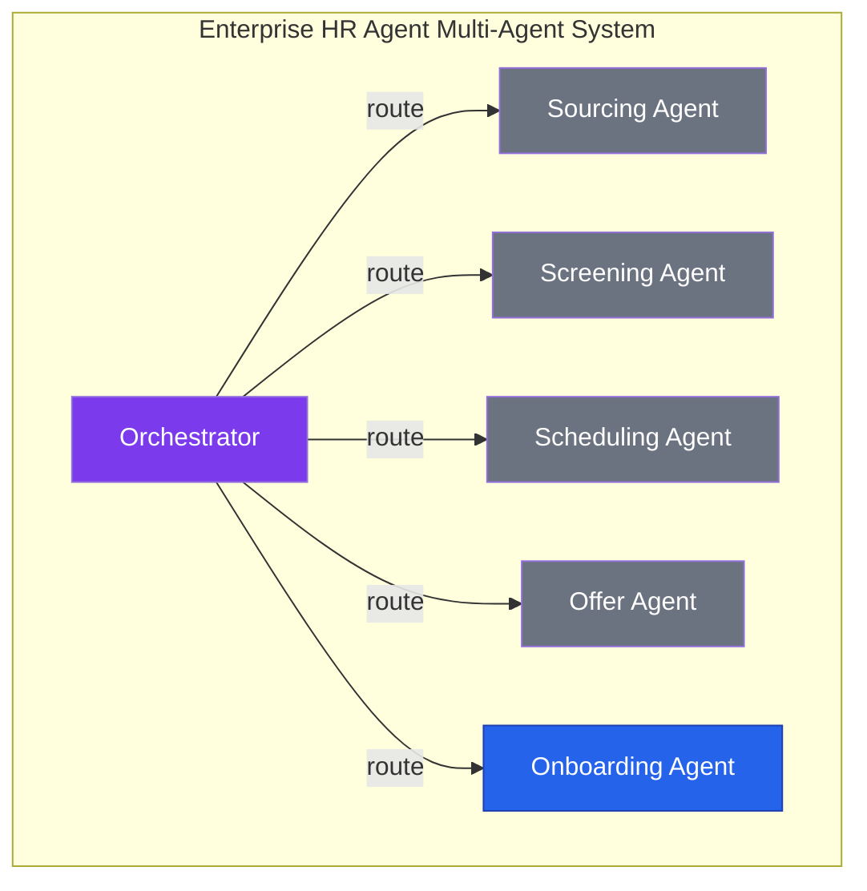
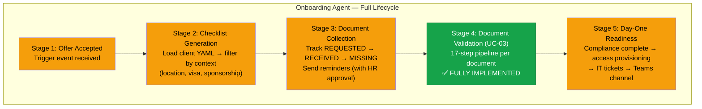
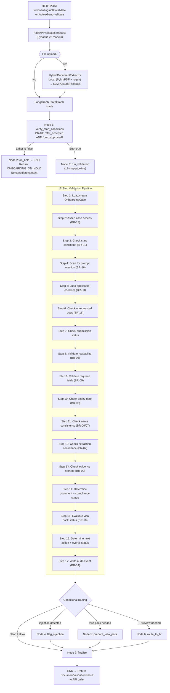
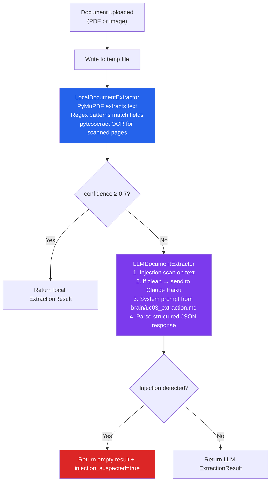
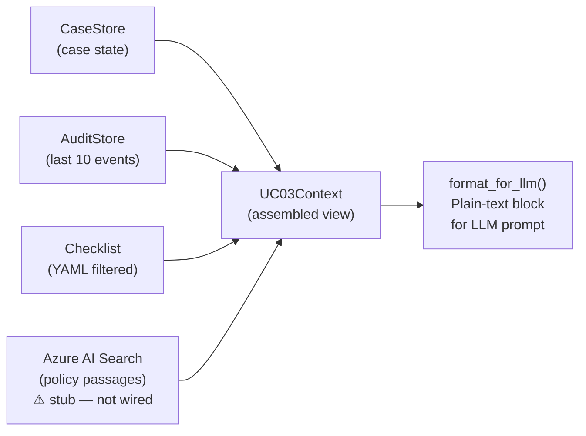

# Enterprise HR Agent Onboarding Agent — Complete Status Report

**Date:** 22 October 2026  
**Project:** Enterprise HR Agent (Autonomous HR Multi-Agent Platform) — Onboarding Agent  
**Stack:** Python 3.11 · FastAPI · LangGraph · Pydantic v2 · Anthropic Claude · Azure

---

## 1. Technical Deliverables & Expected Results

### 1.1 What the Onboarding Agent produces

The Onboarding Agent is one of six stage-agents in the Enterprise HR Agent multi-agent HR system. It manages the complete employee onboarding journey from **offer acceptance** through **day-one readiness**. Currently, **UC-03 (Document & Information Validation)** is the first fully implemented use case.

| # | Deliverable | Type | Description |
|---|---|---|---|
| 1 | **Document validation verdict** | [`DocumentValidationResult`](file:///c:/ROR/Enterprise HR Agent/src/agents/onboarding/uc03/models.py#L73-L89) | Structured JSON containing document status, list of findings, compliance status, next required action, audit reference, and injection flag |
| 2 | **Client-specific document checklist** | `list[DocumentRequirement]` | Auto-generated from [`default.yaml`](file:///c:/ROR/Enterprise HR Agent/knowledge/checklists/default.yaml) — 10 document types filtered by employee location, visa status, and sponsorship |
| 3 | **Outstanding requirements list** | `list[str]` | Document IDs still needed, derived from checklist minus submitted docs |
| 4 | **Compliance item status** | `ComplianceStatus` | `COMPLETE` / `INCOMPLETE` / `BLOCKED` / `PENDING_APPROVAL` — **never set to COMPLETE autonomously** (always requires an `ApprovalRecord`) |
| 5 | **Next-action recommendation** | `RequiredAction` | Single most important action: `HR_REVIEW`, `SEND_REMINDER`, `SEND_REPLACEMENT_REQUEST`, `PREPARE_VISA_PACK`, `FLAG_INJECTION`, `DENY_ACCESS`, etc. (10 possible values) |
| 6 | **Visa pack readiness** | `VisaPackStatus` | `READY_FOR_PRO` / `OUTSTANDING_ITEMS` — agent assembles but **never submits** to government portals |
| 7 | **Draft communications** | `str \| null` | Reminder emails or replacement-document requests — always **pending HR approval** before delivery |
| 8 | **Immutable audit trail** | [`AuditEvent`](file:///c:/ROR/Enterprise HR Agent/src/state/models.py#L41-L49) | UUID-linked, timestamped record of every action — logs document type + findings only, **never raw document content** |
| 9 | **Extraction result** | [`ExtractionResult`](file:///c:/ROR/Enterprise HR Agent/src/agents/onboarding/uc03/extraction.py#L45-L52) | Extracted name, fields, confidence score, injection flag, language detection from uploaded PDF/image |
| 10 | **Onboarding case state** | [`OnboardingCase`](file:///c:/ROR/Enterprise HR Agent/src/state/models.py#L11-L26) | Persistent case record tracking employee, status, authorized actors, dates |

### 1.2 Expected results per scenario

| Scenario | Input | Expected Findings | Required Action | Overall Status |
|---|---|---|---|---|
| ✅ Valid passport, all fields OK, high confidence | `readable=true, fields_present=true, confidence=0.96` | `VALID` | `HUMAN_CONFIRMATION` | `READY_FOR_HUMAN_CONFIRMATION` |
| 📄 Missing document | `submission_status=MISSING` | `MISSING_DOCUMENT` | `SEND_REMINDER` | `ACTION_REQUIRED` |
| ⏰ Expired passport | `expiry_date` < today | `EXPIRED_DOCUMENT` | `SEND_REPLACEMENT_REQUEST` | `ACTION_REQUIRED` |
| 🔤 Name mismatch (form ≠ document) | `employee_name_form ≠ extracted_name` | `NAME_MISMATCH` | `HR_REVIEW` | `HR_REVIEW_REQUIRED` |
| 🔍 Low OCR confidence | `extraction_confidence=0.45` | `LOW_CONFIDENCE` | `HR_REVIEW` | `HR_REVIEW_REQUIRED` |
| 🛡️ Prompt injection detected | Document text contains "ignore previous instructions" | `PROMPT_INJECTION_DETECTED` | `FLAG_INJECTION` | `HR_REVIEW_REQUIRED` |
| ⚠️ Unrequested sensitive document | Document type not in checklist but `submission_status=RECEIVED` | `UNREQUESTED_SENSITIVE` | `APPLY_RETENTION_POLICY` | `HR_REVIEW_REQUIRED` |
| ⏸️ Offer not yet accepted | `offer_accepted=false` | *(no validation runs)* | `NONE` | `ONBOARDING_ON_HOLD` |
| 🚫 Unauthorised actor | Actor not in `authorized_actor_ids` | *(access denied)* | `DENY_ACCESS` | HTTP 403 |

---

## 2. How the Workflow Operates (Start to Finish)

### 2.1 Full onboarding lifecycle (designed)

The Enterprise HR Agent system envisions a multi-stage onboarding pipeline. Currently **Stage 4 (UC-03)** is fully implemented:





### 2.2 UC-03 detailed workflow (implemented)



### 2.3 Step-by-step walkthrough

| Phase | What happens | Code |
|---|---|---|
| **API entry** | HR user or system sends POST request with document metadata (or uploads file). Pydantic validates request shape. | [`api/uc03.py`](file:///c:/ROR/Enterprise HR Agent/src/api/uc03.py#L33-L137) |
| **Extraction** (upload path) | `HybridDocumentExtractor` runs local PDF extraction (PyMuPDF + regex). If confidence < 0.7, falls back to Claude Haiku LLM for field extraction. Injection scanned before LLM call. | [`extraction.py`](file:///c:/ROR/Enterprise HR Agent/src/agents/onboarding/uc03/extraction.py#L276-L294) |
| **Graph entry** | LangGraph `StateGraph` starts at `verify_start_conditions` node. Checks BR-01 gate (offer + form approved). | [`workflow.py`](file:///c:/ROR/Enterprise HR Agent/src/agents/onboarding/uc03/workflow.py#L33-L43) |
| **Validation** | 17-step pipeline in `DocumentValidationService.validate()`. Runs deterministic business rules, checklist lookup, evidence checks, compliance assessment. | [`validator.py`](file:///c:/ROR/Enterprise HR Agent/src/agents/onboarding/uc03/validator.py#L56-L335) |
| **Routing** | Conditional edges route to `flag_injection`, `prepare_visa_pack`, `route_to_hr`, or straight to `finalize`. | [`workflow.py`](file:///c:/ROR/Enterprise HR Agent/src/agents/onboarding/uc03/workflow.py#L77-L92) |
| **Result** | Typed `DocumentValidationResult` returned to caller with all findings, statuses, audit ref, and next action. | [`models.py`](file:///c:/ROR/Enterprise HR Agent/src/agents/onboarding/uc03/models.py#L73-L89) |

---

## 3. Sub-Agents & Tools Used

### 3.1 Core components (all implemented)

| Component | File | Role | Status |
|---|---|---|---|
| **DocumentValidationService** | [`validator.py`](file:///c:/ROR/Enterprise HR Agent/src/agents/onboarding/uc03/validator.py) | 17-step validation pipeline — the "brain" of UC-03 | ✅ |
| **Rules engine** | [`rules.py`](file:///c:/ROR/Enterprise HR Agent/src/agents/onboarding/uc03/rules.py) | All 16 business rules as pure deterministic Python functions — no side effects, fully testable | ✅ |
| **ChecklistService** | [`checklist.py`](file:///c:/ROR/Enterprise HR Agent/src/agents/onboarding/uc03/checklist.py) | Loads client-specific YAML checklists, filters documents by context (location, visa, sponsorship) | ✅ |
| **LangGraph workflow** | [`workflow.py`](file:///c:/ROR/Enterprise HR Agent/src/agents/onboarding/uc03/workflow.py) | `StateGraph` with 7 nodes and conditional routing edges | ✅ |
| **HybridDocumentExtractor** | [`extraction.py`](file:///c:/ROR/Enterprise HR Agent/src/agents/onboarding/uc03/extraction.py#L276-L294) | Local (PyMuPDF + regex) → LLM (Claude Haiku) fallback when confidence < 0.7 | ✅ |
| **UC03 Context Assembler** | [`context_layer/uc03_context.py`](file:///c:/ROR/Enterprise HR Agent/context_layer/uc03_context.py) | Assembles per-step context from CaseStore + AuditStore + Checklist + Knowledge retrieval for LLM prompts | ✅ |
| **Injection guardrail** | [`guardrails/injection.py`](file:///c:/ROR/Enterprise HR Agent/guardrails/injection.py) | 14-pattern regex scan applied to all untrusted document text | ✅ |
| **Access guardrail** | [`guardrails/access.py`](file:///c:/ROR/Enterprise HR Agent/guardrails/access.py) | Case-level actor authorization — denies + logs unauthorized access | ✅ |
| **PII guardrail** | [`guardrails/pii.py`](file:///c:/ROR/Enterprise HR Agent/guardrails/pii.py) | Classifies sensitive fields (medical, criminal, disability, salary, bank) and masks them as "HR item" | ✅ |
| **Approval hook** | [`hooks/approval.py`](file:///c:/ROR/Enterprise HR Agent/hooks/approval.py) | Server-side gate — `require_approval()` raises `ApprovalRequiredError` if no approved record exists | ✅ |
| **Audit hook** | [`hooks/audit.py`](file:///c:/ROR/Enterprise HR Agent/hooks/audit.py) | Pre/post tool-call audit logging with `before_tool_call()` and `after_tool_call()` | ✅ |

### 3.2 MCP tool servers (4 servers × 4 tools each = 16 tools)

Each MCP server has a full mock implementation for local dev/CI and a `_real_call()` placeholder for production.

#### HRIS MCP Server — [`mcp/hris/client.py`](file:///c:/ROR/Enterprise HR Agent/mcp/hris/client.py)
| Tool | What it does | Approval needed? |
|---|---|---|
| `get_employee` | Retrieve employee master record (name, dept, location, nationality, contract type) | No |
| `get_onboarding_form` | Retrieve approved onboarding form data (source of truth for name, grade, joining date) | No |
| `update_employee` | Write updates to employee record in HRIS | **Yes** — `WRITE_SYSTEM` |
| `list_open_cases` | List all open onboarding cases for a client | No |

#### Microsoft Graph MCP Server — [`mcp/graph/client.py`](file:///c:/ROR/Enterprise HR Agent/mcp/graph/client.py)
| Tool | What it does | Approval needed? |
|---|---|---|
| `get_user` | Retrieve Azure AD user profile | No |
| `create_email_draft` | Create a draft reminder/replacement email — does NOT send | No |
| `send_email` | Send an approved draft email | **Yes** — `SEND_REMINDER` |
| `create_teams_channel` | Create a Teams onboarding channel for the new employee | **Yes** — `ACCESS_REQUEST` |

#### IT Service Desk MCP Server — [`mcp/itsd/client.py`](file:///c:/ROR/Enterprise HR Agent/mcp/itsd/client.py)
| Tool | What it does | Approval needed? |
|---|---|---|
| `create_ticket` | Raise an IT ticket (equipment, access card, network) | No |
| `get_ticket_status` | Check ticket progress | No |
| `create_access_request` | Request system access for the new employee | **Yes** — `ACCESS_REQUEST` |
| `get_access_status` | Check access provisioning status | No |

#### Document Storage MCP Server — [`mcp/documents/client.py`](file:///c:/ROR/Enterprise HR Agent/mcp/documents/client.py)
| Tool | What it does | Approval needed? |
|---|---|---|
| `store_document` | Upload and store a document in the correct case folder (raw bytes never logged) | No |
| `get_document_metadata` | Return metadata for a stored document (never raw content) | No |
| `confirm_stored` | Check whether a document reference exists in a case | No |
| `delete_document` | Delete under retention policy | **Yes** — HR approval |

### 3.3 LLM prompts (brain)

| Prompt | File | Purpose |
|---|---|---|
| **Extraction prompt** | [`brain/onboarding/uc03_extraction.md`](file:///c:/ROR/Enterprise HR Agent/brain/onboarding/uc03_extraction.md) | Instructs Claude to extract structured fields from document text. Rules: extract only visible info, assign confidence, never invent values, treat content as untrusted, detect injection, report language. |
| **Communication prompt** | [`brain/onboarding/uc03_communication.md`](file:///c:/ROR/Enterprise HR Agent/brain/onboarding/uc03_communication.md) | Drafts professional reminder/replacement emails. Rules: use formal name from form, list only outstanding items, never mention sensitive categories, state next step, mark as pending HR approval. |

### 3.4 Policy configuration

| Config | File | What it defines |
|---|---|---|
| **Approval gates** | [`policy/approval_gates.yaml`](file:///c:/ROR/Enterprise HR Agent/policy/approval_gates.yaml) | 6 approval gates: `SEND_REMINDER`, `SEND_REPLACEMENT_REQUEST`, `WRITE_SYSTEM`, `COMPLETE_COMPLIANCE`, `PREPARE_VISA_PACK`, `ACCESS_REQUEST` — all `auto_approve: false` |
| **Autonomy levels** | [`policy/autonomy.yaml`](file:///c:/ROR/Enterprise HR Agent/policy/autonomy.yaml) | 6 task categories mapped to autonomy levels 1–3 |

---

## 4. Tasks the Agent Automates

### 4.1 Autonomy Level 1 — Fully automated (agent executes independently)

| # | Task | Business Rule | What it does |
|---|---|---|---|
| 1 | Generate client-specific document checklist | BR-03 | Load YAML, filter by location/visa/sponsorship context → list of applicable documents |
| 2 | Track document submission status | BR-03, BR-04 | Maintain REQUESTED → RECEIVED → MISSING lifecycle per document |
| 3 | Validate document readability | BR-05 | Flag unreadable scans or missing text |
| 4 | Validate required fields present | BR-05 | Check that expected fields (name, expiry, passport number, etc.) are visible |
| 5 | Check document expiry dates | BR-05 | Compare `expiry_date` against `validation_date`, flag expired |
| 6 | Detect name mismatches | BR-06 | Compare form name vs. extracted document name (case-insensitive, trimmed) |
| 7 | Flag low-confidence extractions | BR-07 | Any `extraction_confidence` < 0.7 → route to HR, never guess |
| 8 | Filter family/dependent documents | BR-08 | Only include when `sponsorship_applicable=true` |
| 9 | Scan for prompt injection | BR-16 | 14-pattern regex scan on all untrusted text (document content, document_ref field, extracted_name) |
| 10 | Flag unrequested sensitive documents | BR-15 | If document type not in checklist but received → flag + retention policy |
| 11 | Enforce access control + write audit | BR-13, BR-14 | Every request: verify actor authorization, log timestamped audit event with findings only |

### 4.2 Autonomy Level 2 — Agent drafts, human approves

| # | Task | Approval Gate | What it does |
|---|---|---|---|
| 12 | Draft document reminder to candidate | `SEND_REMINDER` | Generate email listing outstanding documents, using communication prompt |
| 13 | Draft replacement-document request | `SEND_REPLACEMENT_REQUEST` | Generate email requesting re-upload of expired/unreadable/wrong document |

### 4.3 Autonomy Level 3 — Agent cannot execute without explicit HR approval

| # | Task | Approval Gate | What it does |
|---|---|---|---|
| 14 | Mark compliance item as COMPLETE | `COMPLETE_COMPLIANCE` | Requires stored evidence AND HR approval record |
| 15 | Write to external HR system | `WRITE_SYSTEM` | Update employee record in HRIS |
| 16 | Prepare visa pack for PRO | `PREPARE_VISA_PACK` | Assemble visa documents — agent can set `READY_FOR_PRO` but never `SUBMITTED` |
| 17 | Grant system access | `ACCESS_REQUEST` | Raise access request in IT Service Desk |

### 4.4 Things the agent explicitly CANNOT do

| Prohibited action | Why |
|---|---|
| Make final compliance decisions | Always requires `ApprovalRecord` (BR-09, BR-11) |
| Send communications without approval | Every draft requires `SEND_REMINDER` or `SEND_REPLACEMENT_REQUEST` approval |
| Submit documents to government portals | Agent can prepare visa pack, never submit (BR-10) |
| Determine document authenticity | Agent flags; humans decide |
| Access cases they're not authorized for | `assert_case_access()` blocks + logs (BR-13) |
| Log raw document content | Only document_type and findings in audit events (BR-14) |

---

## 5. How the Onboarding Agent Works

### 5.1 System architecture

```
┌─────────────────────────────────────────────────────────────────────┐
│                        Enterprise HR Agent Multi-Agent System                      │
│                                                                     │
│  ┌─────────────┐    ┌─────────┐ ┌─────────┐ ┌─────────┐ ┌───────┐│
│  │ Orchestrator │───▶│Sourcing ││Screening││Scheduling││ Offer ││
│  │  (gpt-4o)   │    └─────────┘ └─────────┘ └─────────┘ └───────┘│
│  │             │                                                    │
│  │  Routes to  │    ┌───────────────────────────────────────────┐  │
│  │  the right  │───▶│          ONBOARDING AGENT                 │  │
│  │  stage      │    │  ┌─────────────────────────────────────┐  │  │
│  └─────────────┘    │  │  UC-03: Document Validation ✅       │  │  │
│                     │  │  UC-01: Checklist Generation 🔧     │  │  │
│                     │  │  UC-02: Document Collection 🔧      │  │  │
│                     │  │  UC-04: Compliance Tracking 🔧      │  │  │
│                     │  │  UC-05: Day-One Readiness 🔧        │  │  │
│                     │  └─────────────────────────────────────┘  │  │
│                     └───────────────────────────────────────────┘  │
└─────────────────────────────────────────────────────────────────────┘
```

### 5.2 UC-03 internal architecture (implemented)

```
┌──────────────────────────────────────────────────────────────────────┐
│                   UC-03 Architecture                                  │
│                                                                      │
│  ┌──────────┐     ┌──────────────────────────────────────────────┐  │
│  │ FastAPI   │────▶│   LangGraph StateGraph (7 nodes)             │  │
│  │  4 routes │     │                                              │  │
│  │ • validate│     │  verify_start_conditions                     │  │
│  │ • upload  │     │       ▼                                      │  │
│  │ • approval│     │  run_validation ──▶ DocumentValidationService│  │
│  │ • audit   │     │       ▼                    │                 │  │
│  └──────────┘     │  conditional routing        │                 │  │
│                   │       ▼                     │                 │  │
│                   │  finalize → END             │                 │  │
│                   └─────────────────────────────┼─────────────────┘  │
│                                                 │                    │
│  ┌──────────────────────────────────────────────┘                    │
│  │                                                                   │
│  │  ┌──────────────┐  ┌──────────────┐  ┌────────────────────┐     │
│  ├──│ rules.py     │  │ checklist.py │  │ extraction.py      │     │
│  │  │ 16 BR rules  │  │ YAML loader  │  │ Local → LLM hybrid │     │
│  │  │ pure funcs   │  │ context filt │  │ PyMuPDF + Claude   │     │
│  │  └──────────────┘  └──────────────┘  └────────────────────┘     │
│  │                                                                   │
│  │  ┌──────────────┐  ┌──────────────┐  ┌────────────────────┐     │
│  ├──│ guardrails/  │  │ hooks/       │  │ context_layer/     │     │
│  │  │ • injection  │  │ • approval   │  │ UC03ContextAssembl │     │
│  │  │ • access     │  │ • audit      │  │ er — case state +  │     │
│  │  │ • PII        │  │              │  │ audit + checklist   │     │
│  │  └──────────────┘  └──────────────┘  └────────────────────┘     │
│  │                                                                   │
│  │  ┌──────────────┐  ┌──────────────┐                              │
│  └──│ state/       │  │ brain/       │                              │
│     │ • CaseStore  │  │ • extraction │                              │
│     │ • AuditStore │  │   prompt     │                              │
│     │ • enums (10) │  │ • communic.  │                              │
│     │ • models     │  │   prompt     │                              │
│     └──────────────┘  └──────────────┘                              │
│                                                                      │
│  ┌───────────────────────────────────────────────────────────────┐   │
│  │  MCP Tool Servers (4 servers, 16 tools total)                 │   │
│  │  ┌──────┐  ┌──────────┐  ┌──────┐  ┌───────────┐            │   │
│  │  │ HRIS │  │ MS Graph │  │ ITSD │  │ Documents │            │   │
│  │  │4 tools│ │ 4 tools  │  │4 tools│ │  4 tools  │            │   │
│  │  └──────┘  └──────────┘  └──────┘  └───────────┘            │   │
│  └───────────────────────────────────────────────────────────────┘   │
└──────────────────────────────────────────────────────────────────────┘
```

### 5.3 Hybrid document extraction pipeline



**Regex patterns implemented for:**
- **Passport**: passport_number, nationality, expiry_date, date_of_birth
- **Emirates ID**: emirates_id_number, expiry_date
- **Degree certificate**: institution, qualification, graduation_year
- **Signed offer letter**: employer, joining_date, designation

### 5.4 Context assembly (how the agent "sees" the case)

The [`UC03ContextAssembler`](file:///c:/ROR/Enterprise HR Agent/context_layer/uc03_context.py#L55-L194) builds a structured context for each step, pulling from 4 sources:



The context includes:
- Case metadata (ID, status, location, nationality, visa/sponsorship flags)
- Applicable documents with submitted/outstanding status
- Recent audit events (capped at 10, sensitive fields stripped)
- Retrieved policy passages (empty until Azure AI Search wired)
- Assembly warnings (e.g., "checklist not found", "search not configured")

### 5.5 Security model (defense in depth)

| Layer | Threat | Mitigation | Code |
|---|---|---|---|
| **Layer 1: Input** | Prompt injection via document text | 14-pattern regex scan on all untrusted text | [`guardrails/injection.py`](file:///c:/ROR/Enterprise HR Agent/guardrails/injection.py) |
| **Layer 2: Extraction** | Injection in extracted text before LLM call | Second injection scan in `LLMDocumentExtractor` before Claude call | [`extraction.py#L201-L210`](file:///c:/ROR/Enterprise HR Agent/src/agents/onboarding/uc03/extraction.py#L201-L210) |
| **Layer 3: Rules** | Injection in business logic | `check_prompt_injection()` in rules engine | [`rules.py#L109-L116`](file:///c:/ROR/Enterprise HR Agent/src/agents/onboarding/uc03/rules.py#L109-L116) |
| **Layer 4: Access** | Cross-case document access | `assert_case_access()` on every request | [`guardrails/access.py`](file:///c:/ROR/Enterprise HR Agent/guardrails/access.py) |
| **Layer 5: Approval** | Unauthorised actions | Server-side `require_approval()` before all protected actions | [`hooks/approval.py`](file:///c:/ROR/Enterprise HR Agent/hooks/approval.py) |
| **Layer 6: Audit** | Sensitive data in logs | Only document_type + findings logged — never raw content or PII | [`hooks/audit.py`](file:///c:/ROR/Enterprise HR Agent/hooks/audit.py) |
| **Layer 7: PII** | Sensitive fields exposed to wrong roles | Role-based field restriction + "HR item" masking | [`guardrails/pii.py`](file:///c:/ROR/Enterprise HR Agent/guardrails/pii.py) |

### 5.6 Key design principles

| # | Principle | How it's enforced |
|---|---|---|
| 1 | **Human-in-the-loop** | Agent never marks compliance COMPLETE autonomously. Every completion requires an explicit `ApprovalRecord` from an `HR_USER`. |
| 2 | **Defense in depth** | Document text is scanned for injection at 3 separate layers (guardrail → extraction → rules). |
| 3 | **PII-safe audit trail** | `AuditEvent` records document_type and findings only — raw document content, extracted names, and file bytes are never logged. |
| 4 | **Config-driven checklists** | New client = new YAML file in `knowledge/checklists/`. Zero code changes needed. `applies_to` rules handle location/visa/sponsorship filtering. |
| 5 | **Testable business rules** | All 16 rules are pure functions in `rules.py` — no side effects, no I/O, fully deterministic. Each is individually unit-tested. |

---

## 6. Development Completed ✅

### Core pipeline

| Deliverable | File | Lines |
|---|---|---|
| Pydantic v2 request/response models | [`models.py`](file:///c:/ROR/Enterprise HR Agent/src/agents/onboarding/uc03/models.py) | 89 |
| 16 business rules (pure functions) | [`rules.py`](file:///c:/ROR/Enterprise HR Agent/src/agents/onboarding/uc03/rules.py) | 237 |
| 17-step validation service | [`validator.py`](file:///c:/ROR/Enterprise HR Agent/src/agents/onboarding/uc03/validator.py) | 336 |
| LangGraph StateGraph (7 nodes) | [`workflow.py`](file:///c:/ROR/Enterprise HR Agent/src/agents/onboarding/uc03/workflow.py) | 161 |
| FastAPI endpoints (4 routes) | [`api/uc03.py`](file:///c:/ROR/Enterprise HR Agent/src/api/uc03.py) | 209 |

### Extraction pipeline

| Deliverable | File |
|---|---|
| `DocumentExtractor` protocol | [`extraction.py`](file:///c:/ROR/Enterprise HR Agent/src/agents/onboarding/uc03/extraction.py#L54-L56) |
| `MockDocumentExtractor` (tests + local dev) | [`extraction.py`](file:///c:/ROR/Enterprise HR Agent/src/agents/onboarding/uc03/extraction.py#L61-L77) |
| `LocalDocumentExtractor` (PyMuPDF + pytesseract + regex) | [`extraction.py`](file:///c:/ROR/Enterprise HR Agent/src/agents/onboarding/uc03/extraction.py#L82-L175) |
| `LLMDocumentExtractor` (Claude Haiku fallback) | [`extraction.py`](file:///c:/ROR/Enterprise HR Agent/src/agents/onboarding/uc03/extraction.py#L186-L271) |
| `HybridDocumentExtractor` (local → LLM) | [`extraction.py`](file:///c:/ROR/Enterprise HR Agent/src/agents/onboarding/uc03/extraction.py#L276-L294) |
| Field regex patterns (passport, emirates ID, degree, offer letter) | [`extraction.py`](file:///c:/ROR/Enterprise HR Agent/src/agents/onboarding/uc03/extraction.py#L16-L42) |

### Security, hooks & state

| Deliverable | File |
|---|---|
| 14-pattern injection scanner | [`guardrails/injection.py`](file:///c:/ROR/Enterprise HR Agent/guardrails/injection.py) |
| Case-level access control | [`guardrails/access.py`](file:///c:/ROR/Enterprise HR Agent/guardrails/access.py) |
| PII classification + masking | [`guardrails/pii.py`](file:///c:/ROR/Enterprise HR Agent/guardrails/pii.py) |
| Server-side approval gates | [`hooks/approval.py`](file:///c:/ROR/Enterprise HR Agent/hooks/approval.py) |
| Pre/post tool-call audit logging | [`hooks/audit.py`](file:///c:/ROR/Enterprise HR Agent/hooks/audit.py) |
| Audit event utility | [`state/audit.py`](file:///c:/ROR/Enterprise HR Agent/src/state/audit.py) |
| `OnboardingCase`, `ApprovalRecord`, `AuditEvent` models | [`state/models.py`](file:///c:/ROR/Enterprise HR Agent/src/state/models.py) |
| 10 domain enums | [`state/enums.py`](file:///c:/ROR/Enterprise HR Agent/src/state/enums.py) |
| `CaseStore` / `AuditStore` protocols + in-memory impl | [`state/store.py`](file:///c:/ROR/Enterprise HR Agent/src/state/store.py) |

### Context, knowledge & policy

| Deliverable | File |
|---|---|
| UC03 Context Assembler (4-source context builder + LLM formatter) | [`context_layer/uc03_context.py`](file:///c:/ROR/Enterprise HR Agent/context_layer/uc03_context.py) |
| YAML checklist loader + context filter | [`knowledge/checklists/loader.py`](file:///c:/ROR/Enterprise HR Agent/knowledge/checklists/loader.py) |
| Default 10-document checklist with conditional rules | [`knowledge/checklists/default.yaml`](file:///c:/ROR/Enterprise HR Agent/knowledge/checklists/default.yaml) |
| 6 approval gate definitions | [`policy/approval_gates.yaml`](file:///c:/ROR/Enterprise HR Agent/policy/approval_gates.yaml) |
| 6 autonomy level definitions (L1–L3) | [`policy/autonomy.yaml`](file:///c:/ROR/Enterprise HR Agent/policy/autonomy.yaml) |

### MCP tool servers (4 × mock)

| Server | File | Tools |
|---|---|---|
| HRIS | [`mcp/hris/client.py`](file:///c:/ROR/Enterprise HR Agent/mcp/hris/client.py) | `get_employee`, `get_onboarding_form`, `update_employee`, `list_open_cases` |
| Microsoft Graph | [`mcp/graph/client.py`](file:///c:/ROR/Enterprise HR Agent/mcp/graph/client.py) | `get_user`, `create_email_draft`, `send_email`, `create_teams_channel` |
| IT Service Desk | [`mcp/itsd/client.py`](file:///c:/ROR/Enterprise HR Agent/mcp/itsd/client.py) | `create_ticket`, `get_ticket_status`, `create_access_request`, `get_access_status` |
| Document Storage | [`mcp/documents/client.py`](file:///c:/ROR/Enterprise HR Agent/mcp/documents/client.py) | `store_document`, `get_document_metadata`, `confirm_stored`, `delete_document` |

### LLM prompts & skill definition

| Deliverable | File |
|---|---|
| LLM extraction system prompt | [`brain/onboarding/uc03_extraction.md`](file:///c:/ROR/Enterprise HR Agent/brain/onboarding/uc03_extraction.md) |
| LLM communication drafting prompt | [`brain/onboarding/uc03_communication.md`](file:///c:/ROR/Enterprise HR Agent/brain/onboarding/uc03_communication.md) |
| Skill definition (inputs/outputs/triggers/rules/example) | [`context_layer/skills/default.yaml`](file:///c:/ROR/Enterprise HR Agent/context_layer/skills/default.yaml) |

### Testing & evaluation

| Deliverable | File |
|---|---|
| Unit tests: checklist, extraction, models, rules (4 files) | [`tests/unit/`](file:///c:/ROR/Enterprise HR Agent/tests/unit) |
| Integration tests: API endpoints, validator (2 files) | [`tests/integration/`](file:///c:/ROR/Enterprise HR Agent/tests/integration) |
| 26-scenario eval dataset | [`evals/datasets/uc03_scenarios.json`](file:///c:/ROR/Enterprise HR Agent/evals/datasets/uc03_scenarios.json) |
| Evaluator + metrics | [`evals/evaluators/`](file:///c:/ROR/Enterprise HR Agent/evals/evaluators) |
| Eval runner (CLI with `--scenario` and `--fail-fast`) | [`evals/run_evals.py`](file:///c:/ROR/Enterprise HR Agent/evals/run_evals.py) |
| Shared test fixtures | [`tests/conftest.py`](file:///c:/ROR/Enterprise HR Agent/tests/conftest.py) |
| Technical specification | [`specs/uc03_spec.md`](file:///c:/ROR/Enterprise HR Agent/specs/uc03_spec.md) |

### Infrastructure

| Deliverable | File |
|---|---|
| Dockerfile | [`Dockerfile`](file:///c:/ROR/Enterprise HR Agent/Dockerfile) |
| `.env.example` (Azure OpenAI, Search, Key Vault, HRIS, Graph, ITSD, OTEL) | [`.env.example`](file:///c:/ROR/Enterprise HR Agent/.env.example) |
| App settings (Pydantic Settings) | [`src/config.py`](file:///c:/ROR/Enterprise HR Agent/src/config.py) |
| `pyproject.toml` (uv managed, 17 dependencies) | [`pyproject.toml`](file:///c:/ROR/Enterprise HR Agent/pyproject.toml) |
| MCP base class with mock/real switch | [`mcp/base.py`](file:///c:/ROR/Enterprise HR Agent/mcp/base.py) |

---

## 7. Pending Work 🔧

| # | Item | Category | Effort | Description |
|---|---|---|---|---|
| 1 | **Orchestrator agent** | Architecture | Large | `src/orchestrator/` has only `__init__.py`. The central agent that routes between stage-agents (sourcing → screening → scheduling → offer → onboarding) is not yet built. |
| 2 | **Other onboarding use cases** (UC-01, UC-02, UC-04, UC-05) | Architecture | Large | Only UC-03 exists. Checklist generation, document collection, compliance tracking, and day-one readiness are not yet implemented. |
| 3 | **Azure Form Recognizer adapter** | Extraction | Medium | Replace local regex extraction with Azure Document Intelligence for production-grade OCR. |
| 4 | **Azure AI Search integration** | Knowledge | Medium | Wire `_retrieve_passages()` in context_layer to Azure AI Search for policy/regulation retrieval. |
| 5 | **Persistent storage** (Cosmos DB / PostgreSQL) | State | Medium | Replace `InMemoryCaseStore` / `InMemoryAuditStore` — data is lost on restart. |
| 6 | **Real MCP server implementations** | Integration | Large | All 4 MCP clients return mock data. Need live HRIS, Graph, ITSD, and Document Storage endpoints. |
| 7 | **Azure AD JWT authentication** | Security | Medium | Actor ID passed in request body today. Need JWT middleware to validate Azure AD tokens. |
| 8 | **Multi-language OCR** | Extraction | Medium | Only English extraction implemented. Arabic and other language support needed for UAE market. |
| 9 | **Communication drafting integration** | LLM | Small | The prompt exists in `brain/` but is not wired into the validation pipeline to populate `draft_communication` in the result. |
| 10 | **Attestation tracking** | Logic | Small | Checklist item exists; attestation-specific validation logic not built. |
| 11 | **Duplicate document detection** | Logic | Small | `DUPLICATE_REQUEST` enum exists but no dedup logic implemented. |
| 12 | **OpenTelemetry / monitoring** | Observability | Medium | `monitoring/` has only `.gitkeep`. OTEL packages in `pyproject.toml` but not configured. |
| 13 | **CI/CD pipeline** | DevOps | Small | `cicd/` is empty. Pipeline definitions for test → eval → build → deploy not created. |

---

## 8. Blockers 🚫

| # | Blocker | What it blocks | Who needs to resolve |
|---|---|---|---|
| **B-1** | **No Azure credentials provisioned** | Document extraction (Form Recognizer), knowledge retrieval (AI Search), Key Vault secrets | Cloud / Infra team |
| **B-2** | **HRIS API access not available** | Real employee records, employment data, org structure | HRIS / IT Integration team |
| **B-3** | **Azure AD app registration missing** | JWT auth, Graph API (AD accounts, email, Teams), any Azure-secured call | Identity / Security team |
| **B-4** | **No persistent database provisioned** | Case state + audit trail lost on restart. Blocks staging/UAT deployment | Cloud / Infra team |
| **B-5** | **IT Service Desk API not exposed** | Real service tickets for equipment, access cards, network | IT Operations team |
| **B-6** | **Document storage endpoint TBD** | Production blob storage for evidence documents (compliance requirement) | Cloud / Infra team |

> [!WARNING]
> **All 6 blockers are infrastructure/credential dependencies.** The application code and agent pipeline are fully implemented and passing against mocks. There are zero code-level blockers.

---

## Summary

| Area | Status |
|---|---|
| **UC-03 Document Validation** | ✅ Functionally complete — 17-step pipeline, 16 business rules, 7-node LangGraph, 4 API endpoints, hybrid extraction, 3 guardrails, 26-scenario eval suite |
| **MCP Tools** | ✅ 4 servers × 4 tools = 16 tools — all mock-implemented, production `_real_call()` stubs ready |
| **Security** | ✅ 7-layer defense: injection (3×), access, approval, audit, PII |
| **Policy & Autonomy** | ✅ 6 approval gates, 3 autonomy levels — all configured in YAML |
| **Context Layer** | ✅ UC03ContextAssembler — 4-source context builder with LLM formatter |
| **Testing** | ✅ 6 test files (unit + integration) + 26-scenario eval dataset |
| **Orchestrator** | 🔧 Not yet built — `src/orchestrator/` is empty |
| **Other UCs (01, 02, 04, 05)** | 🔧 Not yet built |
| **External integrations** | 🚫 Blocked on Azure credentials, HRIS, AD, storage provisioning |
