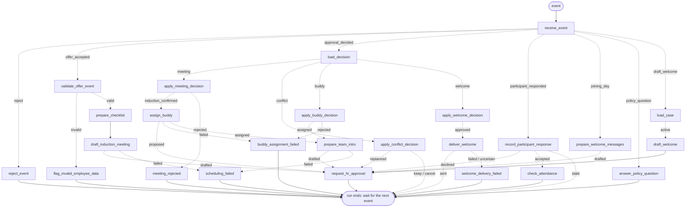

# HR Onboarding Agent

The employee onboarding sub-agent (`agent_id: employee-onboarding`, autonomy **L1**: it drafts and
proposes; a human approves every communication, booking and buddy assignment). It is a LangGraph
workflow behind a FastAPI service, built on the shared harness in the sibling repository
`../hr-onboarding-common` (contracts, LLM gateway, guardrails, policy, HITL inbox, audit), which uv
installs through a path dependency.

**Out of scope:** tracking whether an employee has signed, acknowledged or returned an NDA or HR
policy document is not a responsibility of this agent (the acknowledgement/signature-tracking
feature and its `/v1/onboarding/*/acknowledgements*` routes were retired). **HR Policies Q&A
remains an active feature** (stage 10 below): employees can still ask questions about company
policy, answered and cited only from the company's HR policy,
`HR-Onboarding-Common/src/hr_onboarding_common/context_layer/HR_Policy_Consultants.md`. Salary,
medical and accessibility questions, questions the policy does not cover, and languages not enabled
are routed privately to HR (see `../docs/HR_POLICY_PRIVACY_AND_ESCALATION.md`).

## Status at a glance

| | |
|---|---|
| Onboarding workflow | All 11 stages are implemented as one LangGraph graph in `src/sub_agent/agent.py` and reachable over HTTP. |
| Tests | 533 passing (`uv run pytest`), offline, no API key needed. `tests/test_orchestration_contract.py` pins what the central orchestrator (HR-Onboarding-Common) relies on from this agent. Phase 4 remediation: `docs/PHASE_4_REMEDIATION_REPORT.md`; earlier verification: `docs/PHASE_3_VERIFICATION_REPORT.md` (both predate the removal of acknowledgement/signature tracking; see below). |
| Evaluations | 35 scenarios, 34 pass and 1 is skipped offline because it needs a live model (`uv run python evaluation/run_evals.py`). |
| External integrations | **None are real.** Email, HRMS, calendar and Teams/Outlook notifications are simulated: each connector's `mock.py` (`connectors/<name>/mock.py`), assembled by `src/sub_agent/fakes.py`. Nothing is delivered to anyone. `HR_AGENT_ENV=production` therefore refuses to start. |
| Identity | Verified bearer JWT by default (`src/sub_agent/identity.py`): user, roles and tenant come from signed claims; identity headers are ignored. Header trust exists only for `HR_AGENT_ENV=development`/`test`. Not yet tested against a real identity provider. |
| Durability | With `HR_AGENT_PERSIST=1` (required outside development/test), cases, sessions, invitations, RSVPs, buddy assignments, notifications, the idempotency ledger and joining-day jobs are in SQLite (`onboarding.db`), beside the approvals (`hitl.db`), checkpoints (`checkpoints.db`) and audit log. Single host only; see `src/sub_agent/persistence.py`. |

## Directory layout

```text
HR-Onboarding-Agent/
├── connectors/                  external systems: base.py = interface, mock.py = simulated provider (no real one)
│   ├── email/                   EmailPort: offer-acceptance events; mock: MockEmailAdapter + MockEmailSender (outbound)
│   ├── employee_directory/      EmployeeDirectoryPort: read-only HRMS records; mock: MockEmployeeDirectory
│   ├── calendar/                CalendarPort: availability, tentative holds, confirm/cancel; mock: MockCalendar
│   ├── notifications/           NotificationPort: message delivery on every channel; mock: MockNotifier
│   └── teams/                   TeamsPort: NotificationPort for the Teams channel; mock: MockTeamsAdapter
├── context_layer/               reusable context, independent of the workflow
│   ├── knowledge/               PolicyKnowledgeBase + PolicyCitation, and policies/{global,<client>}/*.md
│   └── skills/                  SKILL.md prompts + loader (onboarding-welcome-writer, hr-policy-answerer)
├── evaluation/run_evals.py      end-to-end scenario evaluation (8 suites)
├── guardrails/policy.yaml       the policy envelope: tool allowlist, kill switch, gates, settings
├── src/sub_agent/
│   ├── agent.py                 the onboarding workflow (graph, state, entry points)
│   ├── api.py                   FastAPI service
│   ├── runtime.py               builds the stores and dependencies from the environment (API + scheduler)
│   ├── identity.py              verified JWT identity; the dev-only header mode and its guard
│   ├── persistence.py           SQLite OnboardingPort + joining-day job store
│   ├── scheduler.py             joining-day scheduler (python -m sub_agent.scheduler)
│   ├── reconciliation.py        what a crash left out of step between the stores (read-only report)
│   ├── fakes.py                 assembles every test/demo double (re-exports the connector mocks)
│   ├── tool_registry.py         tenant/role authorization + ToolGateway for every operation
│   ├── services/                deterministic business rules: intake, checklist, scheduling, welcome,
│   │                            joining_trigger, policy_qa, delivery (idempotent sends)
│   ├── models.py                domain models and errors
│   └── repository.py            OnboardingPort: the agent's own data-access interface and its contract
├── tests/                       testcase.py (central workflow suite) + focused test_*.py files
├── docs/                        design records and API examples (historical; see the notes at their tops)
├── .env.example  pyproject.toml  uv.lock
```

`assets/`, `report.html` and `.coverage` are generated test-report artefacts, not source.

### Responsibilities and dependency direction

```text
api.py ──> agent.py ──> tool_registry.py ──> services/ ──> connectors/ (interfaces) ──> external systems
                │              │                  └──────> repository.py (OnboardingPort)
                └──────────────┴──> context_layer/ (knowledge, skills)
connectors/*/mock.py simulate the external systems; fakes.py assembles them with MockOnboarding
(OnboardingPort) for tests and the offline demo.
```

- **`api.py`**: authenticates (through `IdentityProvider`), validates bodies, tenant-checks the
  target, then delegates. It contains no workflow logic.
- **`agent.py`**: orchestration only. Each node calls `OnboardingToolRegistry`. Nodes contain no
  provider code and no business rules.
- **`tool_registry.py`**: the single enforcement point. Every operation is tenant- and
  role-authorized, then routed through `ToolGateway`, which checks the kill switch and allowlist,
  enforces approval gates and writes the audit record. HITL decisions are applied through it too.
- **`services/`**: business rules as plain functions over ports (idempotency, required tasks,
  office hours, buddy selection, citation grounding, and so on).
- **`connectors/`** and **`context_layer/`** never import the agent, the API or the services, and
  the connector mocks import nothing from `sub_agent` at all. This is enforced by
  `tests/test_context_layer.py`. The mocks only simulate provider behaviour: deterministic state,
  synthetic data, `sim-…` references, `simulated=True` receipts and a `reset()`; they contain no
  workflow logic (`tests/test_connector_mocks.py`).
- **Shared configuration**: `hr_onboarding_common.config` (environment) and
  `guardrails/policy.yaml` (`settings:`). The agent's home directory is resolved once, in
  `agent.py`.

## The onboarding workflow

`OnboardingAgent.build_graph()` compiles a single `StateGraph`. The diagram below is the compiled
graph (27 nodes including start and end; regenerate with `agent.graph.get_graph().draw_mermaid()`).
Dashed labels are the conditional-edge routes.



| # | Stage | Node(s) | Calls (registry → service / connector) | Human gate |
|---|---|---|---|---|
| 1 | Receive and validate the offer-acceptance event | `validate_offer_event` | `intake.process_offer_acceptance_event` → `EmailPort` | — |
| 2 | Retrieve the employee, check required fields, create the case and checklist | `validate_offer_event`, `prepare_checklist` | `EmployeeDirectoryPort`; `checklist.ensure_*` | — |
| 3 | Draft the induction: participants, first free in-hours slot on/after the joining date, silent tentative hold (nobody invited yet) | `draft_induction_meeting` | `scheduling.find_available_slot` / `schedule_session` → `CalendarPort` | — |
| 4 | Request HR approval over the configured channel | `request_hr_approval` | `NotificationPort` (Teams/Outlook; currently the simulated `MockNotifier`) | `scheduling_approval` |
| 5 | Confirm and invite only after an authorized approval; release the hold if rejected | `apply_meeting_decision`, `meeting_rejected` | `scheduling.apply_decision` → `CalendarPort.confirm/cancel` | decided in HITL |
| 6 | Track RSVPs, newest first by provider timestamp; a decline goes to HR; a withdrawn decline tells HR no decision is needed | `record_participant_response`, `check_attendance` | `scheduling.record_response` | `attendance_decision` |
| 7 | Apply HR's keep, cancel or replan decision, unless it has been superseded meanwhile | `apply_conflict_decision` | `scheduling.apply_attendance_decision` | decided in HITL |
| 8 | Propose an eligible same-team buddy, assign on approval, notify both | `assign_buddy`, `apply_buddy_decision`, `buddy_assignment_failed` | `scheduling.propose_buddy_assignment` / `apply_buddy_decision` → `NotificationPort` | `buddy_assignment` |
| 9 | Draft the team intro, approved by the team lead on record | `prepare_team_intro` | as stage 3, approver role `team_lead` | `scheduling_approval` |
| 10 | Policy Q&A with citations | `answer_policy_question` | `policy_qa.answer_policy_question` → `PolicyKnowledgeBase` | — |
| 11 | Joining-day welcome: template, language and branding; deliver once after approval | `prepare_welcome_messages`, `apply_welcome_decision`, `deliver_welcome` | `joining_trigger` / `welcome` → `NotificationPort` | `comms_approval` |

Each run's state (`OnboardingState`) holds identifiers and statuses only: workflow, run, client and
employee ids, the current stage, the meeting, approval, RSVP, conflict, buddy, team-intro and
welcome statuses, plus errors and a stage history for audit correlation. It never holds names,
email addresses, message bodies or secrets.

### How the workflow is triggered, paused and resumed

- **Triggered** by events, each one a separate graph execution:

  | Event | Entry point | Stages |
  |---|---|---|
  | offer accepted | `POST /v1/onboarding/workflow/offer-accepted` | 1–4 |
  | approval decided | the HITL listener, after `POST /v1/approvals/{id}/decision` | 5, 7, 8, 9, 11 |
  | RSVP | `POST /v1/onboarding/workflow/sessions/{id}/responses` | 6 |
  | joining day | the joining-day scheduler (`python -m sub_agent.scheduler`), or `POST /v1/onboarding/workflow/joining-day` | 11 |
  | policy question | `POST /v1/onboarding/workflow/policy-questions` | 10 |
  | draft welcome | `POST /v1/runs` (the original contract) | 11 |

- **Paused** between events by design. A run ends as soon as it needs a human or an external party,
  so no process sits waiting for an approval, an RSVP or the joining date. The repository and the
  HITL inbox carry the case forward. `GET /v1/onboarding/{employee_id}/workflow` reports where a
  case stands, derived from those durable records.
- **Resumed** from checkpoints. Every run checkpoints on thread
  `employee-onboarding:<client>:<event>:<key>`, where `<key>` is the offer email's event id, the
  approval id, or the run id.
  - A run that fails part-way (a provider outage, the kill switch) stops on the failed node.
    Redelivering the same event, or calling `POST /v1/approvals/{id}/retry-apply` for a decision,
    resumes there. Completed steps are not repeated.
  - A completed event that is redelivered is reported as `workflow.duplicate_event` and not
    re-run. The exceptions are invalid employee data and "no slot", which HR is expected to fix
    and resend.
- **Idempotent underneath as well**, so even a lost checkpoint cannot create duplicate meetings,
  assignments or messages:
  - intake by event id
  - checklist items by type
  - meetings by type
  - buddy proposals while one is pending
  - welcome sends by draft status (`SENT`)
  - every external side effect through the **operation ledger** (`OperationRecord`): calendar
    holds, approval requests, buddy notices, welcome messages and "no decision needed" notices.
    The ledger records the operation before the provider call and sends the same idempotency key
    on every retry, so a lost provider response is retried without a second booking or message
    when the provider honours the key. When it cannot (`idempotent_booking` /
    `idempotent_delivery` false), the outcome is reported as uncertain and routed to HR instead of
    being repeated. This is at-most-once with a deduplicating provider, **not exactly-once**.

> **Durability:** with `HR_AGENT_PERSIST=1` the checkpointer is LangGraph's `SqliteSaver` at
> `<HR_AGENT_DATA_DIR>/checkpoints.db`, the repository and ledger are `onboarding.db`, and the HITL
> inbox is `hitl.db`. Cases, pending decisions and their checkpoints survive a restart together
> (`tests/test_persistence_and_recovery.py`). They cannot share one transaction, so
> `GET /v1/onboarding/admin/reconciliation` reports anything a crash left out of step. A
> multi-instance deployment needs a server database and saver (for example Postgres) and
> cross-process locking; the per-thread lock in `agent.py` only serializes within one process.

## API

Start the service with `uv run uvicorn sub_agent.api:app --port 8010`, then open
`http://localhost:8010/docs`. Every route except `/healthz` and `/openapi.json` needs
`Authorization: Bearer <JWT>` (`IDENTITY_MODE=jwt`). The token's `sub`, roles claim and tenant claim
are the caller's identity. With `HR_AGENT_ENV=development` and `IDENTITY_MODE=insecure-dev-headers`,
the `X-User-Id`, `X-Client-Id` and `X-User-Roles` headers are used instead. A missing or invalid
identity returns `401`.

| Group | Routes |
|---|---|
| Workflow | `POST /v1/onboarding/workflow/offer-accepted` `{event_id, induction_start?}`, `POST /v1/onboarding/workflow/sessions/{session_id}/responses` `{participant_id, response}`, `POST /v1/onboarding/workflow/joining-day` `{as_of, template_id?}`, `POST /v1/onboarding/workflow/policy-questions` `{question, as_of, employee_id?}` → `{response: AgentResponse, workflow: {...stage, ids, errors, history}, approvals}`. `GET /v1/onboarding/{employee_id}/workflow` returns the case's stage and pending approvals. |
| Shared (from `create_app`) | `GET /healthz`, `POST /v1/runs` (body `{"instance": "<employee_id>", "input": {"employee_id": ...}}` still drafts a welcome message; `input.event` selects other events), `GET /v1/approvals`, `GET /v1/approvals/{id}`, `POST /v1/approvals/{id}/decision`, `POST /v1/approvals/{id}/retry-apply` |
| Individual operations (HR console, unchanged contracts) | `/v1/onboarding/intake`, `/{id}`, `/{id}/tasks[/pending\|/overdue]`, `/{id}/sessions[/outstanding\|/buddy-intro]`, `/sessions/{id}/invitations\|/responses\|/attendance`, `/sessions/check-timeouts`, `/{id}/buddy`, `/policy-questions` |
| Operations and recovery (`hr_admin`) | `GET /v1/onboarding/admin/reconciliation`, `GET /v1/onboarding/admin/operations` (uncertain bookings and messages), `POST /v1/onboarding/admin/operations/resolve` `{key, outcome: succeeded\|released, provider_ref?, reason?}` (the resolver, time and reason are kept on the operation), `POST /v1/onboarding/admin/welcome/{draft_id}/redeliver` `{reason}` (a new attempt for an approved welcome known **not** to have been delivered: operation `released` or `rejected`, or never attempted; `409` while the outcome is unknown or once delivered; audited as `welcome.redelivery_authorized`) |

Both RSVP routes accept an optional `responded_at` (the provider's timestamp, with an offset). A
response older than the one already recorded is ignored (`409` on the individual route, stage
`response_superseded` on the workflow route). `POST /v1/approvals/{id}/retry-apply` requires the
item's approver role or `hr_admin`.

`POST /v1/approvals/{id}/decision` validates the decision **before** it is recorded
(`services/decisions.py`, passed to `create_app` as `decision_validator`): the specific team lead or
buddy on record (`403`), a booking that is no longer pending (`409`), an edited buddy who is not an
eligible candidate of the employee's client, an edited welcome with an empty subject/body or a
different draft, a replan without a valid office-hours start (`422`). A refused decision leaves the
approval pending for the right person.

Error mapping:

| Status | Meaning |
|---|---|
| 401 | unverified identity |
| 403 | role, policy or kill switch |
| 404 | not found, or another tenant's record (the same response, so existence is never confirmed) |
| 409 | duplicate, double-booking, replayed send, out-of-order RSVP, uncertain delivery awaiting HR, a decision on a booking that is no longer pending |
| 422 | validation, invalid meeting time, unsupported language, an invalid edited decision |
| 502 | provider outage (calendar, email, notifications), or a decision whose follow-up action failed |
| 503 | connector not configured |

The API behaviour in JWT mode is covered in-process (FastAPI `TestClient`) by
`tests/test_identity.py`, using keys generated at test time. It has not been run against a real
identity provider or gateway.

## Configuration

`.env.example` documents every variable:
- `LLM_MODE` (`offline` | `online`; `live` is accepted as `online`) and the model tiers. Online, every
  model call goes to OpenRouter through hr-onboarding-common's `LiteLLMGateway`. The key and tiers
  live in `HR-Onboarding-Common/.env`; point `HR_ONBOARDING_ENV_FILE` at it when running this service
  on its own. A missing key or tier stops startup. See
  `HR-Onboarding-Common/docs/OPENROUTER_INTEGRATION_GUIDE.md` §8a.
- `CONNECTOR_MODE`: only `offline` exists, and any other value fails startup.
- `HR_AGENT_ENV` (`production` by default, `staging`, `development`, `test`): what the service may run
  with. See `src/sub_agent/runtime.py`.
- `IDENTITY_MODE` and `IDENTITY_JWT_*` / `IDENTITY_JWKS_URL` (see `src/sub_agent/identity.py`).
  The old `HR_AGENT_ALLOW_INSECURE_HEADER_IDENTITY` is rejected at startup.
- `HR_AGENT_PERSIST`, `HR_AGENT_DATA_DIR`, `HR_AGENT_TZ`, `LOG_LEVEL`, and `SCHEDULER_*` for the joining-day
  scheduler.

A local development run uses
`HR_AGENT_ENV=development IDENTITY_MODE=insecure-dev-headers HR_AGENT_PERSIST=0`, or `HR_AGENT_PERSIST=1` to
keep data (an empty database is seeded with the synthetic demo data in development only).

Workflow behaviour is configured in `guardrails/policy.yaml` → `settings`:
- approver role per session type
- attendance requirements
- timezone, office hours, weekend days, holidays
- `workflow.session_participants` (who the workflow invites; **placeholder values, confirm with HR**)
- slot search window
- `notifications.approval_channel` / `employee_channel` (`teams` | `email`)
- `invitations`: `on_approval` (default) invites attendees only when the approver confirms the
  hold; `on_hold` invites with the tentative hold, for a client whose rules allow it

## Commands

```bash
uv sync                                         # install (editable; puts the project root and src/ on sys.path)
uv run pytest                                   # 533 passed
uv run pytest tests/testcase.py -v              # the central workflow suite
uv run python evaluation/run_evals.py           # 35 scenarios; --suite NAME, --json results.json
LLM_MODE=live uv run python evaluation/run_evals.py   # also scores the model-dependent checks
HR_AGENT_ENV=development IDENTITY_MODE=insecure-dev-headers uv run uvicorn sub_agent.api:app --port 8010
HR_AGENT_ENV=development IDENTITY_MODE=insecure-dev-headers HR_AGENT_PERSIST=1 uv run python -m sub_agent.scheduler --once
```

On Windows PowerShell, set variables with `$env:LLM_MODE = "live"` before the command.

## Guardrails: where each one is enforced in code

| Requirement | Enforced by |
|---|---|
| Caller identity | `JwtIdentityProvider` (`identity.py`): asymmetric signature, issuer, audience, expiry, age, tenant and roles claims. The header mode is refused outside development/test. One verified actor authorizes the route, the workflow run, every tool call and every decision. `retry-apply` checks the approver role (`api._authorize_retry_apply`). |
| Kill switch on every path | `ToolGateway.call` (every tool call), `BaseAgent.run` (workflow runs), `OnboardingAgent.handle_approval_decision` (HITL decisions) |
| Tool allowlist and autonomy | `ToolGateway` + `guardrails/policy.yaml` `tools:`. A tool not listed fails closed. |
| Approval cannot be bypassed | HITL gates with role checks (`HITLInbox.decide`). Specific team-lead and buddy approvers (`UnauthorizedApproverError`), checked before the decision is recorded (`services/decisions.py`) and again when it is applied. `comms.send_welcome_email` is `write_requires_approval`, and the approval must be the welcome approval **for that draft**. Decisions can't be replayed through `/v1/runs`. Meetings are tentative until approved. An HR-edited buddy must still be an active candidate in the employee's own client's pool (`IneligibleBuddyError`). |
| Tenant isolation | `OnboardingToolRegistry._authorize_*` on every operation. Tenant-scoped HITL queries. `_tenant_check` on `/v1/runs`, and the workflow refuses an input employee that differs from the run's instance. Intake checks the directory record's tenant. The registry re-checks the tenant of every session and draft the repository returns (`_owned`), rather than trusting the repository's own `client_id=` filter. |
| Sensitive data | Workflow state and approver notifications carry ids, not personal data. The audit log carries ids and statuses. Only the message to the employee contains their name and address. |
| Policy Q&A | Injection-screened question (refused before retrieval or the model). Injected, superseded, not-yet-effective and other-tenant documents are dropped. Excerpts are wrapped as untrusted. Every citation is checked as a verbatim quote. "No answer" is the fallback. |
| Callback payloads | RSVPs are accepted only from an invited participant of a session that isn't cancelled (`InvalidParticipantResponseError`, 422). Offer events are validated by intake (parseable, known employee, complete record, caller's tenant). Workflow event payloads are validated per event type. |
| External side effects | Provider failures (retryable) are kept distinct from business outcomes (routed). Every booking and message goes through the operation ledger with a stable idempotency key, and an uncertain outcome with a provider that cannot deduplicate is routed to HR, never resent. Attendees are invited only on approval by default. Connectors that aren't configured raise `ConnectorNotConfiguredError` rather than falling back to a fake. |
| Model errors | `runtime.SanitizedLLM` replaces every provider error message with a generic one before it can reach an API response. The error type is logged. |

## Integrations: real, mocked, pending

| Integration | Interface | Implementation today | Pending |
|---|---|---|---|
| Offer-acceptance email | `connectors/email` | `MockEmailAdapter` (simulated) | email service and credentials |
| Employee directory / HRMS | `connectors/employee_directory` | `MockEmployeeDirectory` (simulated) | HRMS product and credentials |
| Calendar (Google / Microsoft 365) | `connectors/calendar` | `MockCalendar` (simulated) | provider, OAuth, and tentative holds that don't notify attendees |
| Teams / Outlook approval channel, notifications, welcome email | `connectors/notifications`, `connectors/teams`, outbound email in `connectors/email` | `MockNotifier` wired (every channel); `MockTeamsAdapter` and `MockEmailSender` per channel. All `simulated=True` | Teams app registration or webhook, sender domain, adapters, and a channel router if each channel gets its own adapter |
| Onboarding database | `src/sub_agent/repository.py` | `SqliteOnboardingRepository` (`HR_AGENT_PERSIST=1`), `MockOnboarding` (tests/development) | a Enterprise HR Agent-approved server database for more than one host |
| Identity | `hr_onboarding_common.platform.identity` | `JwtIdentityProvider` (`src/sub_agent/identity.py`); `InsecureHeaderIdentityProvider` in development/test only | the organisation's IdP or gateway: issuer, audience, key or JWKS URL, claim names; never tested against one |
| LLM | `hr_onboarding_common.llm` | `FakeLLM` offline; `LiteLLMGateway` live | live mode needs a key and hasn't been evaluated here |
| Workflow checkpoints | LangGraph checkpointer | `SqliteSaver` when `HR_AGENT_PERSIST=1`, else `MemorySaver` | a shared saver (e.g. Postgres) for more than one instance |

No credentials, endpoints or provider configuration exist in this repository, and none were invented.

## Known limitations and open decisions

- **Nothing is delivered.** Every connector is a fake; see the table above.
- **SQLite is single-host.** Fine for one API process plus the scheduler on one machine; not for
  several hosts, network file systems or high availability (`src/sub_agent/persistence.py`).
- **Tentative holds are silent by contract.** With `invitations: on_approval` the hold must not
  notify anyone. A real calendar adapter must honour `book_event(notify_attendees=False)` and
  advertise `idempotent_booking` truthfully.
- **A manual joining-day call and the scheduler** are serialized only within one process.
- **Workflow-drafted meeting participants are placeholder settings** (`settings.workflow`): the
  induction invites the new hire and the team lead.
- **The agent id and autonomy ceiling are placeholders** agreed in Phase 1. The governance source
  (`dact-business-framework`) isn't available on this machine.
- **Decisions are validated before they are recorded on the API path only.** Through
  `POST /v1/approvals/{id}/decision` (and the HR-Onboarding-Common orchestrator's relay) an
  unauthorized or invalid decision is refused and the item stays pending. Code that calls
  `HITLInbox.decide` directly still records first; the listener then refuses to apply the decision
  (`UnauthorizedApproverError`), and HR must re-draft the meeting. `HITLInbox` itself is unchanged.
- **Welcome configuration is per client** (`ClientConfig`: languages, branding, templates). The
  synthetic data configures `CLIENT-ACME`, `CLIENT-GLOBEX` and `CLIENT-TEST-A`. A client without
  one gets the workflow stage `welcome_not_configured` (`MissingClientConfigError`), and a template
  with unknown placeholders, malformed braces or an empty subject/body is refused
  (`InvalidClientConfigError`) before anything is drafted. Both end the workflow run in
  `welcome_not_configured` with a sanitized reason (`MISSING_DATA`), and a later run drafts once
  the client is configured. Real clients' templates must be confirmed with HR.
- **Two policy-question routes exist:** `/v1/onboarding/policy-questions` returns the bare
  `PolicyAnswer` (unchanged contract); `/v1/onboarding/workflow/policy-questions` runs the same
  question as an audited workflow run.
- **`docs/API_ENDPOINT_TEST_EXAMPLES.docx`** is an older export and was not regenerated. The `.md`
  version carries the v0.3.0 notes.
- **NDA/HR policy acknowledgement and signature tracking has been retired from this agent's
  scope.** `src/sub_agent/signatures.py`, the `Acknowledgement` model, the `acknowledgements` table
  and the four `/v1/onboarding/*/acknowledgements*` routes are gone. `docs/PHASE_3_VERIFICATION_REPORT.md`
  and `docs/PHASE_4_REMEDIATION_REPORT.md` still describe that feature and its "finding S3" as
  present-tense current behaviour -- they are historical, point-in-time records of past verification
  work and were intentionally left as-is rather than rewritten. **HR Policies Q&A is unaffected and
  remains fully active** (stage 10): it shares no code with the retired feature.

## Migration from the pre-0.3.0 layout

| Before | Now |
|---|---|
| `src/onboarding_agent/{agent,api,fakes,tool_registry,signatures}.py`, `services/*` | `src/sub_agent/…` (same names; `FakeSignatureVerifier` → `fakes.py`) |
| `connectors/onboarding/base.py` | `src/sub_agent/models.py` (models, errors) + `src/sub_agent/repository.py` (`OnboardingPort`) + `context_layer/knowledge/policy_index.py` (`PolicyCitation`) |
| `connectors/onboarding/mock.py` | `src/sub_agent/fakes.py` (`MockOnboarding`) |
| `connectors/{email,employee_directory}/mock.py`, `calendar/fake.py` | `connectors/{email,employee_directory,calendar}/mock.py` again (they lived in `fakes.py` between 0.3.0 and the connector-mock change), re-exported by `fakes.py`; `FakeCalendar`/`FakeNotifier` remain aliases of `MockCalendar`/`MockNotifier` |
| `src/onboarding_agent/connectors/{email,employee_directory}/base.py`, `calendar/base.py` | `connectors/{email,employee_directory,calendar}/base.py` |
| `knowledge/policy_index.py`, `context_layer/data/policies/` | `context_layer/knowledge/policy_index.py`, `context_layer/knowledge/policies/` |
| `AgentContext.connector = MockOnboarding` | `AgentContext.connector = OnboardingDependencies` (`.repository` is the old object) |
| `apply_buddy_decision(port, port, …)` | `apply_buddy_decision(port, notifier, …)` |
