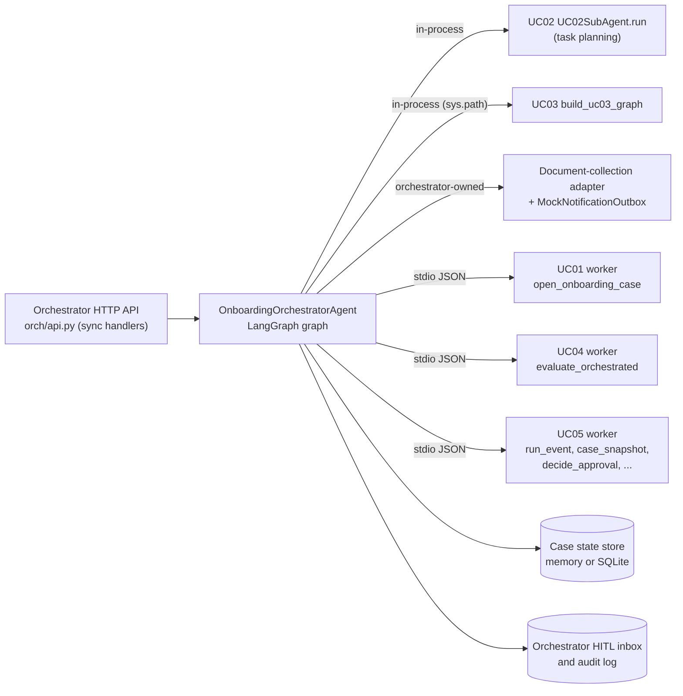

# Local Testing Gap Analysis: HR Onboarding Orchestration Agent

> **Historical analysis (2026-10-30), superseded in part.** Where it says the real-agent demo's "three
> parallel branches fail at once" or that "three branches start" after verification, it describes the
> graph of that date. `plan_tasks` (UC02) now runs on its own and must complete first; with the real
> UC02 still unimportable it fails alone and UC04/UC05 never start. Current design:
> [ORCHESTRATION_WORKFLOW.md](ORCHESTRATION_WORKFLOW.md); changes:
> [ORCHESTRATION_REMAINING_FIXES_COMPLETION_REPORT.md](../HR-Onboarding-Common/docs/ORCHESTRATION_REMAINING_FIXES_COMPLETION_REPORT.md).

| | |
|---|---|
| Date | 2026-10-30 |
| Branch / commit | `Prasanna` @ `ae4e326` |
| Scope | `HR-Onboarding-Common` orchestrator (v0.3.0) and the UC01–UC05 sub-agents |
| Method | Source tracing from the orchestrator entry points through every adapter, worker, UC entry point and connector; plus execution: all six test suites, the workflow demo in both modes, and five targeted probes (Appendix A) |
| Changes made | None. Probes ran against throwaway copies and environments outside the repository; `git status` is clean |

## How to read this document

**Evidence tags.** Every finding carries one:

| Tag | Meaning |
|---|---|
| **[RUN]** | Reproduced by executing code on 2026-10-30 (test suite, demo, or probe; see Appendix A) |
| **[CODE]** | Traced in source; not executed |
| **[REC]** | Recommendation or design observation; not a confirmed defect |

**Implementation status vocabulary.** *Implemented* (real business logic runs), *Simulated* (a mock connector with realistic behaviour), *Stand-in* (a test double that returns an adapter's output shape and skips the UC's business logic), *Placeholder* (a class or method exists but does nothing useful), *Missing*.

**Path aliases.**

| Alias | Path |
|---|---|
| `orch/` | `HR-Onboarding-Common/src/hr_onboarding_common/orchestration/` |
| `ctests/` | `HR-Onboarding-Common/tests/orchestration/` |
| `otm/` | `UC02_Onboarding_Task_Agent/src/onboarding_task_management/` |
| `UC01/` … `UC05/` | The UC project folders (`UC01_Employee_Record_Creation/`, `UC02_Onboarding_Task_Agent/`, `UC03_Document_Validation/`, `UC04_Equipment_Access_Integration_Ready/`, `UC05_Orientation-Schedule-Agent/`) |

**Gap IDs.** `ENV-` environment, `ORC-` orchestrator, `UC0n-` use case, `MOCK-` mock to build, `TEST-` test work, `INF-` infrastructure, `DOC-` documentation. Each ID is defined once (sections 3–8) and scheduled once (section 9).

---

## 1. Executive Summary

### 1.1 Current implementation status

- **The orchestration engine is substantially implemented and well tested.** The LangGraph state machine, routing, parallel fan-out and fan-in, waits, the orchestrator's own HITL gates, retry budget, write-ahead idempotency, tenant scoping, audit, SQLite persistence and the HTTP API all work. All 284 `HR-Onboarding-Common` tests pass with real UC01/UC04/UC05 worker processes, and none are skipped. **[RUN]**
- **No real external API is called anywhere on the orchestrated path.** Every integration is a mock or stub, and no credentials are needed. The one exception is UC03, which calls real LLM providers if their SDKs are installed and an API key is set; neither is the case in the orchestrator's environment (UC03-01). **[RUN] [CODE]**
- **Each UC except UC02 passes its own suite standalone.** UC01: 690, UC03: 200, UC04: 470, UC05: 533. UC02 fails at collection on a one-line syntax error; on a patched copy outside the repository, 670 pass and 8 skip. **[RUN]**
- **The integrated workflow with the real agents cannot reach day-1 readiness.** `run_workflow_demo.py --real` gets through UC01, document collection and UC03 validation. Then all three parallel branches fail at once: UC02 `UC02_PACKAGE_UNIMPORTABLE`, UC04 `INVALID_INPUT`, UC05 `IDENTITY_MISMATCH`. **[RUN]**
- **The existing end-to-end "success" runs use stand-ins.** Both the default demo and the graph tests reach `COMPLETE` with stand-ins for UC01, UC02 planning and UC04 (and for UC03/UC05 in some suites). Those stand-ins return the adapter's output shape and bypass each UC's business logic (section 2.5).

### 1.2 Overall local testing readiness

**Partially testable locally.** The orchestration engine is fully testable today. UC01, UC03 and UC05 are testable through the orchestrator for their main paths. UC02 planning and UC04 cannot be exercised through the orchestrator at all. No single synthetic tenant or employee is known to all five UCs, so an all-real end-to-end case is impossible without new test data (section 11).

### 1.3 Major blockers

| # | Blocker | Evidence | Gap |
|---|---|---|---|
| 1 | UC02 is unimportable: a stray `UC` precedes the docstring at `otm/agent/advisor.py:1` | [RUN] | UC02-01 |
| 2 | Fixing #1 is not enough. The orchestrator's UC02 adapter has three more contract defects: `approved_by_role="HR_OPS"` fails UC02's lowercase enum; offer and form timestamps are always `None`; `llm_behaviour="offline"` is not an accepted fake-LLM behaviour | [RUN] | UC02-02, -03, -04 |
| 3 | No tenant is shared by the UCs. UC02 knows `CLIENT-ALPHA/BETA/EMPTY`; UC04 knows `client_alpha/client_bravo`; UC05 knows `CLIENT-TEST-A/B`; UC01 mints `EMP-000001`, while UC05's directory holds `EMP-TEST-*` | [RUN] | ORC-06, UC02-05, UC05-01 |
| 4 | UC04 rejects every orchestrator call. It needs `SYN-CASE-nnn`/`SYN-EMP-nnn` IDs, a lowercase `snake_case` tenant, and a `SYN-USER-nnn` actor. It also requires the caller to hold `hr_onboarding_officer`, `hiring_manager` or `onboarding_orchestrator`; the cases are started by `hr_admin` | [RUN] | UC04-01, -02 |
| 5 | Even with valid IDs, UC04 returns `NEEDS_HUMAN_REVIEW / NO_ITEMS_REQUESTED`: the orchestrator never sends requested equipment or access. UC04 approvals cannot be relayed, and IT tickets are never raised | [RUN] [CODE] | UC04-03, -05, -06 |
| 6 | Data loss: starting a second case for the same person under a different offer reference overwrites the first case's orchestrator state (submitted documents, correlation ID, stage progress) | [RUN] | ORC-01 |
| 7 | All five UC project `.venv` folders were created on another machine and do not start, so the README's per-UC `uv run pytest` commands fail until environments are rebuilt | [RUN] | ENV-01 |

### 1.4 What does not need to change

These parts already meet the requirements; the roadmap should build on them rather than replace them:

- **The connector layout already matches the requested pattern.** Each UC owns `connectors/<system>/base.py` (the port) plus `mock.py`. UC05's mocks (calendar, notifier, email, directory, Teams) are high fidelity: outage, lost response, permanent refusal, idempotency on/off, conflicts and partial invite failures. Centralising mocks into one file or into `HR-Onboarding-Common` is **not** recommended (section 6.1).
- **The orchestrator's design rules hold.** It never decides UC-owned business rules, never fabricates a success, treats unknown outcomes as `UNCERTAIN` (never retried blindly), and records the data handed to each stage. Keep them.
- **SQLite is already available where it matters**: the orchestrator's case store, checkpoints and HITL inbox (`persist_dir`), and UC05 (`UC05_WORKER_DATA_DIR`). No further SQLite is needed (section 8.2).

---

## 2. Existing Architecture Overview

### 2.1 Orchestration architecture

`OnboardingOrchestratorAgent` (`orch/orchestrator_agent.py:348`) is a `BaseAgent` whose LangGraph graph is built in `build_graph()` (`:533-589`). The topology is hard-coded and matches the documented diagram in `HR-Onboarding-Common/docs/STATE_DRIVEN_ONBOARDING_WORKFLOW.md` §1. **[CODE]**

```
intake (UC01) -> intake_mismatch_proposal -> document_collection (orchestrator adapter "UC02 op A")
  -> document_submission (wait) -> validate_documents (UC03)
  -> dispatch_branches -> { plan_tasks (UC02 op B) | equipment_access (UC04) |
                            orientation_scheduling -> buddy_assignment -> team_introduction (UC05) }
  -> merge_outcomes -> evaluate_overall_status -> day_one_readiness -> day_one_signoff_proposal
  -> joining_day_welcome (UC05) -> complete
every await_* node ends the run; a later API call re-invokes the graph from the case store
```

Process topology:



UC01, UC04 and UC05 each ship a top-level module named `sub_agent`, so they run in separate worker processes under their own interpreters (`orch/workers/uc_worker_runtime.py`, `orch/workers/uc_worker_client.py`). Each worker is one persistent process with a per-UC lock and a startup identity check. UC02 and UC03 run inside the orchestrator process.

### 2.2 Individual use-case architecture

| UC | Package | Entry point the orchestrator calls | Where it runs | Adapter | Standalone suite (2026-10-30) |
|---|---|---|---|---|---|
| UC01 | `uc01-employee-record` (`sub_agent`) | `open_onboarding_case` (`UC01/src/sub_agent/onboarding_entry.py:70`) | Worker | `orch/adapters/uc01_intake.py` | 690 passed **[RUN]** |
| UC02 op A | none (not a UC02 operation) | Orchestrator-owned adapter; reads UC03's checklist and sends via a mock | Orchestrator | `orch/adapters/uc02_document_collection.py` | n/a |
| UC02 op B | `onboarding-task-management` | `UC02SubAgent.run` (`otm/sub_agent/adapter.py:193`) | In-process | `orch/adapters/uc02_tasks.py` | Collection error; patched copy: 670 passed, 8 skipped **[RUN]** |
| UC03 | `dact` (top-level `src`) | `build_uc03_graph(...).ainvoke` per document revision | In-process | `orch/adapters/uc03_documents.py` | 200 passed **[RUN]** |
| UC04 | `dact-uc04-equipment-access` (`sub_agent`) | `Uc04Agent.evaluate_orchestrated` | Worker | `orch/adapters/uc04_equipment_access.py` | 470 passed **[RUN]** |
| UC05 | `hr-onboarding-agent` (`sub_agent`) | `OnboardingAgent.run_event` plus nine other worker ops | Worker | `orch/adapters/uc05_orientation.py` | 533 passed **[RUN]** |

### 2.3 Connector architecture

| UC | Ports (`base.py`) | Mocks (`mock.py` or equivalent) | Reachable from the orchestrated flow |
|---|---|---|---|
| UC01 | `connectors/outlook` (read-only mailbox); `src/sub_agent/ports.py` (repositories, `HrisGateway`, `PersonDirectory`, `DocumentStore`, …) | `MockOutlookConnector`; `src/sub_agent/adapters/memory.py` (in-memory repositories, `StubHrisGateway`) | Repositories yes; mailbox and HRIS no |
| UC02 | `sub_agent/connectors/outlook` (approval-gated send); `providers.py` (config, calendar, repository, notifications, UC06 handoff) | `MockOutlookConnector`; in-memory and JSON providers | Planning only (the reminder path is not invoked) |
| UC03 | `connectors/outlook` (async ABC); `mcp/*` clients; `DocumentExtractor` protocol | `MockOutlookConnector` (always succeeds); mock-mode MCP clients; `MockDocumentExtractor` | Validation only; Outlook, MCP and extractor are not called |
| UC04 | `src/sub_agent/ports.py` (`ITServiceDeskPort`, `CaseContextPort`); `connectors/outlook` | `adapters/it_service_desk_mock.py`, `case_context_mock.py`, `approval_mock.py`; Outlook mock | Evaluate only; ticket submission and approvals no |
| UC05 | `connectors/{calendar,email,employee_directory,notifications,teams}/base.py` | `mock.py` in each folder, high fidelity | All except the Teams and email-sender channel mocks |
| Common | `orch/notifications.py` (`NotificationPort`) | `MockNotificationOutbox` | Yes (document request) |
| Common | `src/hr_onboarding_common/Connectors/{calendar,email,employee_directory}` | `fake.py`, `mock.py` | **Not importable**: imports a nonexistent `onboarding_agent` package (INF-01) **[RUN]** |

### 2.4 State management

- **Channel schema:** `OnboardingCaseState` TypedDict (`orch/state.py:205`). Its typed contract is `WorkflowStateModel` (`orch/workflow_models.py`), validated on every write-through by `_persist` (`orch/orchestrator_agent.py:652`).
- **Authoritative resume point:** the case store (`InMemoryCaseStateStore` or `SqliteCaseStateStore`, `orch/case_store.py`), written after every stage. LangGraph checkpoints (`MemorySaver` or `SqliteSaver`) are written, but resume never reads them (`orch/deps.py:24-29`). Waits end the run instead of using `interrupt()`.
- **Parallel safety:** branches write only to their own key of `branch_outcomes` (reducer `merge_branch_outcomes`, `orch/state.py:163`) and persist their steps under a per-case store lock (`_persist_branch`, `:663`). `merge_outcomes` folds them in.
- **Intake-only personal data** (ID number, email, form) is held in process memory only (`deps.intake_inputs`), never in checkpoints. A restart before intake completes gives `INTAKE_INPUT_UNAVAILABLE` (tested).
- **UC business data** stays in each UC: UC01, UC03 and UC04 in memory; UC05 in memory or SQLite.

### 2.5 Mock and fake architecture: three layers

| Layer | What it is | Where | Business logic exercised? |
|---|---|---|---|
| 1. UC connector mocks | Simulated external systems behind each UC's ports | Each UC's `connectors/*/mock.py`, `adapters/*mock*.py`, `fakes.py` | **Yes**: the UC's own rules run against simulated providers |
| 2. Orchestrator-owned mocks | `MockNotificationOutbox` for the document request; `FakeLLM` in `bootstrap.build_deps` | `orch/notifications.py`, `orch/bootstrap.py:52` | Yes, for orchestrator behaviour |
| 3. Stage stand-ins | Overrides through `OrchestratorDeps.stage_adapters`, or fake workers returning a UC's output shape: `FakeUc01Worker`, `FakeUc04Worker` (`ctests/_lifecycle.py:86,106`), `PlanDouble` and `Uc03Double` (`ctests/_workflow.py`), `FakeUc05Worker` (`ctests/_uc05_fakes.py`), demo stand-ins (`HR-Onboarding-Common/scripts/run_workflow_demo.py:65-127`) | Tests and demo only | **No**: the UC is skipped entirely |

Layer 3 is what lets today's end-to-end runs complete. It validates the orchestrator, not the integration. For example, `FakeUc01Worker` returns the UC05 seed employee ID, which hides the real UC01↔UC05 identity mismatch. `FakeUc04Worker` returns only `READY` or `AWAITING_APPROVAL`, which hides every UC04 contract failure.

### 2.6 Documentation and code discrepancies

Source code is treated as the truth (**DOC-01**).

| Document says | Code shows | Evidence |
|---|---|---|
| README *Known issues*: deleting the two characters in `advisor.py` fixes UC02 planning | Three further adapter defects plus missing tenant configuration still block planning (UC02-02 to -05) | [RUN] |
| README: UC04's `SYN-` IDs are the only UC04 issue; "an ID translation layer is needed" | The tenant ID format, actor ID format, caller role, empty request lists and idempotency key reuse also fail (UC04-01 to -04) | [RUN] |
| README / STATE doc: "No test calls a live LLM" | True in the orchestrator's environment. UC03's own environment ships `anthropic` and `google-genai` and calls them whenever a key is set (UC03-01) | [CODE] |
| `HR-Onboarding-Common/guardrails/policy.yaml` `tools.read` lists `uc01.get_status`, `uc02.get_checklist`, `uc03.get_case_status`, `uc04.get_case_status`, `uc05.get_workflow_status` | None of these operations exists in any adapter or worker | [CODE] |
| `HR-Onboarding-Common/pyproject.toml:33` refers to `orchestration/settings.py` | No such file; the UC03 root comes from `build_deps(uc03_repo_root=...)` | [CODE] |
| `HR-Onboarding-Common/README.md:11` refers to `../HR-Onboarding-Agent/docs/ONBOARDING_COMMON_ARCHITECTURE.md` | The document lives at `HR-Onboarding-Common/docs/ONBOARDING_COMMON_ARCHITECTURE.md` | [CODE] |
| UC04 adapter docstring: the real HR officer's role satisfies UC04's allowlist | True for `hr_onboarding_officer`. The tests, demo and API examples start cases as `hr_admin`, which UC04 denies | [RUN] |
| `HR_ONBOARDING_ORCHESTRATION_AGENT_ANALYSIS.md` | Predates the HTTP API and parallel workflow (the README already says so) | — |

---

## 3. Use-Case-Wise Gap Analysis

### 3.0 Cross-cutting capability matrix (as orchestrated)

✅ testable locally today · ◐ partially (stand-ins only, or part of the behaviour) · ✗ not testable · n/a not applicable. Gap IDs explain each non-✅ cell.

| Capability | Orchestrator | UC01 | UC02 | UC03 | UC04 | UC05 |
|---|---|---|---|---|---|---|
| Input validation | ✅ pydantic, `extra=forbid` | ✅ | ✗ UC02-02/03 | ✅ | ✗ UC04-01 | ✅ preflight |
| Output validation | ✅ `validate_workflow_state` | ◐ dict access | ◐ dict access | ✅ enum-classified | ◐ UC04-07 | ✅ boundary models |
| Agent invocation | ✅ | ✅ worker | ✗ UC02-01 | ✅ in-process | ✗ UC04-01/02 | ✅ worker |
| Agent-to-agent data handoff | ◐ ORC-05 | ◐ ORC-06 | ✗ | ◐ UC03-02 | ✗ ORC-05 | ◐ UC05-01 |
| State management | ✅ | ✅ | ✅ | ✅ | ✅ | ✅ |
| LangGraph state transitions | ✅ | n/a | n/a | ✅ (UC03 graph) | n/a | ✅ (UC05 graph) |
| Conditional routing | ✅ | n/a | n/a | ✅ (UC03 graph) | n/a | ✅ (UC05 graph) |
| Checkpointing and persistence | ✅ SQLite | ◐ memory, UC01-06 | ◐ memory | ◐ UC03-04 | ◐ memory | ✅ SQLite |
| Retry and error handling | ✅ | ◐ ORC-07 | ✗ ORC-07 | ✅ | ✗ UC04-04 | ✅ |
| Timeout handling | ✅ worker timeout → `UNCERTAIN` | ✅ | ◐ ORC-13 | ◐ ORC-13 | ✅ | ✅ |
| Idempotency | ✅ | ✅ | ✅ | ✅ per revision | ✗ UC04-04 | ✅ ledger |
| Duplicate prevention | ◐ ORC-01 | ◐ ORC-01 | ✅ | ✅ | ✅ | ✅ |
| HITL approvals | ◐ ORC-02 | ✗ ORC-03 | ✗ UC02-07 | ✅ HR review | ✗ UC04-06 | ✅ |
| Approval/rejection workflows | ◐ ORC-02 | ✗ | ✗ | ✅ | ✗ | ✅ |
| Tenant isolation | ✅ | ✅ (orchestrator boundary) | ✅ | ✅ | ◐ ORC-10 | ✅ |
| RBAC / authorization | ✅ | ✅ (orchestrator boundary) | ✅ (orchestrator boundary) | ✅ `authorized_actor_ids` | ✗ UC04-02, ORC-12 | ✅ |
| Audit logging | ✅ with correlation ID | ✅ UC-local | ✅ UC-local | ✅ UC-local | ✅ UC-local | ✅ UC-local |
| Failure recovery | ✅ resume, `retry_stage`, reconcile | ◐ | ✗ UC02-04 | ✅ | ✗ UC04-04 | ✅ `resolve_operation`, `retry_apply` |
| Workflow completion status | ✅ `derive_workflow_status` | ✅ | ✗ UC02-01 | ✅ | ◐ UC04-07 | ✅ |

### 3.1 UC01: Employee Record Creation

**A. Existing implementation.**
- **Responsibility:** a start gate (offer accepted, approved form, no hiring freeze), duplicate/rehire/transfer detection, case and employee-number creation, discrepancy flagging, form changes, and HRIS record prepare → approve → write.
- **Orchestrated path:** stage `intake` → `orch/adapters/uc01_intake.py` → worker op `open_onboarding_case` (`orch/workers/uc_worker_runtime.py:92-120`) → `UC01/src/sub_agent/onboarding_entry.py:70`.
- **Inputs sent:** `request_id` (derived from the idempotency key), `client_id`, `hr_officer_id`, `offer_accepted`, `form` (built by the orchestrator, `orch/orchestrator_agent.py:611-623`), `hiring_freeze` (always `False`), `id_number`.
- **Outputs used:** `outcome`; `case.case_id` (renames the orchestrator case); `case.employee_no` (becomes `employee_id`); `case.joining_date`; `approvals_created` (surfaced only).
- **Dependencies:** in-memory repositories (`UC01/src/sub_agent/adapters/memory.py`), `StubHrisGateway`, `MockOutlookConnector`, `FakeLlm` (off by default).
- **Independently executable:** yes, 690 tests pass. **[RUN]**
- **Through the orchestrator:** case opening works (demo `--real` step 1; `ctests/test_orchestrator_e2e.py`). **[RUN]** The rest of UC01's five-step flow (`UC01/src/sub_agent/agent.py:1-22`) is unreachable.

**B. External dependencies:** HRIS (write), the offer-acceptance mailbox (Outlook/Graph), and an HRMS person history. See section 4.

**C. Missing local implementations:** MOCK-03 (worker seeding hooks), MOCK-08 (acceptance-email bridge). See section 6.

**D. Gaps.**

| Component | Current implementation | Missing implementation | External dependency | Local mock required | Priority |
|---|---|---|---|---|---|
| Start gate and case opening | Implemented; real through the worker | — | — | — | — |
| Duplicate open-case handling | Implemented in UC01 (`duplicate_check.py:41`) | The orchestrator treats `LINKED_EXISTING` as `COMPLETE`, takes the existing case ID, and overwrites that case's state; `employee_no` is lost (ORC-01) | — | — | P1 |
| HRIS prepare → approve → write | Implemented with `StubHrisGateway` (`fail_next`, idempotent; `memory.py:364`) | The worker exposes only `open_onboarding_case`. No orchestrated case ever gets an HRIS record **(UC01-01)** [CODE] | HRIS | Stub exists; needs worker ops and a stage | P1 |
| Discrepancy comparison, form changes, variant decisions | Implemented (`CaseService.compare_sources`, `propose_form_change`, `decide_variant`; `service.py:155-243`) | Not exposed by the worker (UC01-01) | — | — | P1 |
| Onboarding-form approval | UC01 requires `status=APPROVED` | The orchestrator builds an `APPROVED` form from the start request, with the case starter as approver **(UC01-02)** [CODE] | HR form system | Optional form-approval fake | P2 |
| Rehire / internal transfer (HC_12) | Implemented in UC01 | The worker's `PersonDirectory` starts empty with no seeding op, and HC_12 approvals cannot be decided (ORC-03) **(UC01-03)** [CODE] | HRMS person history | MOCK-03 | P2 |
| Hiring-freeze pause | Implemented in UC01 | `OnboardingCaseInput` has no field; the adapter always sends `False` (`uc01_intake.py:52`); `declared_variants` is never sent **(UC01-04)** [CODE] | Client policy | — | P2 |
| Acceptance-email intake | `handle_acceptance_email` and `MockOutlookConnector` exist and are unit-tested | Nothing polls the mailbox; `raw_acceptance_email` is accepted by the orchestrator and ignored **(UC01-05)** [CODE] | Outlook/Graph | MOCK-08 | P2 |
| Error classification | The worker classifies failures (`RETRYABLE_PROVIDER_ERROR`, …) | The adapter maps every `ok=False` to `FAILED` (`uc01_intake.py:66-70`) (ORC-07) | — | — | P2 |
| Persistence | In memory per worker | Lost on worker restart; the orchestrator handles it as `UNCERTAIN` (tested) **(UC01-06)** | DB | Not needed | P3 |

### 3.2 UC02: Onboarding Task Agent

**A. Existing implementation.**
- **Responsibility:** a task checklist from per-client configuration, with owners, due dates, dependencies, re-planning gates (date, location, project change, cancellation, joining confirmation), risk, and reminder drafts.
- **Orchestrated paths:**
  - Op A, document collection: the orchestrator's own adapter. UC02 has no such operation (documented).
  - Op B, `plan_tasks`: `orch/adapters/uc02_tasks.py` → `UC02SubAgent().run(WorkflowRequest(...))` in-process.
- **Trigger contract** (`otm/sub_agent/service.py:86`): `client_id`, `employee_id`, `joining_date`, `role_id`, `department`, `manager_id`, `location`, `project`, `grade`, `nationality_group`, `attributes`, `offer{accepted, accepted_at}`, `form{approved, approved_by_role, approved_at}`.
- **Dependencies:** `OnboardingService(build_registry())` (`otm/synthetic.py:485`), in-memory repository, built-in holiday calendar, fake LLM advisor, `MockOutlookConnector`.
- **Independently executable:** no; the package fails to import. After the one-line fix, yes (670/678 pass on a patched copy). **[RUN]**
- **Through the orchestrator:** no. Five stacked defects (UC02-01 to -05), found by the probe in Appendix A.2. **[RUN]**

**B. External dependencies:** client configuration store, holiday calendar, Outlook (reminders, gated), optional Supabase/Postgres (`UC02/supabase/migrations`, `persistence.py`; one live-DB test is skipped by default).

**C. Missing local implementations:** MOCK-01 (tenant pack), MOCK-10 (clock).

**D. Gaps.**

| Component | Current implementation | Missing implementation | External dependency | Local mock required | Priority |
|---|---|---|---|---|---|
| Package import | `otm/agent/advisor.py:1` starts `UC"""…`, a `SyntaxError` **(UC02-01)** [RUN] | Remove `UC`. Then reinstall into the orchestrator venv, which holds a non-editable snapshot (ENV-03) | — | — | P0 |
| Trigger: form approver role | Adapter default `"HR_OPS"` (`uc02_tasks.py:85`) | UC02's enum is lowercase (`hr_ops`), so pydantic rejects it **(UC02-02)** [RUN] | — | — | P0 |
| Trigger: offer and form timestamps | Read from `uc02_role_context["offer_accepted_at"/"form_approved_at"]` (`:78,:86`), which is never populated | `PreconditionError: offer acceptance has no timestamp` (`otm/sub_agent/service.py:143`) **(UC02-03)** [RUN] | Offer and form systems | — | P0 |
| Fake LLM behaviour | `llm_behaviour="offline"` (`uc02_tasks.py:99`) | `make_fake_llm` accepts only `scripted/error/invalid/hallucinate` (`otm/sub_agent/fakes.py:59`). It raises *after* the onboarding record is created (`adapter.py:212`), so every resume fails the same way **(UC02-04)** [RUN] | — | — | P0 |
| Tenant configuration | Registry: `CLIENT-ALPHA`, `CLIENT-BETA`, `CLIENT-EMPTY` | `CLIENT-TEST-A` (the orchestrator and UC05 test tenant) raises `MissingConfigurationError` **(UC02-05)** [RUN] | Client config store | MOCK-01 | P0 |
| Evaluation date | `as_of = joining_date` (`uc02_tasks.py:96`) | Everything is judged as of the joining day: 8 of 10 tasks overdue in the probe, 0 with a realistic date **(UC02-06)** [RUN] | — | MOCK-10 | P1 |
| Re-plan, cancellation, joining-confirmation gates | Implemented in UC02 | Unreachable. Proposals are surfaced with `reference = proposal["action"]` (not an ID) and cannot be decided (ORC-03) **(UC02-07)** [CODE] | — | — | P1 |
| Checklist dimensions (BR-02, BR-07/08) | `grade`, `nationality_group`, `attributes` supported | Never sent, so visa, travel and accommodation tasks never appear **(UC02-08)** [CODE] | HR data | — | P2 |
| Document collection (op A) | Orchestrator adapter with `MockNotificationOutbox` | UC02 has no operation; no second collection round (`r2`) for corrections; reminders are never prepared (`prepare_reminders=False`) **(UC02-09)** [CODE] | Email/Teams | Exists | P2 |
| Error classification | Every exception → `BLOCKED` with `MISSING_DATA` (`uc02_tasks.py:101-106`) | Technical errors are reported as data errors, and `retry_stage` refuses them (ORC-07) | — | — | P2 |
| Holiday calendar and tests | Built-in UAE list always `approved=False`, so every plan carries `calendar_unapproved`; 7 tests skip without the external `hr_recruitment_common` package **(UC02-10)** [RUN] | Approved calendar fixture | Holiday source | `JsonCalendarProvider` exists | P3 |

### 3.3 UC03: Document Validation

**A. Existing implementation.**
- **Responsibility:** per-document type, completeness, readability, expiry, name match, evidence and attestation checks. Doubtful documents go to HR review; reminders and replacement requests are drafted.
- **Orchestrated path:** `validate_documents` → `orch/adapters/uc03_documents.py` → UC03's LangGraph (`UC03/src/sub_agent/workflow.py:111`), once per *document revision*. An unchanged revision reuses its earlier result. UC03 never returns `ACCEPTED`; verification requires the caller to supply `hr_review_status=APPROVED`, which the orchestrator relays from an authenticated reviewer.
- **Inputs:** `DocumentValidationRequest` built from submitted references plus caller-supplied extraction metadata. Contents never enter the system.
- **Outputs:** projected statuses, findings and the required next action, classified from enums.
- **Independently executable:** yes with a working environment (200 pass). No working environment exists on this machine today (ENV-01). **[RUN]**
- **Through the orchestrator:** yes (demo `--real` steps 2–4; real-UC03 tests in `ctests/test_state_driven_workflow.py`). **[RUN]**

**B. External dependencies:** Gemini and Anthropic (real calls, gated by environment variables), OCR (`pymupdf`), and Graph/HRIS/ITSD/DMS through unwired MCP scaffolding. Azure OpenAI, AI Search and Key Vault are declared in `pyproject.toml` and `src/config.py` but not used in `src/`. **[CODE]**

**C. Missing local implementations:** MOCK-06 (LLM seam and fakes), MOCK-07 (document intake).

**D. Gaps.**

| Component | Current implementation | Missing implementation | External dependency | Local mock required | Priority |
|---|---|---|---|---|---|
| Rules and validation graph | Implemented; real | — | — | — | — |
| Name-consistency check | Exact match is local. A variation calls Gemini, then Anthropic, if `GEMINI_API_KEY` or `ANTHROPIC_API_KEY` is set (`name_agent.py:90-115`); otherwise `NAME_MISMATCH` → HR | No injectable LLM port or fake. Form and document names go to external providers whenever a key and SDK are present. A deterministic "variation is consistent" outcome cannot be tested **(UC03-01)** [CODE] | Gemini, Anthropic | MOCK-06 | P1 |
| Communication drafts | Anthropic if `ANTHROPIC_API_KEY` is set (`comms.py:43`, sends the employee's name), otherwise a template | Same as UC03-01 | Anthropic | MOCK-06 | P1 |
| Checklist applicability | `UC03/knowledge/checklists/default.yaml` with `applies_to` rules (`loader.py:38`) | The context comes from `uc02_role_context` (`uc03_documents.py:97-100`): `location="Dubai"` never matches `location:UAE` (`default.yaml:29`), so `emirates_id` is never required. `sponsorship` and `visa_required` are never supplied, so family and visa documents never apply. `grade` and `nationality` are always empty **(UC03-02)** [RUN] | — | — | P1 |
| Extraction | Mock, local (OCR), LLM (Gemini) and hybrid extractors. The orchestrator passes `MockDocumentExtractor` (`uc03_documents.py:88`), but the validator only stores it (`validator.py:52`) and never calls it | No document-intake step: the caller must supply `readable`, `expiry_date`, `extracted_name`, etc. **(UC03-03)** [CODE] | OCR/LLM, document store | MOCK-07 | P2 |
| UC03 state inside the orchestrator | `InMemoryCaseStore` and `InMemoryAuditStore`, cached on `deps` | Lost on restart. An HR approval sent after a restart, for a revision UC03 validated before it, is untested **(UC03-04)** [CODE] | — | — | P2 |
| Scaffolding | `SubAgent.run` raises `NotImplementedError` and `FakeSubAgent` is unused (`agent.py:14-24`, `fakes.py`); `mcp/*` clients are mock-only with `_real_call` unimplemented (`mcp/base.py:40`); `MockOutlookConnector.send_email` always returns `True` and is unused (`connectors/outlook/mock.py:13`) | Placeholders: remove or document **(UC03-05)** [CODE] | Graph, HRIS, ITSD | — | P3 |
| Packaging | The adapter inserts UC03's root on `sys.path` and imports `src.*` internals (`uc03_documents.py:69-94`) | Fragile coupling to a generic top-level `src` package **(UC03-06)** [CODE] | — | — | P3 |

### 3.4 UC04: Equipment and Access Integration Readiness

**A. Existing implementation.**
- **Responsibility:** check equipment and system-access requests against approved role and client matrices; track approvals, mock IT tickets, delivery and provisioning; report readiness.
- **Orchestrated path:** `equipment_access` → `orch/adapters/uc04_equipment_access.py` → worker op `evaluate_orchestrated` (`orch/workers/uc_worker_runtime.py:123-157`) → `Uc04Service.evaluate` (`UC04/src/sub_agent/service.py:76`).
- **Inputs:** `Uc04Input` (`UC04/src/sub_agent/contracts.py:152-177`), including caller-supplied request lists, approval records, ticket, delivery and provisioning status, `config`, and `as_of_date`.
- **Outputs:** `overall_status` (`BLOCKED`, `NEEDS_HUMAN_REVIEW`, `AWAITING_APPROVAL`, `IN_PROGRESS`, `AT_RISK`, `READY`, `CANCELLED`), items, blockers, proposals.
- **Independently executable:** yes (470 pass), but the worker environment has no pytest and the UC's own `.venv` is broken (ENV-01, ENV-02). **[RUN]**
- **Through the orchestrator:** no. Every layer fails in turn (probe, Appendix A.3). **[RUN]**

**B. External dependencies:** IT service desk, parent case registry, approval routing (Teams approvals or Logic Apps per the Enterprise HR Agent proposal), Outlook for readiness notices.

**C. Missing local implementations:** MOCK-04 (fulfilment simulator), MOCK-05 (approval relay), MOCK-01 (tenant pack and ID map).

**D. Gaps.**

| Component | Current implementation | Missing implementation | External dependency | Local mock required | Priority |
|---|---|---|---|---|---|
| Identifiers | Patterns `^SYN-CASE-\d{3,}$`, `^SYN-EMP-\d{3,}$`, tenant `^[a-z][a-z0-9_]{1,40}$`, actor `^SYN-USER-\d{3,}$` (`contracts.py:14-20,153-155,192`) | The orchestrator sends UC01's case UUID, `EMP-000001`, `CLIENT-TEST-A` and `user:hr-admin-01`, all of which are rejected **(UC04-01)** [RUN] | — | ID map (MOCK-01) | P0 |
| Caller role | `allowed_caller_roles`: `hr_onboarding_officer`, `hiring_manager`, `onboarding_orchestrator` (`UC04/policy/uc04_policy.json:9`) | Branch calls use the case actor's roles; `hr_admin` gets `POLICY_DENIED` **(UC04-02)** [RUN] (see ORC-12) | — | — | P0 |
| Requested items | The contract requires the caller to list `requested_access` and `requested_equipment` | The orchestrator always sends `[]` (`uc04_equipment_access.py:55-56`), giving `NEEDS_HUMAN_REVIEW / NO_ITEMS_REQUESTED` **(UC04-03)** [RUN] | HR request intake | — | P0 |
| Idempotency | UC04 caches by key and raises `IdempotencyConflict` (a `RuntimeError`, `store.py:12`) when a key is reused with a different payload (`service.py:88-99`) | The key is fixed per case (`uc04_equipment_access.py:66`), while `as_of_date=date.today()` (`:58`) changes daily. A resume on a later day gets `INTERNAL_ERROR` → `FAILED`, and `retry_stage` hits the same conflict **(UC04-04)** [RUN] | — | MOCK-10 | P1 |
| Ticket submission and fulfilment | `submit_eligible` (`service.py:465`) with `MockITServiceDesk`; progress arrives via the `mock_it_ticket_updates`, `delivery_status` and `provisioning_status` inputs | The worker never calls `submit_eligible`, and nothing supplies progress, so UC04 cannot reach `READY` through the orchestrator **(UC04-05)** [CODE] | IT service desk, asset systems | MOCK-04 | P1 |
| Approvals | `approval_records` input; `MockApprovalDesk` issues records in UC04's tests | Always `[]`; no relay op or route (ORC-03) **(UC04-06)** [CODE] | Approval routing | MOCK-05 | P1 |
| Status mapping | `_READY_STATUSES = {"READY", "IN_PROGRESS"}` → `COMPLETE` (`uc04_equipment_access.py:34,106-111`) | `IN_PROGRESS` means "not every item has completion evidence yet" (`readiness.py:26`), yet day-1 sign-off can be raised. The `AT_RISK` branch at `:107` is dead code, so `AT_RISK` becomes `BLOCKED`. `NEEDS_HUMAN_REVIEW` → `BLOCKED` with no resolution path **(UC04-07)** [CODE] | — | — | P1 |
| Client configuration | `uc04_client_config_ref`: a caller-supplied file path (ORC-10) | Should resolve from tenant configuration | — | — | P2 |
| Mock fidelity | IT desk: `fail_with` is permanent until cleared; no transient count or timeout. Outlook mock raises a bare `RuntimeError` (classified `INTERNAL_ERROR`) | Transient, timeout and lost-response modes **(UC04-08)** [CODE] | — | Extend the mocks | P2 |
| Worker case registration | Writes the private `self._agent._cases._cases` (`uc_worker_runtime.py:137`) | Use a public seam **(UC04-09)** [CODE] | — | — | P3 |
| MCP server | `UC04/mcp/` scaffolding, not wired (README) **(UC04-10)** | — | ITSD | — | P3 |

### 3.5 UC05: Orientation Scheduling Agent

**A. Existing implementation.**
- **Responsibility:** induction (orientation) scheduling as a tentative hold, then HR approval and confirmation with invites; buddy proposal and HR approval; team introduction approved by the specific team lead; optional buddy introduction; RSVPs and attendance decisions; joining-day welcome draft, approval and ledgered delivery; HR policy Q&A.
- **Orchestrated path:** four stages plus the optional buddy-introduction refresh → `orch/adapters/uc05_orientation.py` (read-before-write snapshots, pydantic boundary contracts) → ten worker ops (`uc_worker_runtime.py:160-556`), including test-only `__test_hooks__` gated by `HR_ORCH_WORKER_TEST_HOOKS=1`.
- **Independently executable:** yes (533 pass). **[RUN]**
- **Through the orchestrator:** yes with a UC01 stand-in (`ctests/test_uc05_lifecycle.py::test_successful_onboarding_through_every_stage`). With the real UC01: `IDENTITY_MISMATCH` (UC01 `EMP-000001` vs UC05 `EMP-TEST-001`). **[RUN]**

**B. External dependencies:** offer-acceptance mailbox, HRMS directory, calendar (M365/Google), notifications, Teams, email. See section 4.

**C. Missing local implementations:** MOCK-02 (seeding hooks), MOCK-09 (channel routing).

**D. Gaps.**

| Component | Current implementation | Missing implementation | External dependency | Local mock required | Priority |
|---|---|---|---|---|---|
| Lifecycle (induction → buddy → team intro → welcome) | Implemented; real through the worker; extensively tested | — | — | — | — |
| Canonical employee identity | Tenant identity scheme `shared`, `mapped` or `none` (`orch/tenant_config.py`) | `config/tenants.yaml` has no `mapped` entries, and UC01's numbers never match the UC05 directory **(UC05-01)** [RUN] | HRMS | MOCK-01 | P0 |
| Test data inside the worker | Fixed seed: events `EVT-001`, `EVT-002`, `EVT-010`, `EVT-MALFORMED`; employees `EMP-TEST-001/002/003/010` (`connectors/email/mock.py:58`, `employee_directory/mock.py:39`). Only `EVT-001` → `EMP-TEST-001` is a complete happy path | No hook adds an offer event or directory record, so there is one happy-path employee and no concurrent-case E2E **(UC05-02)** [CODE] | Mailbox, HRMS | MOCK-02 | P1 |
| Channel-specific delivery | `MockNotifier` for every channel (`src/sub_agent/fakes.py:423`) | `MockTeamsAdapter` and `MockEmailSender` exist and are unit-tested but not wired, so "Teams down, email up" cannot be simulated **(UC05-03)** [CODE] | Teams, email | MOCK-09 | P2 |
| Calendar | `MockCalendar`: conflicts, outage, lost response, idempotency toggle, partial invite failure, plus worker hooks | — | M365/Google | Exists | — |
| Persistence | SQLite repository, ledger, checkpoints and HITL with `UC05_WORKER_DATA_DIR` | — | — | — | — |
| Packaging | Path dependency `../hr-onboarding-common` (ENV-04) | — | — | — | P2 |

---

## 4. External Integration Dependency Matrix

No real adapter for any external system exists in the repository. "Real API available" therefore means *real client code exists*.

| Integration | Used by | Required operations | Where called | Real API available | Mock available (fidelity) | Blocks local execution? | Missing work |
|---|---|---|---|---|---|---|---|
| Offer-acceptance mailbox (Outlook/Graph) | UC01 | `fetch_unprocessed`, `acknowledge` | `UC01/connectors/outlook/base.py`; consumed by `intake/email_intake.py` | No | `MockOutlookConnector`: fixtures, `deliver`, one-shot `fail_next`, at-least-once | No (not on the orchestrated path) | MOCK-08 to make it a trigger |
| Offer-acceptance event source | UC05 | `get_event`, `is_processed`, `mark_processed` | `UC05/connectors/email/base.py`; worker `preflight_offer_event` | No | `MockEmailAdapter`: seeded events, `EVT-PROVIDER-OUTAGE`, malformed event | No | MOCK-02 (add events) |
| HRMS / employee directory (read) | UC05 | `get_employee(id, client_id)` | `UC05/connectors/employee_directory/base.py` | No | `MockEmployeeDirectory`: seeded, tenant-filtered, incomplete record | No | MOCK-02 (add records) |
| HRIS write | UC01 | `write`, `update` (idempotent) | `UC01/src/sub_agent/ports.py:144`; `hris_write.py` | No | `StubHrisGateway`: `fail_next(n)`, idempotent | No; never reached (UC01-01) | Worker ops and stage |
| Person history (rehire/transfer) | UC01 | `find_by_email`, `find_by_id_number`, `add` | `ports.py:21` | No | `InMemoryPersonDirectory`, empty in the worker | No | MOCK-03 |
| HRIS read (MCP) | UC03 | `get_employee`, `get_onboarding_form`, … | `UC03/mcp/hris/client.py` | No (`_real_call` raises) | Mock-mode client, unwired | No | None now (UC03-05) |
| Calendar / meetings | UC05 | `check_availability`, `book_event` (tentative, idempotency key), `confirm_event`, `cancel_event` | `UC05/connectors/calendar/base.py`; `services/scheduling.py` | No | `MockCalendar`: high fidelity, plus worker hooks | No | None |
| Calendar (UC04 notices) | UC04 | `create_event`, `cancel_event` | `UC04/connectors/outlook/mock.py` | No | `fail_on_create` (bare `RuntimeError`) | No | UC04-08 |
| Working-day / holiday calendars | UC02, UC04 | holidays, status; working-day arithmetic | `otm/providers.py:158-219`, `UC04/src/sub_agent/calendar.py` | No | Built-in list / JSON / config | No | Approved fixture (UC02-10) |
| Notifications (approver notices, buddy notices, welcome) | UC05 | `send(message)` with idempotency key | `UC05/connectors/notifications/base.py` | No | `MockNotifier`: `fail_next`, `lose_next_responses`, `reject_recipients`, idempotency toggle, plus hooks | No | — |
| Microsoft Teams messages | UC05 | `send` restricted to Teams | `UC05/connectors/teams/base.py` | No | `MockTeamsAdapter` (unwired) | No | MOCK-09 |
| Email (outbound) | UC05, UC02, UC03, UC04 | Send welcome or reminder | UC05 `MockEmailSender` (unwired); UC02 `MockOutlookConnector.send` (approval-gated, `fail_keys`, `fail_times`, idempotent); UC03 mock (always `True`); UC04 mock (`fail_on_send`) | No | Varies: UC02 and UC05 high, UC03 and UC04 low | No | UC04-08, UC03-05 |
| Document-request notification | Orchestrator | `send(NotificationMessage)` | `orch/notifications.py`; `uc02_document_collection.py:107` | No | `MockNotificationOutbox`: `fail_times`, `raise_times`, idempotency | No | — |
| IT service desk | UC04 | `submit_request` | `UC04/src/sub_agent/ports.py:33`; `service.submit_eligible` | No (MCP planned) | `MockITServiceDesk`: `fail_with`, idempotent per request | No; never reached (UC04-05) | MOCK-04 |
| Parent case registry | UC04 | `get_case`, `case_for_employee` | `ports.py:37` | No | `MockCaseContext` (the worker writes private state) | No | UC04-09 |
| Approval routing (Teams approvals / Logic Apps) | UC04 | Issue and decide approval records | `UC04/src/sub_agent/adapters/approval_mock.py` (tests and demo) | No | `MockApprovalDesk` | Yes, for UC04 completion | MOCK-05 |
| Document storage / DMS | UC01, UC03 | Create case folder; fetch documents | `UC01 InMemoryDocumentStore`; `UC03/mcp/documents/client.py` | No | In-memory; mock-mode client | No | — |
| Document extraction / OCR | UC03 | `extract(document_ref, type)` | `UC03/src/sub_agent/extraction.py`; UC03 upload API only | Local OCR (`pymupdf`) real; LLM extractor real (Gemini) | `MockDocumentExtractor` | No (the orchestrator takes metadata) | MOCK-07 |
| LLM providers | UC03 | Name judgement, drafts, extraction | `name_agent.py:90-115`, `comms.py:43`, `extraction.py:240` | **Yes**: real Gemini and Anthropic calls when the SDK and key are present | None | No; but a PII and real-call risk (UC03-01) | MOCK-06 |
| LLM (other UCs) | UC01, UC02, UC04, UC05, orchestrator | `structured(...)` | Each UC's fake; `hr_onboarding_common.llm` | LiteLLM gateway exists (`llm/gateway.py`), unused in tests | `FakeLLM` (common), `FakeLlm` (UC01), `FakeLLMClient` (UC02), `FakeLlmAdvisor` (UC04), `offline_llm` (UC05) | No | — |
| E-signature | None | — | Not present. Signing is modelled as the caller-supplied `attestation_confirmed` document metadata (`UC03/src/sub_agent/rules.py:109`) | No | None | No | **None recommended** (section 6.4) |
| Supabase / Postgres | UC02 (optional) | Repository persistence | `UC02/supabase/migrations`, `otm/persistence.py` | Migrations only | In-memory / JSON repository | No | — |
| Identity provider | Orchestrator API | Verified actor | `platform/identity.py` (header or locally verified JWT) | No | `InsecureHeaderIdentityProvider` (development) | No | Out of scope (production) |

---

## 5. Orchestration-Level Gaps

### 5.1 Answers to the twelve verification questions

| # | Question | Answer | Evidence | Gaps |
|---|---|---|---|---|
| 1 | Can the orchestrator discover and invoke every registered use case? | **There is no registry or discovery**; stages are hard-coded in `build_graph()`. Real invocation works for UC01, UC03 and UC05, and fails for UC02 (import) and UC04 (validation). UC02 op A is not a UC02 call | [RUN] demo `--real` | ORC-04, UC02-01, UC04-01 |
| 2 | Are all use cases connected through the expected workflow? | Yes. The compiled graph matches the documented topology: UC01 → document collection → wait → UC03 → {UC02B, UC04, UC05} → readiness → sign-off → welcome | [CODE] `orchestrator_agent.py:533-589` | — |
| 3 | Are the correct inputs passed to each sub-agent? | **Partially.** The start contract carries five role fields, and downstream UCs need more: UC02 timestamps, grade and attributes; UC03 location normalisation, visa and sponsorship; UC04 request lists and approvals; UC01 hiring freeze. Identifiers do not translate across UCs | [RUN] probes A.2, A.3 | ORC-05, ORC-06 |
| 4 | Are outputs from one use case mapped to the next? | Yes for UC01 → `employee_id`/`joining_date` → UC02/03/04, UC03 → `verified_context` → branches, and UC05 start date → joining-day. No UC04 or UC05 contract consumes UC02's plan; this is recorded as `task_plan_available`, not a defect. **`LINKED_EXISTING` loses `employee_no`** | [RUN] probe A.4 | ORC-01 |
| 5 | Is the shared orchestration state correctly maintained? | Yes: branch reducer, fold, per-case store lock, and pydantic validation on persist (`parallel_branch_results_merge_without_overwriting_each_other`). **Exception:** `LINKED_EXISTING` overwrites another case's state | [RUN] | ORC-01 |
| 6 | Are conditional edges and routing rules correct? | Yes for every implemented route (`ctests/test_routing.py`, 12 tests). **But approving `intake_mismatch_review` cannot unblock intake** | [RUN] probe A.5 | ORC-02 |
| 7 | Can the workflow handle a failed or skipped use case? | A failed branch never hides or stops its siblings (`one_branch_failing_preserves_the_other_branches_results`). There is **no "not applicable" concept** for a whole stage (for example, no UC04 for a contractor); only the buddy introduction is optional | [RUN] | [REC] ORC-04 |
| 8 | Can the workflow resume from a checkpoint? | Yes, from the authoritative **case store**, which survives restarts with SQLite (`a_restarted_orchestrator_resumes_the_wait_at_validation`, `a_new_orchestrator_instance_continues_a_case_from_its_sqlite_case_store`). LangGraph checkpoints are written but not used for resume (documented). Intake inputs are deliberately memory-only | [RUN] | — |
| 9 | Are approval-required steps paused and resumed? | Yes for orchestrator gates, UC03 reviews and UC05 approvals. **UC01, UC02 and UC04 approvals are surfaced but cannot be decided**; the intake-gate approval is a dead end | [RUN] [CODE] | ORC-02, ORC-03 |
| 10 | Can the workflow run without real external APIs? | **Yes.** No real call happens on the orchestrated path. UC03 could call LLMs only if their SDKs were installed in the orchestrator venv (they are not) and a key were set | [RUN] `find_spec` check | UC03-01 |
| 11 | Are use cases independently testable as well as executable through orchestration? | Standalone: UC01, UC03, UC04, UC05 yes; UC02 no until fixed. Through orchestration with the real agent: UC01 partial, UC03 yes, UC05 yes only with a UC01 stand-in, UC02 and UC04 no | [RUN] | Section 11 |
| 12 | Does adding a feature inside a use case require orchestrator changes? | **Sometimes** (see 5.3). Content changes behind a stable contract (new document types, tasks, item kinds) need none. A new stage or UC needs edits in about six orchestrator files. Several adapters depend on UC internals, so internal refactors can break orchestration silently | [CODE] | ORC-04 |

### 5.2 Orchestrator gap register

| ID | Gap | Evidence | Impact |
|---|---|---|---|
| **ORC-01** | `LINKED_EXISTING` (same person, different offer reference) is treated as `COMPLETE` with `case_id` = UC01's existing case ID (`uc01_intake.py:76-86`). `_persist` (`orchestrator_agent.py:652`) then writes the new case's fresh state over the existing case. The existing case lost its submitted passport and correlation ID, and its document collection became `blocked` because the linked result carries no `employee_no`. No test covers it: `test_duplicate_offer_acceptance_links_existing_case_not_a_new_one` reuses the *same* offer reference, which short-circuits before UC01 | [RUN] probe A.4 | Data loss; the duplicate-execution scenario is wrong |
| **ORC-02** | Approving the orchestrator's own `intake_mismatch_review` gate sets `intake_mismatch_approved=True` (`:962-967`) and re-invokes the graph. UC01 runs again with the same inputs and holds again; intake stays `blocked` with no pending approval. The flag stays `True`, so `node_intake_mismatch_proposal` (`:317`) never raises a new review, even for a different hold reason. No test references `intake_mismatch` | [RUN] probe A.5 | The gate's approve outcome has no effect; the only way forward is resubmitting the start request |
| **ORC-03** | Approvals from UC01 (`approvals_created`), UC02 (proposals referenced by action name) and UC04 (proposal `subject_id`) appear in `pending_approvals`. `decide_approval` refuses any approval that is not the orchestrator's or UC05's (`:986-988`), and no worker op or route lets HR decide them in their owning UC | [CODE] | UC04 `AWAITING_APPROVAL` is terminal; variant and re-plan approvals cannot be exercised |
| **ORC-04** | Topology is hard-coded. A new stage or UC requires edits to `state.py` (`Stage`, `BRANCH_STAGES`, `BRANCH_RESULT_KEYS`, `READINESS_STAGES`), `workflow.py` (`STAGE_OPERATIONS`, `stage_inputs`), `orchestrator_agent.py` (`build_graph` tuples, routes, fan-in list), `workflow_models.py`, `api.py` (`case_view`), and, for a colliding module, the worker runtime and config. Adapters also depend on UC internals (5.3) | [CODE] | Maintainability; silent breakage on UC refactors |
| **ORC-05** | `OnboardingCaseInput` and `StartCaseRequest` carry only `role_id`, `department`, `manager_id`, `location` and `project` for downstream UCs. Missing: UC02 offer and form timestamps, `grade`, `nationality_group`, `attributes`; UC03 `grade`, `nationality`, `sponsorship`, `visa_required` and a normalised country; UC04 `requested_access`, `requested_equipment`, `approval_records`, `work_mode`, `client_site_required` and fulfilment status; UC01 `hiring_freeze`, `declared_variants`. `raw_acceptance_email` is accepted and ignored | [CODE] [RUN] | Downstream behaviour is truncated; several UC features are unreachable |
| **ORC-06** | No cross-UC synthetic tenant or identity: tenants `CLIENT-ALPHA` (UC02), `client_alpha` (UC04), `CLIENT-TEST-A` (UC05 and orchestrator); employees `EMP-000001` (UC01), `SYN-EMP-nnn` (UC04), `EMP-TEST-001` (UC05). `tenants.yaml` defines no mapping | [RUN] | No all-real case can pass every branch |
| **ORC-07** | Error classification differs per adapter. UC01 and UC04 map every `ok=False` to `FAILED` and ignore `retryable`. UC02 maps every exception, technical ones included, to `BLOCKED` with `MISSING_DATA`, which `retry_stage` refuses | [CODE] | Transient faults become terminal or look like data errors |
| **ORC-08** | The retry budget counts only `RETRY_PENDING`. UC05's technical `BLOCKED` codes (`UC05_PROVIDER_UNAVAILABLE`, `UC05_UNAVAILABLE`, `DECISION_NOT_APPLIED`) are never counted, so resumes are unlimited. There is no automatic retry or backoff (by design: no scheduler) | [CODE] | Retry-limit behaviour is only partly testable |
| **ORC-09** | There is no orchestrator operation for offer withdrawal or case cancellation, or for a joining-date, location or project change after intake. UC02 has gates for them; UC05 models `cancelled`/`withdrawn`; UC01 has form changes | [CODE] | Late-change scenarios cannot be executed |
| **ORC-10** | `uc04_client_config_ref` is a caller-supplied path (`api.py:81`) that the adapter reads directly (`uc04_equipment_access.py:39-47`). A caller could point at another tenant's configuration, and tests must pass absolute paths | [CODE] | Tenant isolation hole; brittle tests |
| **ORC-11** | No injectable clock: `date.today()` in the UC04 adapter, `now_utc()` throughout, UC02's `as_of` taken from the joining date | [RUN] | Date-dependent outcomes are not reproducible; enables UC04-04 |
| **ORC-12** | The actor of record changes on resume: `advance_case(None, …, actor)` → `_invoke(state, actor)` (`:743-744`). UC calls inside the branches use that human actor's roles. A case started or resumed by `hr_admin` is denied by UC04; `hr_onboarding_officer` would pass | [RUN] probe A.3 step 4 | Role-dependent branch failures; requires a decision (section 9, P0-E) |
| **ORC-13** | The in-process UC02 and UC03 calls have no timeout boundary; a hung call holds the case lock. Worker calls do have one (30 s, then kill → `UNCERTAIN`) | [CODE] | Timeout scenarios for UC02 and UC03 are untestable |

### 5.3 What a change inside a use case does to the orchestrator

| Change inside the UC | Orchestrator change needed? | Why |
|---|---|---|
| UC03: new document type or `applies_to` rule | No | The adapter reads UC03's checklist |
| UC03: new `RequiredAction` value | Yes | It falls through to `blocked` (`uc03_documents.py:149`); add it to `_CLASS_BY_ACTION` |
| UC03: rename graph state keys or move `src.*` modules | Yes; breaks at runtime | The adapter builds UC03's graph state and imports its internals (`:80-83,223-224`) |
| UC02: new task templates or rules | No | Planning output is passed through |
| UC02: new gate | Yes, to decide it | Proposals are only surfaced (ORC-03) |
| UC04: new item kinds or rules | No | Behind `Uc04Input` and `Uc04Result` |
| UC04: new `CaseStatus` value | Yes | It falls through to `BLOCKED` (`uc04_equipment_access.py:118`) |
| UC04: refactor `MockCaseContext` internals | Yes; breaks the worker | Private attribute access (`uc_worker_runtime.py:137`) |
| UC05: new approval `proposal_type` or session type | Yes; fails loudly | `Literal` contracts raise `UC05_CONTRACT_VIOLATION` (by design) |
| UC05: change the ledger key format (`calendar:{client}:{employee}:{type}:`) | Yes; **fails silently** | Unsettled-operation detection matches key prefixes (`uc05_orientation.py:429,728,844`) |
| UC05: new lifecycle step | Yes | New `Stage`, node, route and result key (ORC-04) |
| UC01: new `OpenCaseOutcome` | Yes | Any non-`CASE_OPENED`/`LINKED_EXISTING` outcome becomes a `BLOCKED` hold |
| New UC (for example UC06) | Yes, in about six files | ORC-04 |

**[REC]** Give each UC one versioned orchestration facade, as UC04's `orchestrated.py` already is (a mirrored envelope with `SUPPORTED_CONTRACT_VERSION`). Add a contract test per boundary (TEST-07). Then internal UC changes cannot silently break the orchestrator.

---

## 6. Local Mock Architecture Gaps

### 6.1 Assessment of the current structure

The per-UC `connectors/<system>/base.py` + `mock.py` layout already matches the requested pattern. Each UC owns the mocks for the systems it talks to, and the colliding UCs run their own mocks inside their own worker interpreters. The minimum change is to **extend the existing per-UC mocks and expose test-only seeding through the existing `__test_hooks__` pattern**. That pattern exists for UC05 (`uc_worker_runtime.py:488`), is gated by `HR_ORCH_WORKER_TEST_HOOKS=1`, and only touches simulated connectors. Do **not**:

- move mocks into a shared `fakes.py` or into `HR-Onboarding-Common`. The UC01/UC04 workers cannot import common code (their interpreters do not have it), and the `Connectors/` folder already there is a broken stale copy (INF-01);
- build mocks for integrations with no consumer (section 6.4).

### 6.2 Inventory and fidelity of existing mocks

✅ yes · ◐ partial · ✗ no. *Reachable* = exercised by the orchestrated flow today.

| Mock | Location | Same port as real | Configurable data | Success | Failure | Timeout / unavailable | Duplicate / idempotency | Realistic state | Reachable |
|---|---|---|---|---|---|---|---|---|---|
| `MockOutlookConnector` (UC01) | `UC01/connectors/outlook/mock.py` | ✅ | ✅ fixtures, `deliver` | ✅ | ◐ one-shot `fail_next` | ✗ | ✅ at-least-once, ack | ✅ | ✗ |
| `StubHrisGateway` | `UC01/src/sub_agent/adapters/memory.py:364` | ✅ | ◐ | ✅ | ✅ `fail_next(n)` | ✗ | ✅ per key | ✅ | ✗ |
| `InMemoryPersonDirectory` | same file `:28` | ✅ | ◐ in-process only | ✅ | ✗ | ✗ | n/a | ✅ | ◐ (empty) |
| `MockOutlookConnector` (UC02) | `otm/sub_agent/connectors/outlook/mock.py` | ✅ | ✅ | ✅ | ✅ `fail_keys`, `fail_times` | ✗ | ✅ | ✅ approval gate | ✗ |
| UC02 providers | `otm/providers.py` | ✅ | ✅ JSON | ✅ | ✗ | ✗ | ✅ derived IDs | ✅ | ◐ |
| `MockOutlookConnector` (UC03) | `UC03/connectors/outlook/mock.py` | ✅ | ✗ | ✅ always | ✗ | ✗ | ✗ | ◐ | ✗ |
| `MockDocumentExtractor` | `UC03/src/sub_agent/extraction.py:61` | ✅ | ✅ overrides | ✅ | ✗ | ✗ | n/a | n/a | ✗ (never called) |
| UC03 MCP clients | `UC03/mcp/*/client.py` | ◐ | ◐ | ✅ | ✗ | ✗ | ✗ | ◐ | ✗ |
| `MockITServiceDesk` | `UC04/src/sub_agent/adapters/it_service_desk_mock.py` | ✅ | ◐ | ✅ | ◐ permanent `fail_with` | ◐ only by passing an `AdapterTimeout` | ✅ per request | ◐ | ✗ |
| `MockCaseContext` | `.../case_context_mock.py` | ✅ | ✅ | ✅ | ✗ | ✗ | n/a | ✅ status, client change | ✅ (via private write) |
| `MockApprovalDesk` | `.../approval_mock.py` | n/a (test helper) | ✅ | ✅ | n/a | n/a | n/a | ✅ | ✗ |
| `MockOutlookConnector` (UC04) | `UC04/connectors/outlook/mock.py` | ✅ | ◐ | ✅ | ◐ bare `RuntimeError` | ✗ | ✗ | ◐ | ✗ |
| `MockEmailAdapter` | `UC05/connectors/email/mock.py` | ✅ | ◐ fixed seed in the worker | ✅ | ✅ malformed, unknown | ✅ `EVT-PROVIDER-OUTAGE` | ✅ processed flag | ✅ | ✅ |
| `MockEmployeeDirectory` | `UC05/connectors/employee_directory/mock.py` | ✅ | ◐ fixed seed in the worker | ✅ | ✅ missing, incomplete | ✗ | n/a | ✅ tenant filter | ✅ |
| `MockCalendar` | `UC05/connectors/calendar/mock.py` | ✅ | ✅ + hooks | ✅ | ✅ conflict, outage | ✅ lost response, `fail_next_*` | ✅ toggle | ✅ tentative → confirmed → cancelled | ✅ |
| `MockNotifier` | `UC05/connectors/notifications/mock.py` | ✅ | ✅ + hooks | ✅ | ✅ reject, outage | ✅ lost response | ✅ toggle, per tenant | ✅ | ✅ |
| `MockTeamsAdapter`, `MockEmailSender` | `UC05/connectors/{teams,email}/mock.py` | ✅ | ✅ | ✅ | ✅ | ✅ | ✅ | ✅ | ✗ (not wired) |
| `MockNotificationOutbox` | `orch/notifications.py` | ✅ | ✅ | ✅ | ✅ `fail_times`, `fail_next` | ✅ `raise_times` (unknown outcome) | ✅ | ✅ | ✅ |
| Common `Connectors/*` | `src/hr_onboarding_common/Connectors/` | — | — | — | — | — | — | — | ✗ unimportable |
| LLM fakes | common `FakeLLM`; UC01 `FakeLlm`; UC02 `FakeLLMClient`; UC04 `FakeLlmAdvisor`; UC05 `offline_llm` | ✅ | ✅ | ✅ | ✅ (UC02: `error`, `invalid`, `hallucinate`) | ◐ | n/a | n/a | ✅ |
| UC03 LLM fake | — | ✗ | ✗ | ✗ | ✗ | ✗ | ✗ | ✗ | ✗ **missing** |

### 6.3 Mocks and seams to build

#### MOCK-01: Cross-UC synthetic tenant pack and identity map (P0)

| Attribute | Specification |
|---|---|
| What | One synthetic tenant and one employee known consistently to every UC, plus the ID translations UC04 needs. Data and configuration, not a new connector |
| Why | ORC-06, UC02-05, UC04-01, UC05-01: no all-real case can pass the branches today |
| Real behaviour simulated | One HR system of record shared by all UCs, with each UC's own identifier conventions |
| Contract | UC02 `ClientOnboardingConfig` (`otm/sub_agent/checklist.py`); UC04 `CaseConfig` (`UC04/src/sub_agent/contracts.py`); `TenantConfig` (`orch/tenant_config.py`); UC05 seed records (already include `CLIENT-TEST-A`, `EMP-TEST-001`, `EVT-001`) |
| Location (minimum change) | (a) UC02: register a `CLIENT-TEST-A` config by injecting a pre-built `UC02SubAgent(OnboardingService(registry))` into the cache slot `deps._uc02_sub_agent` (`orch/deps.py:52`) from the test harness and demo. No UC02 source change. (b) UC04: new `UC04/data/client_test_a_config.json` with `client_id: client_test_a`. (c) `HR-Onboarding-Common/config/tenants.yaml`: `CLIENT-TEST-A` with `scheme: mapped` and `EMP-000001 → EMP-TEST-001` (UC01 numbers per worker lifetime, so deterministic in a fresh worker), or `scheme: none` with `employee_id: EMP-TEST-001` in the start request. (d) A per-tenant UC04 reference block in `tenants.yaml` (`uc04_client_id`, plus minting rules for `SYN-CASE-`/`SYN-EMP-`/`SYN-USER-`), consumed by the UC04 adapter (P0-E) |
| Input | Start request: `client_id=CLIENT-TEST-A`, `offer_acceptance_event_id=EVT-001`, `joining_date=2026-12-01`, `role_id=software_engineer`, `location=Dubai`, …; optionally `employee_id=EMP-TEST-001` |
| Output | UC02 creates a plan; UC04 accepts the input; UC05 preflight resolves `EMP-TEST-001` with a matching joining date |
| Scenarios | Success: all branches invoke their real UC. Duplicate: a second fresh worker gives the same `EMP-000001`, so mappings are stable. Edge: an unmapped `employee_no` gives `EMPLOYEE_ID_UNRESOLVED`; a conflicting explicit ID gives `EMPLOYEE_ID_CONFLICT` (already implemented) |

#### MOCK-02: UC05 worker seeding hooks (P1)

| Attribute | Specification |
|---|---|
| What | New `__test_hooks__` actions: `add_offer_event`, `add_directory_record`, `set_email_outage` (on/off), `reset_seed` |
| Why | UC05-02: one happy-path employee only; no concurrent or custom-data E2E |
| Real behaviour simulated | A new acceptance email in the mailbox; a new or updated HRMS record; a mailbox outage window |
| Contract | `OfferAcceptanceEvent`, `EmployeeDirectoryRecord` (`UC05/connectors/*/base.py`) |
| Location | `orch/workers/uc_worker_runtime.py` `_Uc05Handler._test_hooks` (`:488`), operating on `deps.email.events` and `deps.directory.records` (both are plain dicts in the mocks) |
| Input | `{"action": "add_offer_event", "event": {...}}`, `{"action": "add_directory_record", "record": {...}}` |
| Output | The existing counts payload, plus the IDs added |
| Scenarios | Success: a second employee completes in parallel. Failure: a duplicate event ID is refused. Outage: `preflight_offer_event` raises `EmailServiceError` → retryable. Edge: an incomplete record gives `INCOMPLETE_EMPLOYEE_DATA`; another tenant's record gives `EMPLOYEE_NOT_IN_UC05_DIRECTORY` |

#### MOCK-03: UC01 worker test hooks (P2)

| Attribute | Specification |
|---|---|
| What | `__test_hooks__` for UC01 (gated like UC05's): `seed_person` (OPEN_CASE, CURRENT_EMPLOYEE or PAST_EMPLOYEE), `hris_fail_next(n)`, `reset` |
| Why | UC01-03: rehire, transfer and HC_12 variant flows; HRIS outage once UC01-01 exists |
| Real behaviour simulated | HRMS person history; HRIS unavailability |
| Contract | `PersonRecord` and `PersonDirectory.add` (`UC01/src/sub_agent/ports.py:21`); `StubHrisGateway.fail_next` |
| Location | `orch/workers/uc_worker_runtime.py` `_Uc01Handler` (`:92`) |
| Input | `{"action": "seed_person", "record": {...}}` |
| Output | Counts of person records and HRIS writes |
| Scenarios | Rehire gives `variants.is_rehire` and an HC_12 approval; an open-case match gives `LINKED_EXISTING`; an HRIS outage is retried and written exactly once |

#### MOCK-04: UC04 fulfilment simulator (P1)

| Attribute | Specification |
|---|---|
| What | (a) A worker op `submit_eligible` → `OrchestratedEntry.submit_eligible` (it already exists in `UC04/src/sub_agent/orchestrated.py`). (b) A stateful test-side simulator that produces `mock_it_ticket_updates`, `delivery_status` and `provisioning_status` records for the next evaluation. (c) `MockITServiceDesk` extensions: `fail_times` (transient), `timeout_next` (raise `AdapterTimeout`), `lose_next_response` |
| Why | UC04-05, UC04-08: UC04 can never reach `READY`; IT outages are untestable |
| Real behaviour simulated | An ITSM ticket lifecycle (submitted → in progress → fulfilled or rejected), asset delivery and account provisioning |
| Contract | `ITServiceDeskPort.submit_request` (`ports.py:33`); `TicketUpdate`, `DeliveryRecord`, `ProvisioningRecord` (`contracts.py:113,121,138`) |
| Location | Worker op in `orch/workers/uc_worker_runtime.py` `_Uc04Handler`; mock extensions in `UC04/src/sub_agent/adapters/it_service_desk_mock.py`; the simulator next to the UC04 adapter (orchestrator side) or in `ctests/` if test-only |
| Input | Case refs; scripted transitions per `request_id` |
| Output | `SYN-TKT-nnnn` tickets; status records UC04 accepts |
| Scenarios | Success: `AWAITING_APPROVAL` → tickets → `IN_PROGRESS` → `READY`. Failure: ticket rejected → blocker. Timeout: `AdapterTimeout` → retryable. Duplicate: resubmission returns the same ticket. Edge: a delivery after the joining date gives `AT_RISK` |

#### MOCK-05: UC04 approval relay (P1)

| Attribute | Specification |
|---|---|
| What | An orchestrator operation and route that records an authenticated approver's decision on a UC04 proposal as an `ApprovalRecord` (`approval_id` `SYN-APR-nnn`, approver role, decision, date) and re-evaluates UC04 with it |
| Why | ORC-03, UC04-06 |
| Real behaviour simulated | Teams approvals or Logic Apps returning an approval decision |
| Contract | `ApprovalRecord` (`UC04/src/sub_agent/contracts.py:99-110`); approver role taken from the proposal's `requires_approval_by` |
| Location | `orch/orchestrator_agent.py` (a new decision branch next to the UC05 relay); the UC04 adapter (carry `approval_records` in case state); `orch/api.py` (reuse `POST …/approvals/{id}/decision`) |
| Input | Approval ID (UC04 proposal `subject_id`), decision, actor |
| Output | The stage re-evaluated |
| Scenarios | Approve: the item proceeds. Reject: a blocker with the reason captured. Wrong role: refused before anything changes. Duplicate decision: refused. Cross-tenant: 404 |

#### MOCK-06: UC03 LLM seam and deterministic fakes (P1)

| Attribute | Specification |
|---|---|
| What | A small port (for example `NameJudge`, `CommsDrafter`, `LlmExtractor` protocols) injected into `DocumentValidator`, with deterministic fakes, and a hard offline switch so no provider is called in tests or local mode, whatever keys are set |
| Why | UC03-01: real Gemini and Anthropic calls carrying PII whenever a key and SDK are present; the positive name-variation path cannot be tested |
| Real behaviour simulated | An LLM judgement ("Mohammed A. Khan" vs "Mohammed Ahmed Khan"), draft generation, provider failure |
| Contract | Today's internal result types: `NameCheckResult` (`name_agent.py`), `str` draft (`comms.py`), `ExtractionResult` |
| Location | `UC03/src/sub_agent/name_agent.py`, `comms.py`, `extraction.py`, `validator.py` (constructor parameter); fakes in `UC03/src/sub_agent/fakes.py` (replacing the unused `FakeSubAgent`); the orchestrator's UC03 adapter passes the fakes (`uc03_documents.py:88`) |
| Input | Form name, extracted name, confidence; action and outstanding labels |
| Output | Scripted `NameCheckResult`; a template draft |
| Scenarios | Consistent variation → no finding; inconsistent → `NAME_MISMATCH`; provider error → conservative HR review; "no network": a test asserts zero provider calls with keys set |

#### MOCK-07: Document intake fake (P2)

| Attribute | Specification |
|---|---|
| What | A fake intake service that turns a `document_ref` into the extraction metadata UC03 needs, using `MockDocumentExtractor` (or `LocalDocumentExtractor` on `UC03/test_passport.pdf`) |
| Why | UC03-03: tests must hand-craft metadata; there is no "upload → extract → validate" path |
| Real behaviour simulated | A DMS plus OCR/IDP producing fields and confidence |
| Contract | `DocumentExtractor.extract(document_ref, document_type) -> ExtractionResult` (`extraction.py:55`), mapped to `DocumentSubmission.metadata` (`orch/workflow_models.py`) |
| Location | Orchestrator side, behind a new optional port in `OrchestratorDeps`, used by `submit_documents` only when metadata is absent |
| Input | `{document_type, document_ref}` |
| Output | `readable`, `required_fields_present`, `expiry_date`, `extracted_name`, `extraction_confidence` |
| Scenarios | Low confidence → HR review; unreadable → correction; expired → correction; extraction outage → `RETRY_PENDING` (never a document verdict) |

#### MOCK-08: Offer-acceptance trigger bridge (P2)

| Attribute | Specification |
|---|---|
| What | A local poller that reads UC01's mailbox mock (`MockOutlookConnector`), runs `parse_acceptance_email` / `handle_acceptance_email`, and starts the orchestrator case. Acknowledge only after the case is durable |
| Why | UC01-05: Scenario 1 asks for a *simulated offer-acceptance event*; today the start request is the only trigger, and `raw_acceptance_email` is ignored |
| Real behaviour simulated | A Graph mailbox subscription or webhook with at-least-once delivery |
| Contract | `OutlookConnector.fetch_unprocessed` / `acknowledge` (`UC01/connectors/outlook/base.py:54`) |
| Location | A UC01 worker op (`intake_email`) plus a small driver in `HR-Onboarding-Common/scripts/` |
| Input | The `.eml` fixtures in `UC01/demo/emails/` |
| Output | A started case, or a parked/held intake |
| Scenarios | `acceptance_ok.eml` → case; `acceptance_wrong_sender.eml` → refused; `decline.eml` → no case; redelivery → the same case; `fail_next` → retried |

#### MOCK-09: UC05 channel-routing notifier (P2)

| Attribute | Specification |
|---|---|
| What | A `NotificationPort` that routes by `message.channel` to `MockTeamsAdapter`, `MockEmailSender` or `MockNotifier`, with hook targets per channel |
| Why | UC05-03: per-channel failures (Teams down, email up) cannot be simulated |
| Real behaviour simulated | Separate Teams and email providers with independent outages |
| Contract | `NotificationPort` (`UC05/connectors/notifications/base.py`) |
| Location | `UC05/src/sub_agent/fakes.py` (`build_fake_dependencies`, `:418`); worker hook targets `teams` and `email` in `_test_hooks` |
| Input | Notification messages |
| Output | Simulated receipts per channel |
| Scenarios | Teams outage → approver notice not delivered but the approval stays decidable; email refusal → welcome `WELCOME_DELIVERY_REJECTED`; idempotent resend per channel |

#### MOCK-10: Injectable clock (P1 minimum, P2 full)

| Attribute | Specification |
|---|---|
| What | A `Clock` in `OrchestratorDeps` (`today()`, `now()`); `FakeClock` for tests. UC05 already has a `FakeClock` in `UC05/src/sub_agent/fakes.py` to mirror |
| Why | ORC-11, UC02-06, UC04-04: date-dependent outcomes are not reproducible |
| Real behaviour simulated | Wall-clock time in the tenant's timezone |
| Contract | `today() -> date`, `now() -> datetime` (aware) |
| Location | `orch/deps.py`; used by `uc02_tasks.py` (`as_of`), `uc04_equipment_access.py` (`as_of_date`), and later the other `now_utc()` call sites |
| Input / output | — |
| Scenarios | Advance the clock a day and resume UC04 without an idempotency conflict; joining-day scheduler boundaries (already partly tested) |

### 6.4 Do not build

| Candidate | Reason |
|---|---|
| E-signature connector | No code consumes signing status. UC03 models signatures as `attestation_confirmed` metadata, and the orchestrator deliberately tracks no NDA or signature state (`test_nda_or_signature_tracking_not_reintroduced`). Build one only if the business asks for live signing-status lookups |
| Teams *meeting* connector | Meetings belong behind UC05's `CalendarPort` (`UC05/connectors/teams/base.py` docstring); `MockCalendar` covers them |
| A shared HRMS mock in `HR-Onboarding-Common` | UC05's directory mock is the HRMS read model; UC01's `StubHrisGateway` is the write model. Align their seed data (MOCK-01) instead |
| SQLite for UC01, UC03 or UC04 | Not needed for local testing (section 8.2) |
| Real MCP clients (UC03, UC04) | Deployment work; unrelated to local executability |

### 6.5 Clean-up items

| ID | Item | Evidence |
|---|---|---|
| **INF-01** | `HR-Onboarding-Common/src/hr_onboarding_common/Connectors/` (capital C) is an unimportable stale copy of UC05's old connectors. It imports `onboarding_agent.*`, and nothing references it. Delete it, or move it out of the package | [RUN] import fails |
| UC03-05 | UC03 placeholders and scaffolding (see 3.3) | [CODE] |

---

## 7. Test Case Gap Analysis

Status: ✅ covered by a named test · ◐ partial (stand-ins only, standalone only, or part of the scenario) · ✗ missing · ⛔ cannot be written until the named gap is fixed. Scenarios are about the **orchestrated** path; each UC's standalone suite already covers its own rules in depth.

### 7.1 Existing coverage

| Suite | Tests | What it proves |
|---|---|---|
| `HR-Onboarding-Common` | 284 (18 test modules) | Orchestrator routing, waits, gates, retries, persistence, API, tenancy. Real UC01/UC04/UC05 workers at adapter level, real UC03, real UC05 lifecycle; UC01, UC02 planning and UC04 as stand-ins in graph runs |
| UC01 | 690 | Start gate, duplicates, variants, HRIS prepare and write, discrepancies, email intake, policy, audit integrity, evals |
| UC02 | 678 (0 today) | Checklist rules, dependencies, re-planning, approvals, reminders, persistence, security |
| UC03 | 200 | Rules, checklist, extraction, workflow end-to-end, API |
| UC04 | 470 | Rules, readiness, approvals, failures, privacy, both invocation paths |
| UC05 | 533 | Scheduling, buddy, introductions, RSVPs, welcome delivery, persistence, identity, API |

### 7.2 UC01 scenarios (orchestrated)

| ID | Category | Scenario | Expected | Status |
|---|---|---|---|---|
| T01-01 | Positive | Accepted offer with a complete form | Intake `complete`; case renamed to UC01's ID; waits for documents | ✅ `test_intake_completes_and_the_case_waits_for_documents_before_any_branch` |
| T01-02 | Negative | Offer not accepted | `HELD` → intake `blocked`; intake review raised; no downstream stage runs | ✅ `test_unverified_acceptance_pauses_the_workflow` |
| T01-03 | Negative | No designation or joining date (no form) | `HELD` | ✅ `test_unapproved_form_cannot_trigger_downstream_processing` |
| T01-04 | Approval | HR approves the intake review after correcting the data | Case proceeds | ⛔ ORC-02 |
| T01-05 | Rejection | HR rejects the intake review; resume re-raises it | Held; a fresh request after resume | ✗ |
| T01-06 | Duplicate | Same offer submitted twice | Same case; UC01 not re-run | ✅ `test_duplicate_offer_acceptance_links_existing_case_not_a_new_one` |
| T01-07 | Duplicate | Same person, different offer reference | Linked, never overwriting the first case | ⛔ ORC-01 (overwrites today) |
| T01-08 | Boundary | Rehire or internal transfer | Variant flagged; HC_12 approval decidable | ⛔ UC01-03, ORC-03 |
| T01-09 | Boundary | Hiring freeze | `PAUSED` | ⛔ UC01-04 |
| T01-10 | RBAC | Actor without an intake role | Blocked before UC01 is called | ✅ `test_unauthorized_actor_blocks_intake_before_uc01_is_ever_called` |
| T01-11 | Agent failure | Worker crash mid-call | `UNCERTAIN`; never auto-retried | ✅ `test_durability_recovery.py::test_worker_crash_mid_call_surfaces_as_uncertain_not_silently_retried` |
| T01-12 | Retry | Worker returns `RETRYABLE_PROVIDER_ERROR` | `RETRY_PENDING` | ✗ (ORC-07: becomes `FAILED`) |
| T01-13 | Recovery | Restart before intake completes | `INTAKE_INPUT_UNAVAILABLE`; resubmit | ✅ `test_a_restart_before_intake_completes_asks_for_the_start_to_be_resubmitted` |
| T01-14 | Integration | HRIS record prepared, approved, written once; HRIS outage retried | Exactly one external reference | ⛔ UC01-01 |
| T01-15 | Invalid input | Malformed `id_number` or email (`INVALID_INPUT` from the worker) | Stage `FAILED` with UC01's code; no case | ◐ (adapter mapping not tested) |
| T01-16 | Cross-tenant | Another tenant starts or reads the case | 404, indistinguishable from missing | ✅ API tests (`test_reading_a_case_needs_a_reader_role_and_the_same_tenant`) |

### 7.3 UC02 scenarios (orchestrated)

| ID | Category | Scenario | Expected | Status |
|---|---|---|---|---|
| T02-01 | Positive | Verified documents → plan created | `plan_tasks` complete; tasks with owners and due dates relative to the clock | ⛔ UC02-01..05 |
| T02-02 | Duplicate | Resume after the plan exists | `created=False`; no second record | ⛔ UC02-01..05 |
| T02-03 | Negative | Tenant without UC02 configuration | `BLOCKED` with a configuration code (not `MISSING_DATA`) | ⛔ UC02-01 |
| T02-04 | Negative | Missing role context | Blocked before UC02 | ✅ `test_uc02_adapter.py::test_missing_uc01_to_uc02_field_gap_blocks_before_calling_uc02` |
| T02-05 | RBAC | Unauthorized actor | Refused before the import | ✅ `test_unauthorized_actor_is_rejected_before_import_is_attempted` |
| T02-06 | Boundary | Joining date 3 working days away | Overdue and risk flags as UC02 computes them | ⛔ UC02-06, MOCK-10 |
| T02-07 | Boundary | Visa or relocation attributes | Extended tasks appear | ⛔ UC02-08 |
| T02-08 | Agent failure | UC02 raises a technical error | `RETRY_PENDING`, retryable | ✗ (ORC-07) |
| T02-09 | Approval | Joining-date change after the plan → UC02 gate decided by HR | Re-plan | ⛔ ORC-09, UC02-07 |
| T02-10 | Isolation | UC02 blocked while UC04 and UC05 complete; planning later resumes alone | Siblings unaffected | ✅ with `PlanDouble` (`test_uc04_and_uc05_complete_while_task_planning_is_blocked_and_planning_resumes_alone`) ◐ |

### 7.4 UC03 scenarios (orchestrated)

| ID | Category | Scenario | Expected | Status |
|---|---|---|---|---|
| T03-01 | Positive | Valid documents + HR approval → verified → fan-out | `complete`; three branches start | ✅ `test_real_uc03_verifies_only_after_an_hr_review_and_then_fans_out` |
| T03-02 | Negative | Expired passport → correction → revision 2 → review | Waits; no branch starts; resumes at validation | ✅ `test_real_uc03_expired_document_is_corrected_then_reviewed_as_uc03_requires` |
| T03-03 | Negative | Missing document | `waiting_for_input` | ✅ `test_uc03_adapter.py::test_missing_documents_wait_for_input_on_this_stage_only` |
| T03-04 | Rejection | HR rejects a document | A new revision is required | ✅ `test_an_hr_rejection_requires_a_new_revision` |
| T03-05 | Duplicate | Resume with unchanged revisions | No second UC03 call | ✅ `test_an_unchanged_revision_is_never_sent_to_uc03_twice` |
| T03-06 | Agent failure | UC03 raises | `RETRY_PENDING`; never a document verdict | ✅ `test_a_uc03_technical_failure_is_retry_pending_never_a_document_rejection` |
| T03-07 | Retry | Repeated failures → `RETRY_LIMIT_REACHED`; `retry_stage` resets the budget | As described | ✅ `test_repeated_technical_failures_exhaust_the_retry_budget_and_a_retry_resets_it` |
| T03-08 | Boundary | Dubai hire requires an Emirates ID | `emirates_id` in the required list | ⛔ UC03-02 |
| T03-09 | Boundary | Visa or sponsorship case | Visa and family documents required | ⛔ UC03-02, ORC-05 |
| T03-10 | Boundary | Name variation judged consistent | No `NAME_MISMATCH` | ⛔ UC03-01 |
| T03-11 | Invalid input | Unknown document type; a contents field | 422; nothing changes | ✅ `test_documents_this_case_does_not_require_or_contents_are_refused` |
| T03-12 | Cross-tenant | Another tenant submits or reviews | 404 | ✅ `test_document_routes_check_identity_role_tenant_and_content` |
| T03-13 | Recovery | Orchestrator restart, then HR approves a revision validated before the restart | Verified without a spurious duplicate | ✗ (UC03-04) |
| T03-14 | Privacy | Metadata never in logs, audit or responses | Sentinel absent | ✅ `test_document_metadata_never_reaches_logs_audit_or_responses` |
| T03-15 | Safety | Keys set, LLM path reached | Zero provider calls | ⛔ UC03-01 |

### 7.5 UC04 scenarios (orchestrated)

| ID | Category | Scenario | Expected | Status |
|---|---|---|---|---|
| T04-01 | Positive | Requests → approvals → tickets → fulfilment → `READY` | `equipment_access` complete only at `READY` | ⛔ UC04-01..07 |
| T04-02 | Negative | No client configuration | `BLOCKED`/`MISSING_DATA` before UC04 | ✅ `test_uc04_adapter.py::test_missing_client_config_blocks_without_calling_uc04` |
| T04-03 | Approval | No approvals yet | `AWAITING_APPROVAL` (not ready) | ✅ adapter level with hand-made `SYN-` state (`test_no_approvals_yields_awaiting_approval_not_treated_as_ready`) ◐ |
| T04-04 | Approval / rejection | Hiring manager approves or rejects via the orchestrator | Item proceeds, or a blocker with the reason | ⛔ MOCK-05 |
| T04-05 | RBAC | Unaffiliated caller role | UC04 itself refuses; no mutation | ✅ `test_unauthorized_actor_role_is_rejected_by_uc04_itself` |
| T04-06 | Integration failure | IT desk outage or timeout on submit | Retryable; no duplicate ticket | ⛔ MOCK-04 |
| T04-07 | Retry / idempotency | Resume on the next day | Same result; no `IdempotencyConflict` | ⛔ UC04-04 |
| T04-08 | Boundary | Delivery lead time beyond the joining date | `AT_RISK` surfaced as at-risk (not a generic block) | ⛔ UC04-07 |
| T04-09 | Isolation | UC04 awaiting approval does not hold up UC05 | UC05 completes | ✅ with `FakeUc04Worker` (`test_equipment_access_awaiting_approval_does_not_hold_up_uc05`) ◐ |
| T04-10 | Agent failure | Worker crash during evaluate | `UNCERTAIN`, with a lost-state note | ◐ (generic durability tests) |
| T04-11 | Cross-tenant | A configuration path pointing at another tenant's file | Refused | ⛔ ORC-10 |

### 7.6 UC05 scenarios (orchestrated)

| ID | Category | Scenario | Expected | Status |
|---|---|---|---|---|
| T05-01 | Positive | Induction → buddy → team intro → sign-off → welcome | `complete` | ✅ `test_uc05_lifecycle.py::test_successful_onboarding_through_every_stage` (UC01, UC02 and UC04 stand-ins) ◐ |
| T05-02 | Rejection | HR rejects the induction | Hold released; `INDUCTION_REJECTED`; never redelivered | ✅ `test_rejected_induction_is_blocked_and_never_redelivered`, `test_pending_approval_parks_the_case_and_a_rejected_induction_is_released` |
| T05-03 | Integration failure | Calendar conflict, then resume | Blocked, then resumes | ✅ `test_orientation_conflict_blocks_then_resumes_once_the_calendar_is_free` |
| T05-04 | Retry | Provider outage during a decision | Retried and delivered once | ✅ `test_provider_outage_during_a_decision_is_retried_and_delivered_once` |
| T05-05 | Agent failure | Worker lost during the offer event; timeout | `UNCERTAIN`; never resent | ✅ `test_worker_lost_during_the_offer_event_is_uncertain_and_never_resent`, `test_worker_timeout_stops_the_worker_and_reports_an_unknown_outcome` |
| T05-06 | Duplicate | Repeated joining-day event | One welcome | ✅ `test_repeated_joining_day_event_drafts_and_sends_one_welcome` |
| T05-07 | Approval | The wrong team lead or buddy decides | Refused; the approval stays usable | ✅ `test_a_team_intro_decision_by_another_team_lead_is_refused_and_leaves_the_approval_usable` |
| T05-08 | Recovery | Orchestrator and UC05 restart | Resumes without duplicates | ✅ `test_orchestrator_and_uc05_restart_resume_the_same_case_without_duplicates` |
| T05-09 | Cross-tenant | Another tenant's actor or event | Refused | ✅ `test_cross_tenant_actor_is_rejected_by_uc05_itself`, `test_uc05_itself_refuses_another_tenants_offer_event_even_without_the_preflight` |
| T05-10 | Integration failure | Welcome delivery uncertain or refused | Never resent; operator resolves | ✅ `test_welcome_recovery.py` (7 tests) |
| T05-11 | Integration | With the **real UC01** (identity mapping) | Preflight resolves the mapped employee | ⛔ MOCK-01 |
| T05-12 | Concurrency | Two employees through one UC05 worker | Independent progress | ⛔ MOCK-02 |
| T05-13 | Integration failure | Teams-only outage for approver notices | Notice failed; approval still decidable | ⛔ MOCK-09 |
| T05-14 | Integration failure | Offer-event mailbox outage (`EVT-PROVIDER-OUTAGE`) | Retryable block, then resumes | ◐ (UC05 standalone tests the mock; no orchestrated test) |

### 7.7 Cross-UC orchestration scenarios

#### Scenario 1: Successful onboarding, all real agents ⛔ (P0 set plus UC04-05/06)

1. Configure the synthetic tenant pack (MOCK-01); start a fresh UC01/UC04/UC05 worker set.
2. Trigger: `POST /v1/orchestration/cases` (or the MOCK-08 bridge) for `CLIENT-TEST-A`, `EVT-001`, joining date `2026-12-01`, started by `hr_onboarding_officer` (or per the P0-E decision).
3. UC01 opens the case; `employee_no` maps to `EMP-TEST-001`.
4. The document request goes through `MockNotificationOutbox`; assert one message and the idempotency key `doc-collection:<case>:r1`.
5. Submit seven documents; UC03 asks for review on each; an HR reviewer approves; validation is `complete`.
6. Branches run in parallel. UC02 creates a plan (assert owners and due dates against `FakeClock`). UC04 evaluates the requested items → `AWAITING_APPROVAL`. UC05 drafts the induction as a tentative hold → `AWAITING_APPROVAL`.
7. The hiring manager approves the UC04 items (MOCK-05); tickets are raised and fulfilled (MOCK-04) → `READY`.
8. HR approves the induction → UC05 confirms and invites; the buddy is proposed and approved; the team lead approves the team intro.
9. Merge → day-1 readiness → a second HR admin signs off.
10. The joining-day event (scheduler `tick` with `FakeClock`) → welcome drafted → HR approves → delivered once.
11. Verify: `workflow_status=completed`; `completed_stages` holds all eleven required stages; no `pending_actions`; ledger operations `succeeded`; one calendar booking per session; one welcome message; audit events carry one `correlation_id`.

#### Scenario 2: Orientation approval rejected ✅ (UC05 real; UC01, UC02, UC04 stand-ins)

HR rejects the induction booking. Verify: the calendar hold is cancelled (no live booking, hook `counts`); `stage_errors.orientation_scheduling.code = INDUCTION_REJECTED`; the branch is `blocked` and the workflow `blocked`; the event is never redelivered automatically; an HR `reschedule_session` operation restarts it. Covered by `test_rejected_induction_is_blocked_and_never_redelivered`. **Missing:** the same scenario with all real agents (after the P0 set), and asserting that the rejection reason code supplied by HR reaches the `approval_decisions` record.

#### Scenario 3: External integration failure and recovery ◐

- **Calendar or notification provider outage** (`fail_next_bookings` / `fail_next` hooks) → `UC05_PROVIDER_UNAVAILABLE` (retry-pending) → resume after recovery → exactly one booking or delivery. ✅ (`test_retryable_provider_failure_is_resumable_not_terminal`, `test_provider_outage_during_a_decision_is_retried_and_delivered_once`)
- **Teams-specific outage** ⛔ (MOCK-09).
- **Document-request transport lost** → `DOCUMENT_REQUEST_DELIVERY_UNCERTAIN`; not resent by a plain resume; resent once under the same key after an authorized `retry_stage`. ✅ (`test_an_uncertain_document_request_is_not_resent_until_an_authorized_retry`)
- **IT service desk outage** ⛔ (MOCK-04).
- **Retry budget across UC05 technical blocks** ✗ (ORC-08).

#### Further cross-UC scenarios

| ID | Scenario | Verification | Status |
|---|---|---|---|
| X-04 | Document correction loop (expired → corrected → reviewed) | No UC01 re-run; no second request; branches start only after verification | ✅ (demo + `test_corrected_documents_resume_at_validation_without_recreating_the_record_or_resending_the_request`) |
| X-05 | One branch fails, others complete | Results preserved; workflow `failed`/`blocked`; retrying the failed branch alone completes it | ✅ (`test_one_branch_failing_preserves_the_other_branches_results`) with stand-ins ◐ |
| X-06 | Orchestrator restart mid-workflow (SQLite) | The same stage resumes; no duplicate side effects | ✅ (`test_checkpoint_recovery_resumes_same_case_and_stage`, `test_a_restarted_orchestrator_resumes_the_wait_at_validation`) |
| X-07 | Day-1 sign-off rejected | Held until HR resumes; the resume raises a fresh request | ✅ (`test_rejected_day_one_signoff_holds_the_case_until_hr_resumes`) |
| X-08 | UC04 awaiting approval, then approved → readiness | Readiness is reached only after UC04 `READY` | ⛔ ORC-03, UC04-05..07 |
| X-09 | Duplicate offer acceptance, different reference | Both cases intact, or an explicit duplicate block | ⛔ ORC-01 |
| X-10 | Kill switch during a workflow | Every write refused; reads allowed | ✅ (`test_kill_switch_stops_every_write_but_not_reads`) |
| X-11 | Joining-day scheduler across tenants and timezones | Triggered once per case; retried; lease reclaimed | ✅ (`test_joining_day_scheduler.py`, 11 tests) |
| X-12 | Late change: joining date moved or offer withdrawn after the branches | UC02 re-plan gate, UC05 reschedule or cancel, UC04 re-evaluation | ✗ ORC-09 (feature missing) |
| X-13 | Two concurrent cases (all real) | No cross-contamination | ⛔ MOCK-02, MOCK-01 |
| X-14 | Cross-tenant attempts on every route | 404 / 403; nothing changes | ✅ (`test_another_tenant_can_neither_read_nor_change_a_case`, API suite) |
| X-15 | UC04 resumed on a later calendar day | No conflict; same evaluation semantics | ⛔ UC04-04 |

---

## 8. Test Infrastructure Gaps

### 8.1 Infrastructure inventory

| Component | Available? | Where | Gap and requirement | ID / priority |
|---|---|---|---|---|
| FakeLLM | Yes, per UC; none for UC03 | `hr_onboarding_common.llm.FakeLLM`; UC01 `llm/fake.py`; UC02 `agent/fake_llm.py`; UC04 `FakeLlmAdvisor`; UC05 `offline_llm` | UC03 needs a seam and fakes | UC03-01 / P1 |
| Mock connectors | Yes, per UC | Section 6.2 | Seeding hooks, UC04 fulfilment, channel routing | MOCK-02..05, -09 |
| Test fixtures | Per UC | UC01 `tests/factories.py`, `demo/emails/*.eml`; UC02 `data/mock/*.json`; UC04 `data/*.json`, `tests/helpers.py`; UC05 seeds in `fakes.py`; `ctests/_workflow.py`, `_lifecycle.py` | No cross-UC tenant pack | MOCK-01 / P0 |
| Test configuration | Yes | `config/tenants.yaml`, `worker_config.example.yaml`, worker environment variables | Mapped identity entries, UC04 references per tenant | MOCK-01 / P0 |
| Local settings | Partial | `.env.example` per UC (UC05 defaults to `production`; UC01 requires `APP_ENV=dev`; UC03 `HR_AGENT_ENV=local`) | Document a single "local" profile, including unsetting `ANTHROPIC_API_KEY`/`GEMINI_API_KEY` | DOC-01 / P3 |
| In-memory repositories | Yes, everywhere | — | — | — |
| SQLite test database | Yes where needed | Orchestrator `persist_dir`; UC05 `UC05_WORKER_DATA_DIR` | None (section 8.2) | — |
| LangGraph checkpointer | Yes | `MemorySaver` / `SqliteSaver` (`orch/bootstrap.py:41-45`) | Used only for record-keeping; resume reads the case store (documented) | — |
| State initialisation | Yes | `new_state`, `ensure_lifecycle_fields` | — | — |
| Dependency injection | Partial | `OrchestratorDeps` (`stage_adapters`, `worker_pool`, `notifier`, `tenants`, `case_states`) | No clock (MOCK-10); no extractor (MOCK-07); workers build their own fakes, with hooks only for UC05 | MOCK-10 / P1 |
| Data factories | Partial | `World.case_input`, `synthetic_document` (`ctests/_workflow.py`) | Factories for all-real cases (tenant pack, documents per checklist, UC04 requests) | TEST-01 / P1 |
| Integration test utilities | Yes | `World`/`Flow` harnesses, `start_uc05_worker`, `Pool` | A "real world" variant with all workers and no stand-ins | TEST-01 / P1 |
| E2E utilities | Yes | `scripts/run_workflow_demo.py` (default, `--real`, `--serve`, `--persist-dir`) | `--real` stops at the branches until the P0 set is done | P0 |
| Worker environments | Partial | `scripts/run_tests.ps1` builds `uc01`, `uc04`, `uc05` | UC04 is built without dev extras (no pytest); nothing for UC02 or UC03; runs only the common and UC05 suites | ENV-02 / P1 |
| Project virtualenvs | **Broken** | All five UC `.venv` folders point at `C:\Users\Prasanna Kumar\…` | Rebuild | ENV-01 / P0 |
| Skip visibility | Weak | `ctests/_helpers.py:54` skips worker tests when an interpreter is missing | A run can be green with integration tests skipped. Add a strict mode (`HR_ORCH_REQUIRE_WORKERS=1` turns skips into failures) | TEST-05 / P2 |
| Test selection | None | No pytest markers in `ctests/` | Markers: `workers`, `real_uc`, `slow`, `durability` | TEST-06 / P2 |
| Test reporting | None | No JUnit or coverage configuration in common (UC01 has a coverage gate) | `--junitxml`; coverage for `orch/` | TEST-06 / P2 |
| Contract tests | Partial | UC04 mirrors its envelope; UC05 has `test_orchestration_contract.py` | One boundary test per UC, run against the real UC | TEST-07 / P2 |
| CI | Inert | `UC01/.github/workflows`, `UC04/.github/workflows`; GitHub only reads the repository root | Root workflow running all suites | ENV-05 / P3 |

### 8.2 Is SQLite needed?

| Store | Needed for local testing? | Reason |
|---|---|---|
| Orchestrator case store, checkpoints, HITL, audit | Only for restart and recovery tests | Implemented (`persist_dir`); in-memory suffices otherwise |
| UC05 repository, ledger, HITL | Only for UC05 restart tests | Implemented (`UC05_WORKER_DATA_DIR`) |
| UC01, UC04 worker data | **No** | The orchestrator already treats lost worker state as `UNCERTAIN` (`test_restarted_worker_starts_with_no_business_data_then_succeeds_fresh`). Persisting it is a production concern |
| UC03 stores | **No** | Restart behaviour can be tested with a new `OrchestratorDeps` (UC03-04) |
| UC02 repository | **No** | The JSON and Supabase options exist; in-memory suffices |

---

## 9. Prioritized Implementation Plan

Priorities: **P0** blocks real execution of a stage locally · **P1** required for complete-workflow validation · **P2** edge cases and reliability · **P3** improvements and maintainability.

### 9.1 P0: Critical

Recommended order: P0-A → P0-B → P0-C → P0-D → P0-E → P0-F.

**P0-A: Working local environments** (ENV-01, ENV-03)
- Component: all projects.
- Description: every UC `.venv` is a broken copy from another machine. UC02 is installed into the orchestrator venv as a non-editable snapshot (`direct_url.json` `editable:false`), so UC02 source fixes do not reach the orchestrator.
- Required implementation: rebuild each project environment from its `uv.lock`. Reinstall UC02 into `HR-Onboarding-Common/.venv` after every UC02 change (`uv sync --reinstall-package onboarding-task-management`, or declare the source `editable = true`).
- Dependencies: none.
- Files: none (environment). Optionally the README and `scripts/run_tests.ps1`.
- Acceptance: every project's interpreter starts; `python -c "import onboarding_task_management"` in the orchestrator venv reflects the current UC02 source.

**P0-B: UC02 importable** (UC02-01, TEST-04)
- Description: `SyntaxError` at `otm/agent/advisor.py:1`.
- Required implementation: remove the `UC` prefix. **TEST-04:** update the four tests that assert the defect: `ctests/test_uc02_adapter.py:48` (`test_known_import_defect_surfaces_as_failed_not_a_fake_success`), `ctests/test_orchestrator_e2e.py:73`, `ctests/test_state_driven_workflow.py:266-276`, and `ctests/test_uc05_lifecycle.py:142-146`. Update the docstrings in `uc02_tasks.py` and `_workflow.py`.
- Dependencies: P0-A.
- Files: `otm/agent/advisor.py`, the four test files.
- Acceptance: the UC02 suite reports 670 passed and 8 skipped; the common suite passes with updated expectations.

**P0-C: UC02 planning adapter contract** (UC02-02, -03, -04; ORC-05 in part)
- Description: wrong enum casing, missing offer and form timestamps, unsupported fake-LLM behaviour.
- Required implementation:
  - send `approved_by_role` as UC02's `Role` value (`hr_ops`);
  - carry the offer-acceptance and form-approval timestamps from intake into the case state. Today the form's `approved_at` exists only in the intake-only inputs, which are dropped after intake (`orchestrator_agent.py:420-423`), so keep the two timestamps, which are not personal data;
  - use `llm_behaviour="scripted"`, or agree with the UC02 owner on a supported offline advisor;
  - classify UC02 exceptions as technical (`RETRY_PENDING`) versus precondition (`BLOCKED`).
- Dependencies: P0-B.
- Files: `orch/adapters/uc02_tasks.py`, `orch/orchestrator_agent.py` (`initial_state`, `intake_inputs_for`), `orch/state.py`, `orch/workflow_models.py`.
- Acceptance: `call_uc02_plan_tasks` against the real UC02 returns `COMPLETE` with a `task_plan`; a second call returns `COMPLETE` with `created=False`; a new test covers both.

**P0-D: Cross-UC synthetic tenant and identity** (ORC-06, UC02-05, UC05-01, MOCK-01)
- Description: no tenant or employee is known to every UC.
- Required implementation: MOCK-01. Register `CLIENT-TEST-A` in UC02 through `deps._uc02_sub_agent` injection; add a UC04 configuration for `client_test_a`; add a `mapped` (or `none` + explicit ID) identity entry to `tenants.yaml`; align the demo `START_BODY`.
- Dependencies: P0-C.
- Files: `HR-Onboarding-Common/config/tenants.yaml`, `UC04/data/client_test_a_config.json` (new), `scripts/run_workflow_demo.py`, `ctests/_lifecycle.py`/`_workflow.py`.
- Acceptance: one start request passes UC01, UC02 planning, UC03, and the UC05 preflight identity check with no stand-in.

**P0-E: UC04 boundary translation** (UC04-01, UC04-02, ORC-12)
- Description: UC04 rejects every orchestrator identifier, and the case actor's role.
- Required implementation:
  - a per-case UC04 reference map, persisted in case state: `SYN-CASE-nnn`, `SYN-EMP-nnn` and `SYN-USER-nnn`, minted deterministically and never reused, plus the lowercase tenant from `tenants.yaml`;
  - **a decision for the owners** on the caller role: (a) require cases to be started by `hr_onboarding_officer`, or (b) call UC04 as a service principal with UC04's sanctioned `onboarding_orchestrator` role, recording the human actor separately. Option (b) touches the orchestrator rule against an "orchestrator principal", so the decision belongs to the owners.
- Dependencies: P0-D.
- Files: `orch/adapters/uc04_equipment_access.py`, `orch/tenant_config.py`, `orch/state.py`, `orch/workflow_models.py`, `config/tenants.yaml`.
- Acceptance: probe A.3 steps 1–4 succeed through the adapter; `ctests/test_uc04_adapter.py` uses orchestrator-shaped state, not hand-made `SYN-` state.

**P0-F: UC04 requested items** (UC04-03, ORC-05 in part)
- Description: `requested_access` and `requested_equipment` are always `[]`.
- Required implementation: add optional `requested_access` and `requested_equipment` (UC04 `RequestedItem` shape) to `OnboardingCaseInput`/`StartCaseRequest` and pass them through. Do not derive them in the orchestrator; that would be UC04 business logic.
- Dependencies: P0-E.
- Files: `orch/contracts.py`, `orch/api.py`, `orch/orchestrator_agent.py` (`initial_state`), `orch/adapters/uc04_equipment_access.py`.
- Acceptance: an orchestrated UC04 call returns items and `AWAITING_APPROVAL`, not `NO_ITEMS_REQUESTED`.

**P0 exit criterion:** `run_workflow_demo.py --real` passes document verification, and every branch invokes its real UC without a contract error. Expected: `plan_tasks` complete; UC05 `AWAITING_APPROVAL` (induction hold); UC04 `AWAITING_APPROVAL` with items.

### 9.2 P1: High

| Gap ID | Component | Description → required implementation | Depends on | Files | Acceptance criteria |
|---|---|---|---|---|---|
| ORC-01 | Orchestrator / UC01 | `LINKED_EXISTING` overwrites the linked case → never rename into a different live case. Block with `DUPLICATE_OPEN_CASE` and record `linked_case_id` (or merge into the existing case under its own lock) | P0-A | `orch/adapters/uc01_intake.py`, `orch/orchestrator_agent.py` (`_persist`, `advance_case`) | Probe A.4 leaves case A intact; regression test added (TEST-03) |
| ORC-02 | Orchestrator gate | The intake-review approval is a dead end → define its semantics: approval accompanies corrected intake input, or clears the flag so a new hold raises a new review. Reset `intake_mismatch_approved` when UC01's hold reasons change | — | `orch/orchestrator_agent.py:317-331,962-967` | Approve and reject tests; probe A.5 shows progression or an explicit next action |
| ORC-03, UC04-06, UC02-07 | Approval relays | Non-UC05 approvals cannot be decided → MOCK-05 for UC04. For UC01 and UC02, either relay ops or stop surfacing them as `decide_approval` items (show them as informational) | P0-E | `orch/orchestrator_agent.py`, `orch/adapters/uc04_equipment_access.py`, `orch/api.py`, worker runtime | A UC04 approval is decided via `POST …/approvals/{id}/decision`; `pending_actions` lists nothing undecidable |
| UC04-04 | UC04 adapter | `IdempotencyConflict` on a later-day resume → derive the key from a hash of the stable input, or bump it per re-evaluation; take `as_of_date` from the clock | MOCK-10 | `orch/adapters/uc04_equipment_access.py` | X-15 passes: resume the next day gives a fresh, valid evaluation |
| UC04-05 | UC04 fulfilment | Tickets are never raised and progress is never fed → MOCK-04 | P0-F | Worker runtime, `UC04/.../it_service_desk_mock.py`, UC04 adapter | T04-01 reaches `READY` |
| UC04-07 | UC04 status mapping | `IN_PROGRESS` is treated as complete; dead `AT_RISK` branch → complete only on `READY`; surface `AT_RISK` as a risk blocker; give `NEEDS_HUMAN_REVIEW` a resolution path | UC04-05 | `orch/adapters/uc04_equipment_access.py:34,106-119` | Unit tests per `CaseStatus` |
| UC02-06 | UC02 adapter | `as_of = joining_date` → use the clock date | MOCK-10 (minimal) | `orch/adapters/uc02_tasks.py:96` | Probe A.2 shows 0 overdue tasks for a joining date 30 days out |
| UC03-01 | UC03 | Real LLM calls with PII, gated by environment variables → MOCK-06 plus a hard offline switch | — | `UC03/src/sub_agent/{name_agent,comms,extraction,validator,fakes}.py`, `orch/adapters/uc03_documents.py` | T03-15: zero provider calls with keys set; T03-10 passes with the fake |
| UC03-02 | Orchestrator → UC03 | Checklist context mismatch → pass a normalised country (`UAE`), plus `sponsorship`, `visa_required`, `grade`, `nationality` from the start input (or a mapping table) | ORC-05 | `orch/adapters/uc03_documents.py:97-100`, `orch/contracts.py`, `orch/api.py` | T03-08 and T03-09 pass |
| UC05-02 | UC05 worker | Fixed seed data → MOCK-02 | — | `orch/workers/uc_worker_runtime.py:488` | X-13 passes with two employees |
| UC01-01 | UC01 worker / stage | HRIS write and discrepancy flows are unreachable → add worker ops (`prepare_hris`, `decide_hris_write`, `execute_hris_write`, `compare_sources`) and decide where HRIS write sits in the graph (after intake, or after verification). Alternatively, scope it out explicitly in the documentation | Owner decision | Worker runtime, new adapter or stage, `orch/state.py`, `orch/workflow.py` | T01-14 passes, or the scope-out is documented |
| ORC-05 | Orchestrator input | Remaining downstream fields (UC02 `grade`, `attributes`; UC01 `hiring_freeze`) → extend `OnboardingCaseInput` and `StartCaseRequest`; route through `uc02_role_context` or a new `case_attributes` field | P0-C | `orch/contracts.py`, `orch/api.py`, `orch/state.py`, `orch/workflow_models.py` | Inputs recorded in `stage_outcomes[*].inputs` |
| ENV-02 | Test runner | `run_tests.ps1` lacks UC02/UC03/UC04 dev environments and suites → add them | P0-A | `HR-Onboarding-Common/scripts/run_tests.ps1` | `-Suite all` runs six suites and prints six results |
| TEST-01 | E2E | An all-real happy-path test (Scenario 1) with a "real world" harness | P0 set, UC04-05/06 | `ctests/test_all_real_e2e.py` (new), harness helper | Scenario 1 passes with no `stage_adapters` override |
| TEST-02 | E2E | The scenario suite from 7.7 with all real agents (S2, S3, X-08, X-09, X-15) | TEST-01 | `ctests/` | Listed scenarios pass |
| TEST-03 | Regression | Tests for ORC-01, ORC-02, UC04-04 | Respective fixes | `ctests/` | Each fails before its fix and passes after |

### 9.3 P2: Medium

| Gap ID | Component | Description → required implementation | Depends on | Files | Acceptance criteria |
|---|---|---|---|---|---|
| ORC-07 | Adapters | Unify error classification: retryable worker errors → `RETRY_PENDING`; UC02 technical vs precondition | P0-C | `uc01_intake.py`, `uc04_equipment_access.py`, `uc02_tasks.py` | T01-12 and T02-08 pass |
| ORC-08 | Retry policy | Count UC05 technical `BLOCKED` outcomes against the budget | — | `orch/orchestrator_agent.py:411-451` | Budget exhaustion test for a UC05 stage |
| ORC-09 | Lifecycle operations | Offer withdrawal and joining-date change propagated to UC02 gates, UC05 reschedule or cancel, and UC04 re-evaluation | P1 relays | Orchestrator, adapters, API | X-12 passes |
| ORC-10 | Tenant config | Resolve the UC04 configuration per tenant; drop caller-supplied paths | P0-D | `orch/api.py:81`, UC04 adapter, `tenants.yaml` | A path supplied by a caller is refused (T04-11) |
| ORC-11 / MOCK-10 | Clock | Full clock injection (all `now_utc()` and `date.today()` call sites on stage paths) | — | `orch/deps.py`, adapters | Date-sensitive tests use `FakeClock` only |
| ORC-12 | Identity | Make the "actor of record" explicit: keep the initiating actor for UC calls, or apply the P0-E service-principal rule; record the resuming actor separately | P0-E | `orch/orchestrator_agent.py:738-744` | A resume by another role does not change UC04/UC03 authorization outcomes |
| ORC-13 | Timeouts | Timeout boundary for in-process UC02 and UC03 calls (`asyncio.wait_for` for UC03; a thread-based deadline for UC02) → `RETRY_PENDING` | — | `uc03_documents.py:232`, `uc02_tasks.py` | A hung-call test parks the stage instead of blocking the case lock |
| UC01-02 | Intake | Make form approval explicit: a supplied approved-form reference, or document the assumption | Owner decision | `orch/orchestrator_agent.py:611-623` | Documented or tested |
| UC01-03 / MOCK-03 | UC01 worker | Seeding hooks | — | Worker runtime | T01-08 passes |
| UC01-04 | Intake input | `hiring_freeze`, `declared_variants`; drop or implement `raw_acceptance_email` | ORC-05 | `orch/contracts.py`, `uc01_intake.py` | T01-09 passes |
| UC01-05 / MOCK-08 | Trigger | Acceptance-email bridge | MOCK-01 | UC01 worker op, `scripts/` | The `.eml` fixtures drive case starts |
| UC02-08 | UC02 input | `grade`, `nationality_group`, `attributes` passed through | ORC-05 | `uc02_tasks.py` | T02-07 passes |
| UC02-09 | Document collection | Correction round (`r2`) notification; optional reminder preparation | — | `uc02_document_collection.py` | A correction triggers exactly one `r2` message |
| UC03-03 / MOCK-07 | Document intake | Fake intake and extraction | UC03-01 | `orch/deps.py`, `orch/orchestrator_agent.py` (`submit_documents`) | Submitting references only validates end to end |
| UC03-04 | UC03 recovery | Test (and fix if needed) a post-restart HR review | — | `ctests/` | T03-13 passes |
| UC04-08 | UC04 mocks | Transient, timeout and lost-response modes; typed Outlook mock errors | — | UC04 mocks | T04-06 passes |
| UC05-03 / MOCK-09 | UC05 notifier | Channel routing | — | `UC05/src/sub_agent/fakes.py`, worker hooks | T05-13 passes |
| ENV-04 | UC05 packaging | Path dependency casing (`../HR-Onboarding-Common`) | — | `UC05/pyproject.toml:21`, `uv.lock` | `uv sync` works on Linux |
| TEST-05 | Test harness | Strict mode: worker skips become failures | — | `ctests/_helpers.py:54` | `HR_ORCH_REQUIRE_WORKERS=1` fails a run with a missing interpreter |
| TEST-06 | Reporting | Pytest markers, JUnit XML, coverage for `orch/` | — | `HR-Onboarding-Common/pyproject.toml`, tests | `pytest -m "not workers"` runs in seconds; a coverage report is produced |
| TEST-07 | Contracts | Boundary contract test per UC against the real UC | P0 set | `ctests/` | Each adapter's request and response shape is checked against the real UC |

### 9.4 P3: Low

| Gap ID | Component | Description → required implementation | Depends on | Files | Acceptance criteria |
|---|---|---|---|---|---|
| ORC-04 | Architecture | Versioned per-UC orchestration facades; optional stage-applicability rules; a table-driven stage registry | TEST-07 | `orch/*` | A new UC stage is added by registration plus an adapter |
| UC01-06 | UC01 durability | Only if worker-restart continuity becomes a requirement | — | UC01 adapters | — |
| UC02-10 | UC02 data and tests | Approved holiday fixture; `hr_recruitment_common` skips (document or vendor) | — | `UC02/data/mock`, tests | No `calendar_unapproved` in orchestrated plans |
| UC03-05 | UC03 hygiene | Remove or document `SubAgent`, `FakeSubAgent`, the unwired MCP clients, the unused Outlook mock and the unused Azure dependencies | — | UC03 | No placeholder left on an importable path without a note |
| UC03-06 | UC03 packaging | A package name other than `src`; import through a public facade | ORC-04 | UC03, `uc03_documents.py` | No `sys.path` insertion |
| UC04-09 | UC04 worker | A public case-registration seam | — | UC04 `MockCaseContext`, worker runtime | No private attribute access |
| UC04-10 | UC04 MCP | Document as future work | — | README | — |
| INF-01 | Common | Remove the unimportable `Connectors/` package | — | `src/hr_onboarding_common/Connectors/` | The package tree imports cleanly |
| ENV-05 | CI | A root `.github/workflows` running all six suites | ENV-02 | `.github/workflows/` (new) | CI runs on push |
| ENV-06 | Tooling | A bash or `uv run` script equivalent to `run_tests.ps1` | ENV-02 | `HR-Onboarding-Common/scripts/` | Runs on Linux and macOS |
| DOC-01 | Documentation | Fix the discrepancies in 2.6; remove the unimplemented `tools.read` entries from `policy.yaml`, or implement them | — | README, STATE doc, `policy.yaml`, `pyproject.toml` comment | The documents match the code |

---

## 10. Local Testing Execution Strategy

All commands are PowerShell from the repository root unless stated, matching `scripts/run_tests.ps1`. No credentials are needed. **Before running UC03 standalone, clear `ANTHROPIC_API_KEY` and `GEMINI_API_KEY`** (UC03-01).

### 10.1 One-time environment setup

```powershell
# Orchestrator venv plus worker environments for UC01/UC04/UC05 (built under %LOCALAPPDATA%\hr-onboarding-envs);
# then runs the common and UC05 suites
powershell -ExecutionPolicy Bypass -File HR-Onboarding-Common\scripts\run_tests.ps1
```

The UC `.venv` folders in the repository do not start on this machine (ENV-01). Pick one of two options:

```powershell
# Option 1: rebuild a project's own .venv (git-ignored). Delete the stale copy first.
cd UC03_Document_Validation; Remove-Item -Recurse -Force .venv; uv sync --extra dev; cd ..

# Option 2 (verified for this analysis): build outside the project folder, leaving it untouched
$env:UV_PROJECT_ENVIRONMENT = "$env:LOCALAPPDATA\hr-onboarding-envs\uc03-dev"
cd UC03_Document_Validation; uv sync --frozen --python 3.12 --extra dev; cd ..
Remove-Item Env:UV_PROJECT_ENVIRONMENT
```

Extras per project: UC01 none (the `dev` group is default); UC02 `--extra api`; UC03 `--extra dev`; UC04 `--extra api --extra dev`; UC05 none.

### 10.2 Individual use-case tests

| UC | Command (inside the project folder, after setup) | Result on 2026-10-30 |
|---|---|---|
| UC01 | `uv run pytest` | 690 passed |
| UC02 | `uv run pytest` | Collection error until P0-B; then 670 passed, 8 skipped |
| UC03 | `uv run pytest tests/` | 200 passed |
| UC04 | `uv run pytest` | 470 passed |
| UC05 | `uv run pytest`, or `run_tests.ps1 -Suite uc05` | 533 passed |

Scenario evaluations (per the README; not run for this analysis): `uv run python -m evaluation.uc01.runner` (UC01); `uv run python evaluation/run_evals.py` (UC02, UC04, UC05). UC03 also has `evals/run_evals.py`, which the README does not list.

### 10.3 Connector mock tests

| Mocks | Command |
|---|---|
| UC05 calendar, email, directory, notifier, Teams | `cd UC05_Orientation-Schedule-Agent; uv run pytest tests/test_connector_mocks.py` |
| UC01 Outlook mailbox | `cd UC01_Employee_Record_Creation; uv run pytest tests/testcase.py` |
| UC02 Outlook (approval-gated) | `cd UC02_Onboarding_Task_Agent; uv run pytest tests/test_mock_integration.py` (after P0-B) |
| UC04 IT desk, boundaries, failures | `cd UC04_Equipment_Access_Integration_Ready; uv run pytest tests/test_integration_boundaries.py tests/test_failures.py` |
| Orchestrator notification outbox | See 10.4 (`-k "document_request"`) |

### 10.4 Orchestration tests

```powershell
cd HR-Onboarding-Common
$E = "$env:LOCALAPPDATA\hr-onboarding-envs"
$env:UC01_WORKER_PYTHON = "$E\uc01\Scripts\python.exe"
$env:UC04_WORKER_PYTHON = "$E\uc04\Scripts\python.exe"
$env:UC05_WORKER_PYTHON = "$E\uc05\Scripts\python.exe"

.venv\Scripts\python.exe -m pytest -rs        # all 284; -rs lists any skipped worker-backed test

# No worker process needed (fast):
.venv\Scripts\python.exe -m pytest tests/orchestration/test_state_driven_workflow.py `
    tests/orchestration/test_routing.py tests/orchestration/test_lifecycle_contracts.py

# Adapter tests against the real UC workers:
.venv\Scripts\python.exe -m pytest tests/orchestration/test_uc01_adapter.py tests/orchestration/test_uc04_adapter.py `
    tests/orchestration/test_uc05_adapter.py -rs

# Document-request mock behaviour:
.venv\Scripts\python.exe -m pytest tests/orchestration/test_state_driven_workflow.py -k "document_request"
```

Always pass `-rs`: worker-backed tests **skip** rather than fail when an interpreter is missing (TEST-05).

### 10.5 End-to-end workflow tests

```powershell
cd HR-Onboarding-Common
.venv\Scripts\python.exe scripts\run_workflow_demo.py            # stand-ins for UC01/UC02/UC04/UC05; reaches COMPLETE
.venv\Scripts\python.exe scripts\run_workflow_demo.py --real     # real agents (worker variables from 10.4); stops at the branches today
.venv\Scripts\python.exe scripts\run_workflow_demo.py --serve --persist-dir .local-demo   # API on 127.0.0.1:8080
```

With `--serve`, call the API with development identity headers. Example:

```powershell
$h = @{ "X-User-Id" = "user:hr-admin-01"; "X-Client-Id" = "CLIENT-TEST-A"; "X-User-Roles" = "hr_admin" }
Invoke-RestMethod -Method Get -Uri http://127.0.0.1:8080/v1/orchestration/cases/<case_id> -Headers $h
```

Delete `.local-demo` afterwards; it is not git-ignored.

### 10.6 Failure and recovery tests

```powershell
cd HR-Onboarding-Common
.venv\Scripts\python.exe -m pytest tests/orchestration/test_durability_recovery.py `
    tests/orchestration/test_welcome_recovery.py tests/orchestration/test_joining_day_scheduler.py -rs
.venv\Scripts\python.exe -m pytest -k "retry or uncertain or restart or crash or timeout or outage" -rs
```

UC05 failure injection in a worker requires `HR_ORCH_WORKER_TEST_HOOKS=1`; the harness sets it (`ctests/_lifecycle.py:67-70`).

### 10.7 Bash equivalent

```bash
cd HR-Onboarding-Common
E="$LOCALAPPDATA/hr-onboarding-envs"
export UC01_WORKER_PYTHON=$E/uc01/Scripts/python.exe UC04_WORKER_PYTHON=$E/uc04/Scripts/python.exe \
       UC05_WORKER_PYTHON=$E/uc05/Scripts/python.exe
.venv/Scripts/python.exe -m pytest -rs
```

---

## 11. Final Readiness Assessment

### 11.1 Per use case

| UC | Standalone | Through the orchestrator, real agent | Notes |
|---|---|---|---|
| UC01 | **Fully testable locally** (690) | **Partially testable** | Case opening, holds, duplicates of the same offer and crash handling work. HRIS write, variants and hiring freeze are unreachable; the different-offer duplicate loses data (ORC-01) |
| UC02 | **Not testable locally** today; fully after P0-B (670/678 on a patched copy) | **Not testable locally** | Five stacked defects (UC02-01..05) |
| UC03 | **Fully testable locally** once an environment exists (200) | **Partially testable** | Core validation, correction, HR review, retry and privacy are real and tested. The UAE, visa and sponsorship document rules and the name-variation acceptance path are unreachable (UC03-01/02) |
| UC04 | **Fully testable locally** once an environment exists (470) | **Not testable locally** | Rejects every orchestrator input (UC04-01..03); cannot reach `READY` (UC04-05..07) |
| UC05 | **Fully testable locally** (533) | **Partially testable** | Fully exercised with a UC01 stand-in; with the real UC01 the identity mismatches (UC05-01); one seeded employee only (UC05-02) |

### 11.2 Orchestration readiness

| Aspect | Status |
|---|---|
| Orchestration engine (routing, waits, gates, retries, persistence, tenancy, API) | **Fully testable locally**: 284 tests, 0 skipped |
| End-to-end workflow with stand-ins | **Executable**: the demo reaches `COMPLETE` |
| End-to-end workflow with all real agents | **Not executable past document verification** |
| Independence from real external APIs | **Achieved** (with the UC03 caveat, UC03-01) |

**Overall: partially testable locally.** After the P0 set, every branch should run its real UC, with UC04 stopping at `AWAITING_APPROVAL`. After the P1 set, an all-real case should reach `completed` (Scenario 1).

---

## Appendix A: Verification log (2026-10-30)

All runs used `PYTHONDONTWRITEBYTECODE=1` and `-p no:cacheprovider`. Probes ran on copies under a temporary directory outside the repository. `git status --porcelain` was empty before and after.

### A.1 Suites, environments and demo

| Item | Interpreter | Result |
|---|---|---|
| Project `.venv` folders (UC01–UC05) | Their own | `uv trampoline failed to spawn Python child process`. Each `pyvenv.cfg` points at `C:\Users\Prasanna Kumar\…` |
| `HR-Onboarding-Common` suite | Own `.venv` plus `%LOCALAPPDATA%\hr-onboarding-envs\uc0{1,4,5}` workers | 284 passed, 0 skipped |
| UC01 suite | `hr-onboarding-envs\uc01` | 690 passed |
| UC04 suite | `hr-onboarding-envs\uc04` | `No module named pytest` (built without dev extras) |
| UC04 suite | Throwaway environment from `uv.lock`, `--extra dev --extra api` | 470 passed |
| UC03 suite | Orchestrator venv | `No module named 'pytest_asyncio'` |
| UC03 suite | Throwaway environment, `--extra dev` | 200 passed |
| UC02 suite | Orchestrator venv | 3 collection errors (`SyntaxError`, `advisor.py:1`) |
| UC02 suite | Patched full copy (only `UC` removed) | 678 collected: 670 passed, 8 skipped |
| UC05 suite | `hr-onboarding-envs\uc05` | 533 passed |
| UC02 install mode | `direct_url.json` in the orchestrator venv | `"editable": false` |
| UC03 LLM SDKs in the orchestrator venv | `importlib.util.find_spec` | `anthropic`: not installed; `google.genai`: not installed |
| Demo, default | Orchestrator venv | Six steps → `workflow_status=completed` |
| Demo, `--real` | Orchestrator venv plus workers | After the HR review: `plan_tasks` `UC02_PACKAGE_UNIMPORTABLE`, `equipment_access` `INVALID_INPUT` (3 validation errors), `orientation_scheduling` `IDENTITY_MISMATCH` (`EMP-TEST-001` vs `EMP-000001`) |

### A.2 Probe: UC02 planning adapter against a patched UC02 copy

The orchestrator's real `call_uc02_plan_tasks` was called with orchestrator-shaped state (`CLIENT-ALPHA`), fixing one layer per run:

1. Copy with `advisor.py` fixed → `BLOCKED/MISSING_DATA`: `form.approved_by_role` input `'HR_OPS'` is not a valid enum value (expects `'hr_ops'`).
2. Supplied `approved_by_role="hr_ops"` → `offer acceptance has no timestamp`.
3. Supplied timestamps → `unknown fake LLM behaviour 'offline'; expected one of ('scripted', 'error', 'invalid', 'hallucinate')`. The same result on resume.
4. Direct `UC02SubAgent.run` with `llm_behaviour="scripted"` and `as_of` = joining date → created, 10 tasks, 9 blocked, **8 overdue**.
5. The same with tenant `CLIENT-TEST-A` → `MissingConfigurationError`. With `CLIENT-ALPHA` and `as_of=2026-10-30` → created, 9 tasks, **0 overdue**, issue `calendar_unapproved`.

### A.3 Probe: real UC04 worker, driven the way the adapter calls it

| Step | Input change | Result |
|---|---|---|
| 1 | Orchestrator IDs as-is | `INVALID_INPUT`: `case_id`, `employee_ref`, `client_id` patterns |
| 2 | `SYN-CASE-901`, `SYN-EMP-901` | `INVALID_INPUT`: `client_id` must match `^[a-z][a-z0-9_]{1,40}$` |
| 3 | + `client_alpha` | `INVALID_INPUT`: `actor_id` (`Uc04ValidationError`) |
| 4 | + actor `SYN-USER-201`, role `hr_admin` | `POLICY_DENIED`: caller has no allowed role |
| 5 | + role `hr_onboarding_officer` | ok: `NEEDS_HUMAN_REVIEW`, 0 items, blocker `NO_ITEMS_REQUESTED` |
| 6 | Same key, same payload | ok: the same cached result |
| 7 | Same key, `as_of_date` + 1 day | `INTERNAL_ERROR`: `IdempotencyConflict` |

### A.4 Probe: duplicate person, different offer reference

Real orchestrator graph, real UC01 worker, real UC03, in-memory stores.
- Case A (`OFR-A-001`) opened and its passport submitted.
- Case B (`OFR-B-002`, same email) → UC01 `LINKED_EXISTING`; B's state was persisted under A's case ID.
- Re-reading A: `submitted_documents=[]` (passport lost), `correlation_id` changed, `document_collection=blocked` (no employee number).

### A.5 Probe: approving the orchestrator's intake-review gate

Real graph and HITL inbox; a UC01 stub returns `HELD` (offer not accepted).
- After start: intake `blocked`; one pending `intake_mismatch_review`.
- After `decide_gate(..., "approved")`: UC01 called a second time; intake still `blocked`; `workflow_status=blocked`; `intake_mismatch_approved=True`; no pending approval; next action `hr_review:intake:held`.
