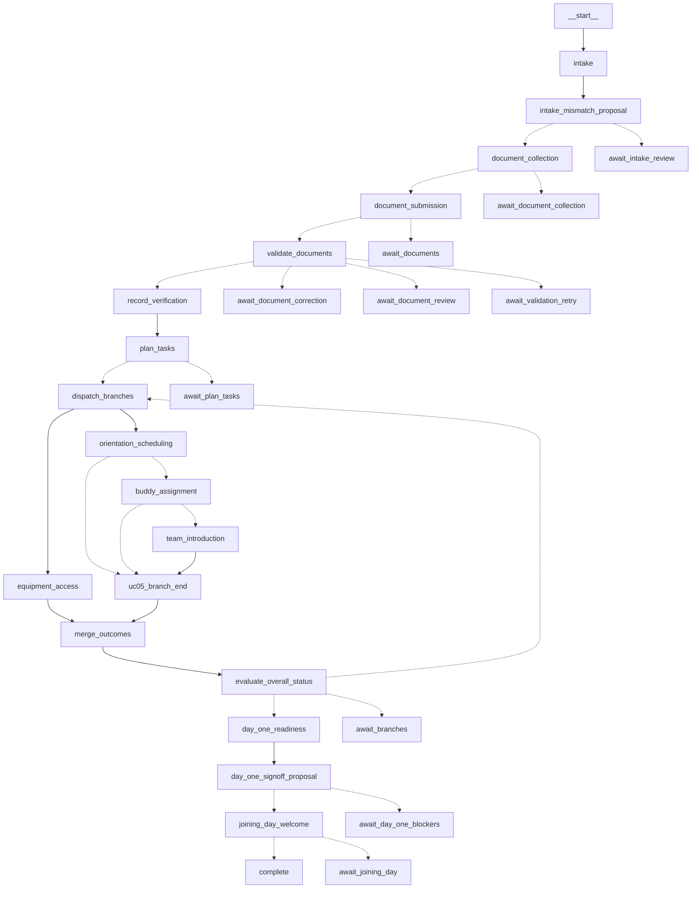

# Orchestration Workflow

> **Superseded for the stage order.** UC02 now plans right after UC01, and UC03 owns document
> collection, storage and validation, with a UC03 → UC02 replanning loop. The current graph, routing
> and dependencies are in [`UPDATED_ONBOARDING_WORKFLOW.md`](UPDATED_ONBOARDING_WORKFLOW.md). The
> contract, approval, retry and persistence mechanics below still apply.

The central onboarding orchestrator (`OnboardingOrchestratorAgent`,
`HR-Onboarding-Common/src/hr_onboarding_common/orchestration/orchestrator_agent.py`, re-exported from
`hr_onboarding_common.agent`) is a LangGraph state machine. It drives UC01–UC05 from offer acceptance
to the joining day. This document describes the graph as it is compiled today: its nodes, edges,
routing, dependency rules, approvals, failure paths, resume behavior and terminal conditions.

Related: [UC_INTEGRATION_CONTRACTS.md](UC_INTEGRATION_CONTRACTS.md) (what crosses each edge),
[SHARED_STATE_AND_CONTEXT.md](SHARED_STATE_AND_CONTEXT.md) (the state it moves).
`HR-Onboarding-Common/docs/STATE_DRIVEN_ONBOARDING_WORKFLOW.md` has the document-collection and UC03
details; `ONBOARDING_COMMON_ARCHITECTURE.md` has the UC05 lifecycle details.

## 1. Business sequence

The requested UC01 → UC02 → UC03 → UC04 → UC05 order is the dependency order. It is not forced into one
line. Once documents are verified, UC02 task planning (`plan_tasks`) runs on its own and must complete:
the task plan, and the joining date as it stands after planning, come first. Then UC04 and UC05, which
have no data dependency on each other, run in parallel. Both read the authoritative joining date; a
date that UC02 later revises through its own approval gate is reconciled before day-1 signoff
(section 8).

```
Offer accepted
 └─ UC01  employee record (intake) ── HELD/PAUSED ──► HR intake review (orchestrator gate)
 └─ UC02  document request (operation A; requirements from UC03's checklist; mock notification)
 └─ wait  required documents supplied
 └─ UC03  validate ── correction / HR review / technical retry ──► wait, then re-validate
 └─ UC02  task plan, owners, due dates (operation B) ── not complete ──► wait; no branch starts
 └─ fan-out ┬ UC04  equipment & access readiness (UC04's own approvals)
            └ UC05  induction ─► buddy ─► team introduction (UC05's own order and approvals)
 └─ merge ─ evaluate ─ (all complete, all for the current joining date) day-1 readiness
    ─► HR signoff (orchestrator gate)
 └─ joining-day event ─► UC05 welcome (HR approves, UC05 delivers once) ─► complete
```

## 2. The compiled graph

Generated from the compiled graph (`agent.graph.get_graph().draw_mermaid()`, styling removed). Dashed
edges are conditional. Every `await_*` node goes to `__end__`.



`plan_tasks` is a sequential stage, not a branch: `dispatch_branches` is reached only when it is
`complete`. `merge_outcomes` is one join over two edges (`equipment_access`, `uc05_branch_end`): it runs
once per dispatch, after both branches, however many steps each takes. (LangGraph's checkpoint `next`
can list `merge_outcomes` while only one branch has arrived; the node itself runs once, after both --
`test_execution_order.py` checks the nodes that executed.) `evaluate_overall_status -.-> dispatch_branches`
is the only cycle. It is bounded (section 7).

## 3. Nodes

| Node | Stage | Calls | Kind |
|---|---|---|---|
| `intake` | `intake` | UC01 (worker) | sequential stage |
| `intake_mismatch_proposal` | — | raises the orchestrator's `intake_mismatch_review` gate once | gate |
| `document_collection` | `document_collection` | UC02 operation A (orchestration adapter + mock outbox) | sequential stage |
| `document_submission` | `document_submission` | nothing: the document wait | sequential stage |
| `validate_documents` | `validate_documents` | UC03 (in-process) | sequential stage |
| `record_verification` | — | records `verified_context` (what `plan_tasks` and both branches receive) | bookkeeping |
| `plan_tasks` | `plan_tasks` | UC02 operation B (in-process) | sequential stage (prerequisite of both branches) |
| `dispatch_branches` | — | starts the fan-out once `plan_tasks` is complete | fan-out |
| `equipment_access` | `equipment_access` | UC04 (worker) | branch stage |
| `orientation_scheduling`, `buddy_assignment`, `team_introduction` | same | UC05 (worker) | branch stages |
| `uc05_branch_end`, `merge_outcomes`, `evaluate_overall_status` | — | fan-in, fold, derive status | join |
| `day_one_readiness` + `day_one_signoff_proposal` | `day_one_readiness` | the orchestrator's `day_one_signoff` gate | gate |
| `joining_day_welcome` | `joining_day_welcome` | UC05 (worker) | sequential stage |
| `complete` | `complete` | marks the case complete | terminal |
| `await_*` (10 nodes) | — | refresh the derived view, end the run | park |

Every stage node runs `_execute_stage`, which applies the standard UC contract (UC_INTEGRATION_CONTRACTS.md
§1). A stage node never runs a `complete` stage again, nor a `failed` one (section 8).

## 4. Conditional routing

All routing functions are pure and status-driven, never free text (`ROUTING_TABLE` in
`orchestrator_agent.py`).

| Route | After | Destination |
|---|---|---|
| `route_after_intake` | intake + gate | `complete` → `document_collection`; else `await_intake_review` |
| `route_after_document_collection` | UC02 op A | `complete` → `document_submission`; else `await_document_collection` |
| `route_after_document_submission` | the wait | `complete` → `validate_documents`; else `await_documents` |
| `route_after_validation` | UC03 | `complete` → `record_verification` → `plan_tasks`; `waiting_for_input`/`blocked` → `await_document_correction`; `awaiting_approval` → `await_document_review`; anything else (`retry_pending`, `failed`) → `await_validation_retry` |
| `route_after_plan_tasks` | UC02 op B | `complete` → `dispatch_branches` (both branches start); anything else → `await_plan_tasks`, and no branch starts |
| `route_after_scheduling` | UC05 induction | `complete` → `buddy_assignment`; else `uc05_branch_end` |
| `route_after_buddy` | UC05 buddy | `complete` → `team_introduction`; else `uc05_branch_end` |
| `route_after_evaluation` | merge | every readiness stage `complete` → `day_one_readiness`; a dependency-blocked branch is now runnable → `dispatch_branches`; else `await_branches` |
| `route_after_readiness` | signoff | `complete` → `joining_day_welcome`; else `await_day_one_blockers` |
| `route_after_welcome` | UC05 welcome | `complete` → `complete`; else `await_joining_day` |

How each UC's outcome maps onto a stage status, per scenario:

| UC | Outcome | Stage status → route |
|---|---|---|
| UC01 | record created, or linked to an existing one | `complete` → UC02 |
| UC01 | HELD / PAUSED (unverified acceptance, unapproved form, mismatch, ambiguous duplicate) | `blocked` + `intake_mismatch_review` gate → `await_intake_review` |
| UC01 | worker crash/timeout | `uncertain` → park; no blind retry |
| UC01 | another tenant's record returned | `failed` `TENANT_CONTEXT_CONFLICT` |
| UC02 A | request accepted by the mock transport | `complete` |
| UC02 A | refused (known undelivered) / checklist unavailable | `retry_pending` → resume re-sends under the same key |
| UC02 A | transport lost (outcome unknown) | `retry_pending` `…_UNCERTAIN` → only an authorized `retry_stage` re-sends |
| UC03 | every document verified | `complete` → `plan_tasks` |
| UC03 | supply / correct documents | `waiting_for_input` → `await_document_correction` |
| UC03 | HR review needed (incl. a duplicate submission) | `awaiting_approval` → `await_document_review` |
| UC03 | technical failure or timeout | `retry_pending` → `await_validation_retry` |
| UC02 B | plan created | `complete` → fan-out to UC04 and UC05 |
| UC02 B | package unimportable (current state) | `failed` `UC02_PACKAGE_UNIMPORTABLE` → `await_plan_tasks`; UC04 and UC05 are not called |
| UC02 B | precondition failed / joining date missing or not a valid ISO date | `blocked` `MISSING_DATA` → `await_plan_tasks` |
| UC04 | READY / IN_PROGRESS | `complete` |
| UC04 | AWAITING_APPROVAL | `awaiting_approval` (UC04's own approver) |
| UC04 | AT_RISK, BLOCKED / rejected | `blocked` with UC04's blockers (the adapter's "AT_RISK completes with a blocker" branch is unreachable: AT_RISK is not in its ready set; see the report, §10) |
| UC05 | induction/buddy/team intro pending approval | `awaiting_approval` → branch ends, case parks |
| UC05 | scheduling conflict / no slot | `blocked` (retryable) |
| UC05 | provider outage | `blocked` `UC05_PROVIDER_UNAVAILABLE` (canonically a retryable failure) |
| UC05 | UC05 holds a start date other than the case's joining date (after an approved change) | `blocked` `JOINING_DATE_MISMATCH`; a person aligns UC05's record, then resumes |
| orchestrator | a date-dependent result produced for another joining date, at readiness | `day_one_readiness` `blocked` `JOINING_DATE_UNRECONCILED`; no signoff is requested |
| UC05 | welcome before the joining day | `waiting` → `await_joining_day` |
| UC05 | welcome delivery outcome unknown | `uncertain` `WELCOME_DELIVERY_UNCERTAIN` → an operator resolves it; never resent blindly |

## 5. Dependency rules

Defined once in `orchestration/dependencies.py` (`STAGE_DEPENDENCIES`). They are evaluated before every
stage execution. An unmet **required** dependency blocks the stage, and its UC is not called:

- `PREREQUISITE_NOT_MET`: the upstream stage is not complete (a wait; canonical status `PENDING`).
- `MISSING_DATA`: the upstream stage completed without a field this stage consumes (a correction). A
  `joining_date` must also be a valid ISO date; an unparseable one counts as missing.

| Stage | Required dependencies | Optional |
|---|---|---|
| `document_collection` | `uc01.employee_record` (intake complete + `employee_id`) | — |
| `document_submission` | `uc02.document_requirements` (+ `document_collection.required_documents`) | — |
| `validate_documents` | `uc01.employee_record`, `uc02.document_requirements`, `orchestrator.documents_supplied` | — |
| `plan_tasks` | `uc03.documents_verified` (+ `verified_context.documents_verified`), `uc01.employee_record`, `uc01.joining_date` | — |
| `equipment_access` | `uc03.documents_verified`, `uc01.employee_record`, `uc01.joining_date`, `uc02.task_plan` | — |
| `orientation_scheduling` | `uc03.documents_verified`, `uc01.joining_date`, `uc02.task_plan` | `uc04.equipment_access_ready` (**configurable**) |
| `buddy_assignment` | `uc05.induction_confirmed` | — |
| `team_introduction` | `uc05.buddy_assigned` | — |
| `day_one_readiness` | every readiness stage, `uc04.equipment_access_ready` included | — |
| `joining_day_welcome` | `orchestrator.day_one_signoff` (which requires UC04 readiness) | — |

An unmet optional dependency never blocks. The stage runs and its response carries
`DEPENDENCY_OPTIONAL_UNMET`. A tenant may make a configurable optional dependency required in
`HR-Onboarding-Common/config/tenants.yaml`:

```yaml
tenants:
  CLIENT-X:
    dependencies:
      orientation_scheduling:
        uc04.equipment_access_ready: required   # UC05 schedules only once UC04 equipment/access is ready
```

Configuration can never relax a required dependency or change one that is not configurable. Such a file
is refused when it is loaded. The UC05 adapter's own prerequisite checks call the same registry, so a
prerequisite is never defined twice. UC-specific input validation (UC02's role fields, UC04's client
configuration, UC05's offer event) stays in each adapter.

## 6. Approval interrupts

| Approval | Owner | Raised by | Decided through | Resume |
|---|---|---|---|---|
| `intake_mismatch_review` | orchestrator | `intake_mismatch_proposal` (once per case) | `decide_approval` / `decide_gate` (orchestrator HITL, `hr_admin`) | approve → `_invoke`; reject → held until `resume_case` |
| `day_one_signoff` | orchestrator | `day_one_signoff_proposal` (once per joining-date revision; the request names the date and revision) | same | approve → readiness `complete` → welcome. A request for an earlier revision is withdrawn (`withdrawn`, not a decision) and can no longer be decided |
| UC02 joining-date change | UC02 (`DATE_CHANGE` gate) | `request_uc02_date_change` (`POST .../task-planning/date-change`) | `decide_approval` relays to UC02's own gate (`relay_uc02_decision`) | approve → UC02 re-plans, the date becomes the next revision, results produced for the earlier date are reconciled (section 8), `_invoke` |
| UC03 document review | HR reviewer (UC03's input) | `validate_documents` (`awaiting_approval`) | `review_documents` | re-validates the reviewed revisions only |
| UC05 scheduling / buddy / team intro / welcome / attendance | UC05 | UC05, surfaced in `pending_approvals` | `decide_approval` relays to UC05's own inbox (UC05 checks role, tenant, the specific person) | `_invoke` re-reads UC05 |
| UC01 / UC04 approvals, UC02 restricted-action proposals | that UC | listed only | that UC's own mechanism; the orchestrator refuses them (409) | `resume_case` once applied |

**How the interrupt works.** A pending approval parks the case at an `await_*` node, which ends the
graph run. The approval itself is durable: the orchestrator's gates live in its HITL inbox
(`hitl.db` with `persist_dir`), and UC05's in UC05's inbox. The case state lists every open approval in
`pending_approvals`. A decision re-invokes the graph from the case store. Completed stages are skipped,
and the routing re-reads the now-changed condition.

LangGraph's `interrupt()` is not used. The project resumes from its own case store because LangGraph's
`get_state` after `END` returned inconsistent values in this LangGraph version (documented in
`deps.py`). Checkpoints are still written for every step.

Pending approvals survive pause, resume and restart. This is verified by
`test_10_process_restart_during_a_paused_workflow_resumes_from_durable_state`.

## 7. Bounded re-dispatch

When a tenant requires UC04 readiness before UC05 scheduling, both branches still start together. UC05's
dependency check finds UC04 incomplete, so UC05 is not called and is blocked with
`PREREQUISITE_NOT_MET`. Suppose UC04 completes in that same fan-out. Then `evaluate_overall_status`
records the UC05 branch in `redispatch_branches`, and `route_after_evaluation` dispatches only that
branch again, in the same invocation (`active_branches`). Other branches are skipped.

Bounds: at most `MAX_DISPATCH_ROUNDS` (3) dispatches per invocation, and a branch is re-dispatched only
when every required dependency of its waiting stage is met. The graph's recursion limit is
`RECURSION_LIMIT` (64). Verified by
`test_a_tenant_requiring_uc04_first_holds_uc05_then_runs_it_in_the_same_invocation_once_uc04_is_ready`
and `test_redispatch_is_bounded_and_never_reruns_a_branch_that_does_not_need_it`.

## 8. Failure and retry paths

| Situation | Status | What happens |
|---|---|---|
| Technical failure (provider, worker, UC03, transport refused) | `retry_pending` | A resume runs it again. Each failure counts against `stage_max_attempts` (policy, 3). At the limit the stage is `failed` (`RETRY_LIMIT_REACHED`) |
| Terminal failure (contract violation, inactive case, retry limit, UC02 defect) | `failed` | **Not re-run by a resume** (fixed in this integration: before, every resume called the UC again and spent the exhausted budget). Only an authorized `retry_stage` (`stage_retry_roles`) re-opens it and resets the budget |
| Unknown write outcome (worker crash/timeout mid-write, lost provider answer) | `uncertain` | Never retried automatically, and `retry_stage` refuses it. The UC05 adapter re-reads UC05 before any write; an operator resolves it (`resolve_operation`, `resolve_welcome_delivery`) |
| Business block (rejection, conflict, missing configuration) | `blocked` | Resumable once the named cause is corrected |
| Dependency wait | `blocked` `PREREQUISITE_NOT_MET` | Runs as soon as the upstream stage completes (same invocation via re-dispatch, or the next one) |
| Contract rejection (ownership/identity/transition violation) | `failed` | The adapter's update is discarded. An operator reconciles, then `retry_stage` |

Worker timeouts: 30 s per call by default (`build_deps(worker_timeout_s=...)`), overridable per UC
with `timeout_s` in `worker_config.yaml` or `UC0X_WORKER_TIMEOUT_S`; 120 s for worker startup. A
timeout kills the worker (a late reply must never answer the next request), and the outcome is
`uncertain`. UC03, which runs in-process, is bounded by `uc03_timeout_s` (60 s).

Idempotency keys (UC_INTEGRATION_CONTRACTS.md §7), the document request's write-ahead `sending` record,
one UC03 call per document revision, and UC05's operation ledger keep a retry from duplicating a
side effect.

### Joining-date change after the branches ran

A UC02 date change can be requested only once `plan_tasks` is complete, so it normally arrives after
UC04 and UC05 used the earlier date. Before every run, `_reconcile_joining_date`
(`orchestration/joining_date.py`) compares the date each date-dependent result was produced for
(recorded with its revision in the stage's outcome) with the current one:

| Situation | What happens |
|---|---|
| `equipment_access` / `orientation_scheduling` `complete` for an earlier date | re-opened (`stage_history` code `JOINING_DATE_CHANGED`) and run again in this invocation with the current date |
| same, in a runnable status (`blocked`, `awaiting_approval`, `retry_pending`, …) | runs again with the current date (it would anyway) |
| same, `uncertain` or `failed` | left for a person: no write while an outcome is unknown; `retry_stage` re-runs a failed one |
| a result already produced for the current date | not run again |
| UC04 re-evaluation | a new idempotency key per revision (`<key>.jd<revision>`); UC04's EC-11 reassessment re-plans its due dates; a retry within a revision replays UC04's stored answer |
| UC05 holds another start date | `orientation_scheduling` `blocked` `JOINING_DATE_MISMATCH`: UC05 has no operation to change a case's start date, so a person aligns UC05's record |
| day-1 readiness evaluated for an earlier date | re-opened; its signoff no longer counts; an undecided signoff request is withdrawn |
| a result still stale, or UC05's date different, at readiness | `day_one_readiness` `blocked` `JOINING_DATE_UNRECONCILED`; no signoff; the joining-day trigger and scheduler refuse the case |
| joining-day event already recorded | a date change is refused |

The reconciliation is written through before the graph runs, so a process that stops part-way resumes
it. `joining_date_consistency` in the case view shows the outcome (`consistent`, `stale`, `conflict`,
`not_started`). Verified by `test_joining_date_reconciliation.py`.

## 9. Resume behavior

`advance_case(None, case_id=...)` (and every operation that ends in `_invoke`) loads the case from the
`CaseStateStore` and re-invokes the graph from `intake`. Nodes skip completed and failed stages, so no UC
is called for them. The routing functions re-evaluate the real conditions, and the run proceeds or
parks again. Per-invocation fan-out bookkeeping (`dispatch_round`, `active_branches`,
`redispatch_branches`) starts afresh, and results produced for an earlier joining date are reconciled
first (section 8). There is no resume from a mid-graph checkpoint, so a resumed run cannot reach the
branches without passing `plan_tasks`'s `complete` route.

Entry points that resume: `resume_case`, `submit_documents`, `review_documents`, `retry_stage`,
`decide_approval`/`decide_gate`, `retry_approval`, `trigger_joining_day`, `request_uc05_operation`,
`record_participant_response`, `handle_event`. A repeated start for a case past intake (a duplicate
offer acceptance) also resumes that case; UC01 is not called again.

## 10. Asynchronous events

`handle_event(case_id, event_id, event_type, payload, actor)` (HTTP
`POST /v1/orchestration/cases/{case_id}/events`) applies an event at most once per `event_id`:

| Type | Payload | Applied as | Role check |
|---|---|---|---|
| `documents_submitted` | `{documents: [...]}` | `submit_documents` | `document_submitter_roles` |
| `joining_day` | `{as_of: "YYYY-MM-DD"}` | `trigger_joining_day` | `joining_day_trigger_roles` |
| `participant_response` | `{session_id, participant_id, response, responded_at?}` | `record_participant_response` | UC05 decides |
| `resume` | `{}` | `resume_case` | `case_operator_roles` |

A redelivered event is answered from `processed_events` (`duplicate: true`) and changes nothing: no
second document revision (which UC03 would flag as a duplicate needing HR review), no second RSVP relay.
An event id reused for a different type is refused (409). A refused event (403/404/409/422) is not
recorded, so its redelivery is evaluated again. For example, an early joining-day event is processed
when it is redelivered on the day.

The event id is recorded right after the operation, under the same case lock. If the process crashes
between those two writes, a redelivery is applied again: at-least-once in that window, chosen over
losing the event. A repeated document submission becomes an HR review in UC03; a lost one would leave
the case waiting.

## 11. Terminal conditions

- **Complete.** `complete` is reached only through `route_after_welcome`. That requires every required
  stage complete, HR's day-1 signoff, the joining-day event, and a delivered (or operator-confirmed)
  welcome. `workflow_status` is `completed` only then.
- **Failed.** Any required stage `failed` makes `workflow_status` `failed`. The case stays parked until
  `retry_stage`.
- **Parked.** Every other run ends at an `await_*` node. `workflow_status` is the most severe status
  of the required stages: failed > blocked > retry_pending > waiting_for_approval > waiting_for_input >
  running > pending. A dependency wait counts as pending.

## 12. HTTP entry points

All under `/v1/orchestration`. Identity comes from the configured `IdentityProvider`. The tenant is the
verified actor's `client_id`. Another tenant's case is answered as 404, and the kill switch stops every
write.

| Route | Roles | Purpose |
|---|---|---|
| `POST /cases` | `case_operator_roles` | start (idempotent per offer) |
| `GET /cases/{id}` | `case_reader_roles` | case view, incl. `state_version`, `field_provenance`, `joining_date_revision`, `joining_date_history`, `joining_date_consistency` |
| `POST /cases/{id}/task-planning/date-change` | `uc02_date_change_roles` | request a joining-date change through UC02's gate (decided via `/approvals/{aid}/decision`) |
| `GET /cases/{id}/stages`, `/stages/{stage}` | `case_reader_roles` | **new:** each stage's execution status: canonical/native status, last execution ids, live dependency checks, categorized error, warnings, retry bookkeeping, open approvals |
| `GET /cases/{id}/errors` | `case_reader_roles` | **new:** sanitized, categorized stage errors |
| `GET /cases/{id}/approvals` | `case_reader_roles` | **new:** open approvals and relayed decisions |
| `GET /cases/{id}/pending-actions` | `case_reader_roles` | what has to happen next and who acts |
| `POST /cases/{id}/events` | per type | **new:** asynchronous events, at most once per `event_id` |
| `GET /dependencies` | `case_reader_roles` | **new:** the dependency registry with the caller's tenant overrides |
| `POST /cases/{id}/resume`, `/documents`, `/documents/reviews`, `/stages/{stage}/retry`, `/approvals/{aid}/decision`, `/approvals/{aid}/retry-apply`, `/joining-day`, `/orientation/operations`, `/sessions/{sid}/responses` | as before | case operations (all delegate to the orchestrator) |
