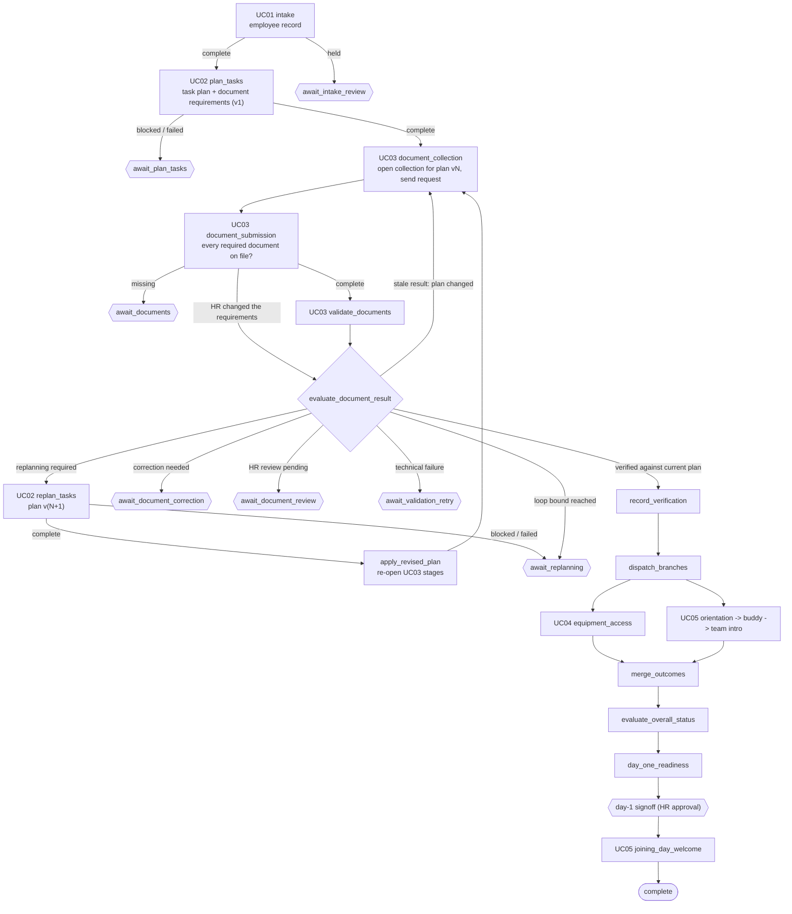

# Updated onboarding workflow: UC02 plans, UC03 owns documents

This document describes the onboarding workflow as the orchestrator runs it after the UC02/UC03
responsibility change (orchestrator `hr_onboarding_common.orchestration`, graph in
`orchestrator_agent.py`). It replaces the earlier order, in which document collection ran right after
UC01 and UC02 planned only after the documents were verified.

Related documents:

- [`UC02_UC03_RESPONSIBILITY_MIGRATION.md`](UC02_UC03_RESPONSIBILITY_MIGRATION.md): what moved, what was
  added, what is deprecated.
- [`UC02_UC03_REPLANNING_CONTRACT.md`](UC02_UC03_REPLANNING_CONTRACT.md): the request, feedback and
  revised-plan contracts, plan versioning and error handling.
- [`WORKFLOW_IMPLEMENTATION_REPORT.md`](WORKFLOW_IMPLEMENTATION_REPORT.md): files changed, test results,
  known blockers.

All data in this project is synthetic. Every external system is a mock.

## 1. Responsibilities

| Use case | Responsibility in this workflow | Stage(s) |
|---|---|---|
| UC01 Employee intake and record | Validates the intake, creates the employee record and the case, sets the joining date. | `intake` |
| UC02 Task planning and replanning | Plans the onboarding tasks right after UC01 and defines the plan's **versioned document requirements**. Replans when UC03 reports that the plan must change, and produces the next plan version. Never collects, stores or validates a document. | `plan_tasks`, `replan_tasks` |
| UC03 Document collection, storage, validation | Opens the collection for the current plan version, sends the (mock) request, stores every submitted document as a numbered revision (idempotent), validates each revision, asks for corrections, routes doubtful documents to HR review, and reports structured feedback to UC02. | `document_collection`, `document_submission`, `validate_documents` |
| UC04 Equipment and access readiness | Unchanged. Runs only after UC03 verified every document of the current plan version. | `equipment_access` |
| UC05 Orientation scheduling | Unchanged: induction, buddy, team introduction, joining-day welcome, HR Policies Q&A. No NDA/policy signature tracking. Runs in parallel with UC04. | `orientation_scheduling`, `buddy_assignment`, `team_introduction`, `joining_day_welcome` |
| Orchestrator | Sequences the stages, owns the overall workflow state, its two HITL gates (intake mismatch review, day-1 signoff), and the replanning loop's bound. | `evaluate_document_result`, `apply_revised_plan`, `dispatch_branches`, `merge_outcomes`, `day_one_readiness` |

## 2. Workflow

Every `await_*` node ends the run. The case is checkpointed and resumes when the awaited event arrives
(documents, a review, an approval, a retry, the joining day).

## 3. Sequential dependencies

`UC01 → UC02 → UC03` run one after another. The dependency registry (`dependencies.py`) enforces this
on every path that can run a stage: resume, retry and re-dispatch. An unmet required dependency means
the UC is never called.

| Stage | Requires | Field it consumes |
|---|---|---|
| `plan_tasks` (UC02) | `intake` complete | `employee_id`, a well-formed `joining_date` |
| `document_collection` (UC03) | `plan_tasks` complete | `onboarding_plan.required_documents` |
| `document_submission` (UC03) | `document_collection` complete | `document_collection.required_documents` |
| `validate_documents` (UC03) | collection and submission complete | the stored revisions |
| `replan_tasks` (UC02) | `plan_tasks` complete | `onboarding_plan.plan_id`, plus UC03's feedback (checked by the adapter) |
| `equipment_access` (UC04), `orientation_scheduling` (UC05) | `validate_documents` complete **and** `plan_tasks` complete | `verified_context.documents_verified`, `task_plan`, `joining_date` |

No edge leads from UC01, UC02 or any UC03 stage to UC04, UC05 or `dispatch_branches`. The only way into
the fan-out is `evaluate_document_result → record_verification → dispatch_branches`. The test
`test_the_graph_runs_uc01_uc02_uc03_in_sequence_and_only_verification_fans_out` asserts this against
the compiled graph.

## 4. The UC03 → UC02 → UC03 loop

After every UC03 run, `evaluate_document_result` decides the route from UC03's structured feedback and
the stage statuses. It never reads free text.

| Situation | Route | What happens |
|---|---|---|
| Every document verified against the **current** plan version | `record_verification` | `verified_context` records the plan id and version, then the fan-out. |
| UC03 reports `replanning_required` for the current plan version | `replan_tasks` | UC02 replans. On success `apply_revised_plan` re-opens UC03's three stages; UC03 opens the collection for the new version, requests only what is new, and revalidates. |
| The result was produced for an older plan version (UC02 versioned the plan since, e.g. an approved joining-date change) | `document_collection` | UC03's stages re-open. The stale result is never accepted as verified. |
| Missing, invalid, expired documents; nothing in the plan needs to change | `await_document_correction` | No replanning. UC03 revalidates the corrected revision when it arrives. |
| HR review pending | `await_document_review` | Only `document_review_roles` may decide. A refused attempt changes nothing. |
| Technical failure | `await_validation_retry` | `RETRY_PENDING`, bounded by `stage_max_attempts`. |
| Replanning failed (`BLOCKED`/`FAILED`), or the loop ran `max_replan_rounds` times in this run | `await_replanning` | The case holds. UC04 and UC05 do not start. |

UC03 reports that the plan must change when any of the following holds:

1. **UC03's catalog requires a mandatory document the plan does not list** (`NEW_MANDATORY_DOCUMENT`).
   Example: a passport whose metadata shows the holder needs a visa makes UC03's `visa_documents`
   rule apply.
2. **A submitted document establishes a UC02 applicability attribute** the plan does not have yet
   (`DOCUMENT_DERIVED_ATTRIBUTE`). Example: `visa_required`, which makes UC02 add its medical,
   biometrics and visa tasks.
3. **HR changed the document requirements** (`HR_REQUIREMENT_CHANGE`) through
   `POST /v1/orchestration/cases/{id}/documents/requirements`. A document HR removed is a waiver, and
   UC03's catalog never re-adds it.

A plain resubmission (an expired passport replaced, a missing payslip supplied) does **not** trigger
replanning.

The loop is bounded: `OrchestratorDeps.max_replan_rounds` (default 3) per invocation. Beyond it the
case parks with `REPLAN_LIMIT_REACHED` for a person.

## 5. UC04 and UC05 in parallel

Once UC03 has verified every document of the current plan version, `dispatch_branches` starts
`equipment_access` (UC04) and `orientation_scheduling` (UC05) in the same LangGraph superstep, on
separate threads. Both receive the same `employee_id`, `joining_date`, `plan_id`, `plan_version`,
`verified_plan_version` and `documents_verified`. Each branch writes only its own outcome
(`branch_outcomes` reducer). `merge_outcomes` waits for both branches before folding them in.
`MAX_DISPATCH_ROUNDS` bounds re-dispatch, and a completed branch stage never runs again on a retry or
resume.

UC04 and UC05 do not start while a correction, an HR review, a replan or a technical retry is pending.
`test_uc02_uc03_replanning_workflow.py` (tests 18 and 20–24) and `test_execution_order.py` prove this
from the gate's enter/exit events and LangGraph's checkpoint history.

## 6. State, ownership and persistence

| Field | Owner (writes it) | Notes |
|---|---|---|
| `onboarding_plan`, `plan_history`, `task_plan` | UC02 (`plan_tasks`, `replan_tasks`) | Every change is a new `plan_version`. `plan_history` is the append-only audit trail. |
| `revised_plan`, `requirement_change_requests` (applied status) | UC02 (`replan_tasks`) | HR requests are recorded by the orchestrator API, then applied by the replan. |
| `document_collection`, `submitted_documents` (projection), `document_validation_result`, `document_validation_feedback`, `correction_requirements`, `validation_issues` | UC03 stages | UC03's registry is the source of truth for revisions. The state holds references and metadata, never document contents. |
| Stage statuses, routing bookkeeping (`replan_round`, `document_route`), gates | Orchestrator | |

`state_sync.FIELD_OWNERS` enforces ownership. A stage that writes a field it does not own is rejected
with `STATE_OWNERSHIP_VIOLATION`.

Persistence with `persist_dir`: the case store (`case_states.db`), LangGraph checkpoints
(`checkpoints.db`), UC03's document registry (`uc03_documents.db`), and the HITL inbox all survive a
restart. UC02's own store follows `UC02_STORE_MODE` (memory by default).
